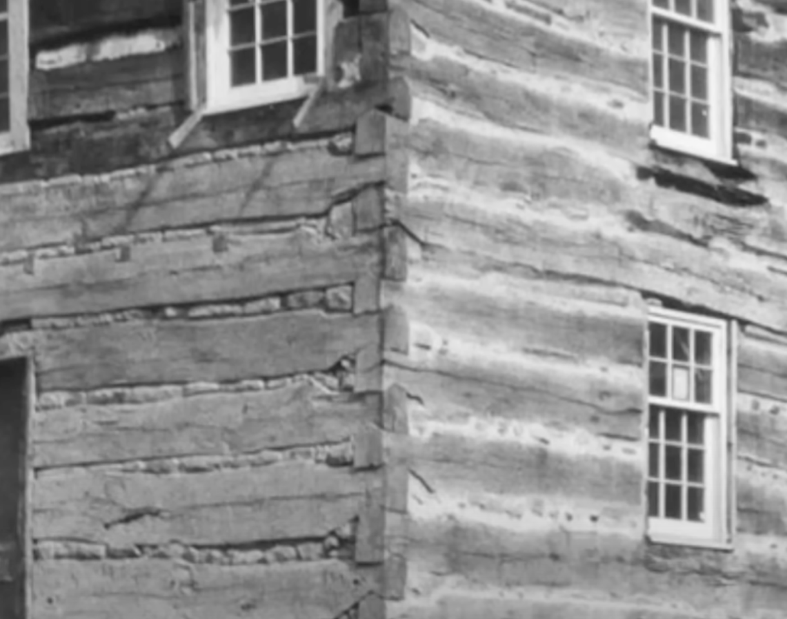
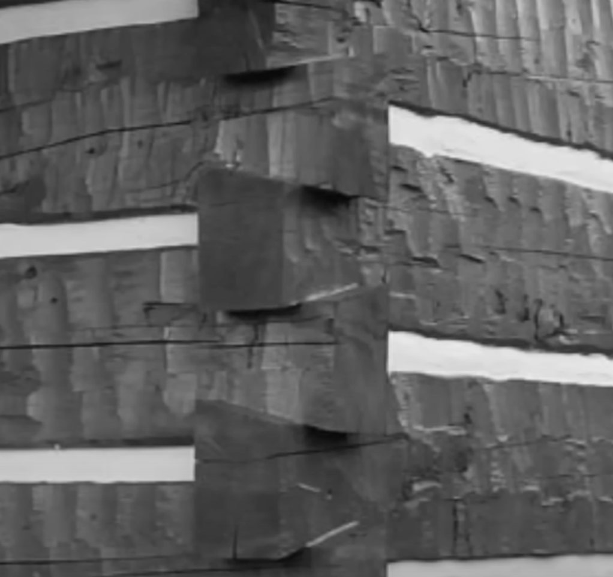
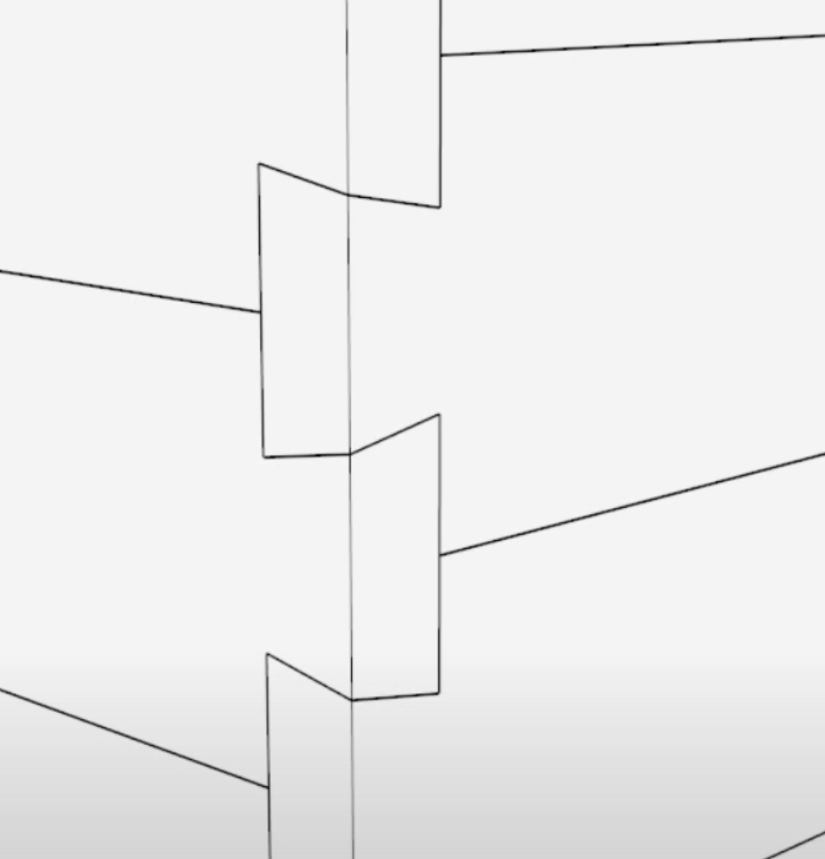
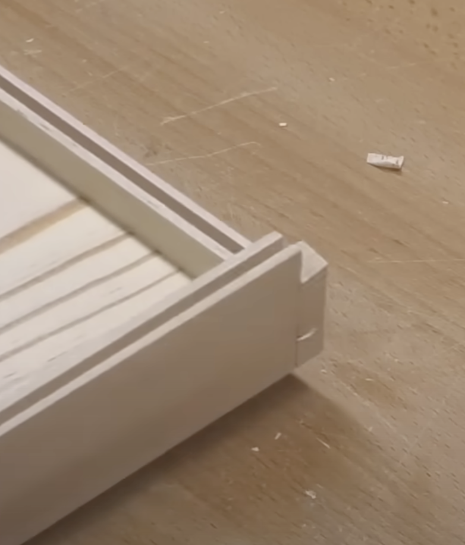
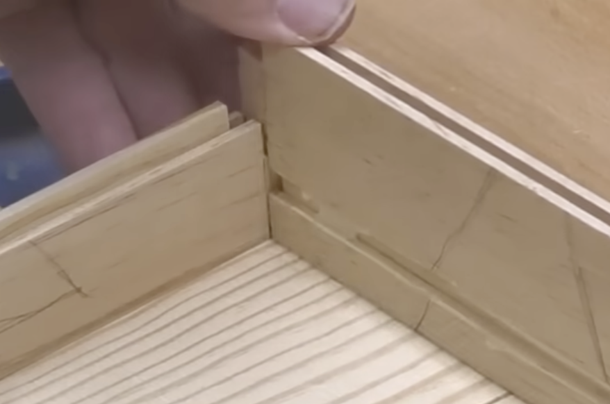
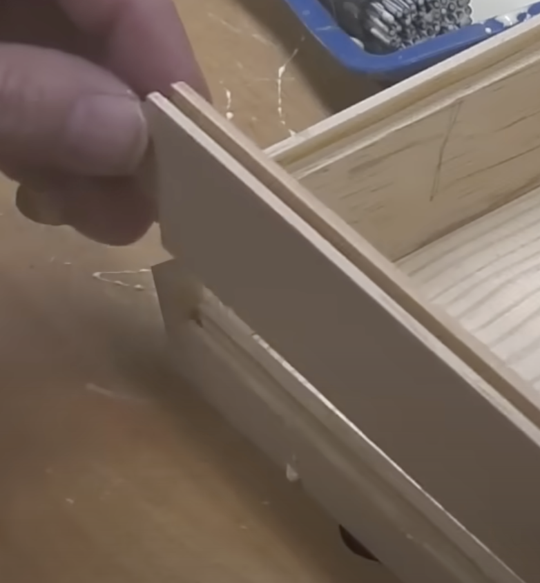
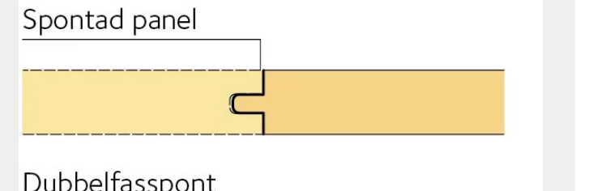

# Todo: Consider to timber a house using the dove tails of the box in youtube video "INDESTRUCTIBLE: I have NEVER seen a box made like this before"?

```#21322ffd``` *As of 2024-12-03 22:10*

[mail plain/text](mail.txt)


I want to assemble my house with self locking modular design and this dove tail joined box uses joints from old USA log cabins.

1) Consider youtube video "INDESTRUCTIBLE: I have NEVER seen a box made like this before" (<https://youtu.be/dI5wzdSmr0A> )?













==&gt; Consider to cut the dove tails in tounged and grooved wood (Swedish "Spontad Panel" )?



...


