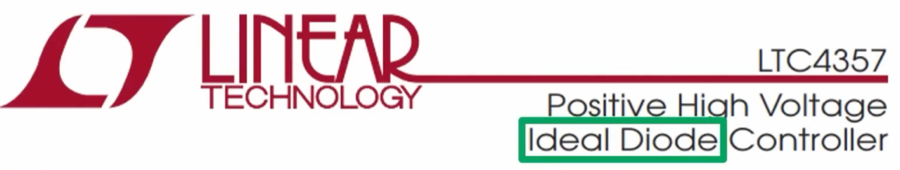
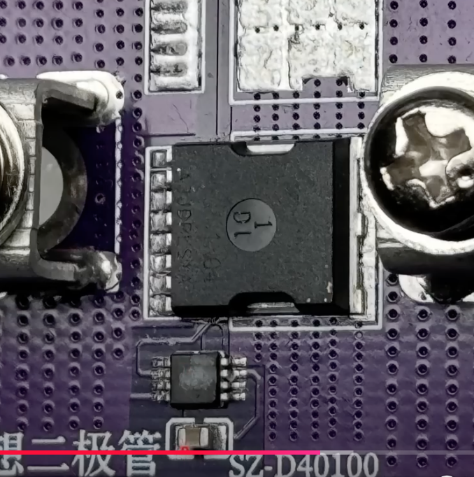
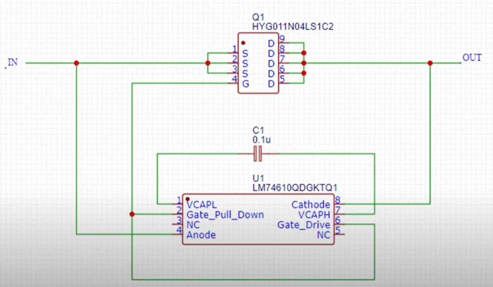
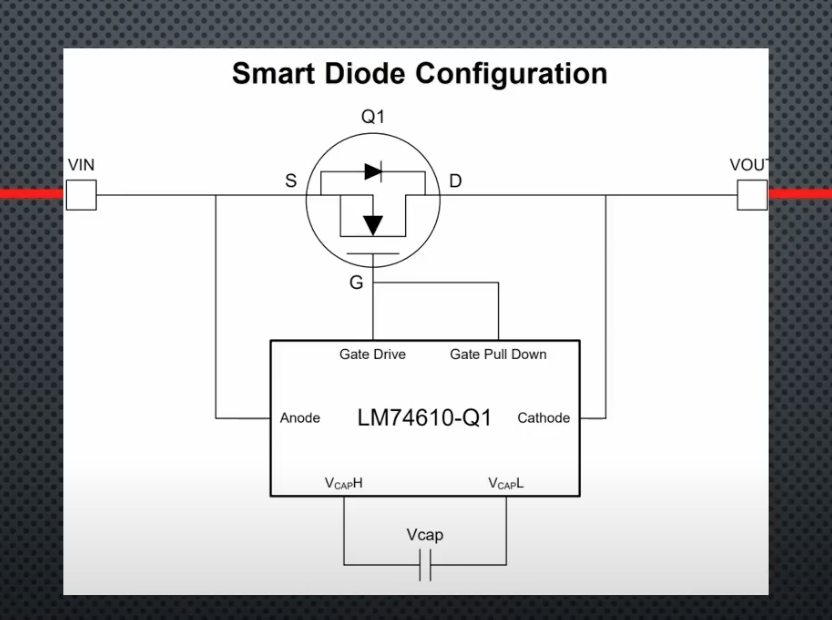
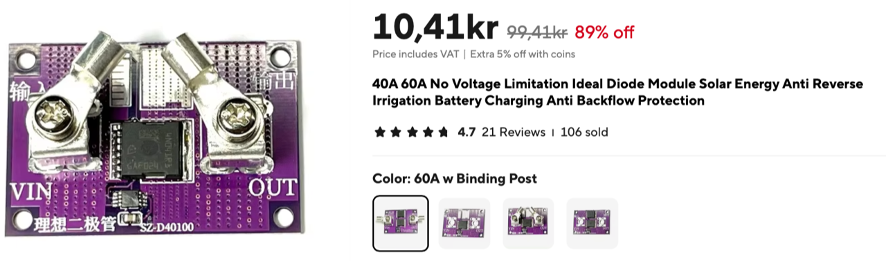
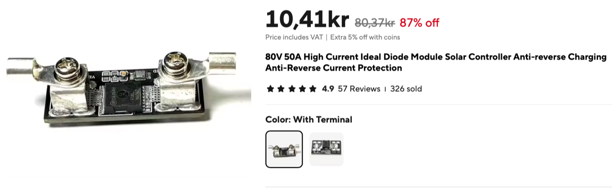

# Todo: Consider the youtube video "How to Protect Your Devices Against Reverse Polarity Using Ideal Diodes" for available

```#22c88ac3``` *As of 2024-09-08 17:12*

[mail plain/text](mail.txt)


I want to build a full bridge rectifier to harvest energy from small audio signals to power a mixer for those signals.

==&gt; Also see "[Todo: Consider a line level mixer that is driven by the energy of the input audio signals?](../58608978/chime.md)"

1) Consider the youtube video "How to Protect Your Devices Against Reverse Polarity Using Ideal Diodes" (<https://youtu.be/1tQHjUYKQwI> )?

==&gt; It seems the LTC4357 is an IC solution that uses a charge pump to harvest a voltage sufficient to switch a MOSFET on and off to work as an "ideal" diode?



==&gt; At around 6:12 he seems to show the board of one of the "ideal diodes" with a MOSFET, an IC and a capacitor for charge storage?



<https://youtu.be/1tQHjUYKQwI?t=372>

==&gt; At around 7:03 he seems to show a reversed engineered circuit diagram for the "smart diode" board he tested?



<https://youtu.be/1tQHjUYKQwI?t=423>

==&gt; At around 7:47 he seems to show how to connect the LM4610-Q1 as a "smart diode" with a MOSFET?



<https://youtu.be/1tQHjUYKQwI?t=467>

2) Consider the Links he published to the products tested in the video?

Links:



Ideal diode with TI chip: [https://s.click.aliexpress.com/e/_DCc...](https://www.youtube.com/redirect?event=video_description&redir_token=QUFFLUhqa3ZXdUZsSVlvdEljaXdCZ1JxckFaX3NQYlRPd3xBQ3Jtc0trWWtIU1ZiTkdPcHVrbkVCbWh0TWpfMVE3N0JTNVlRdVlfVUY5TVdhUHFBd0RtWXk1RkxhM2lWRU5LSTBnQnZWRWhFeWtESVl5WDBJWVotUkFvSnRndU1IOWJvSEhmR1dGU1R2Sjh4YkRCdFNScTdJTQ&q=https%3A%2F%2Fs.click.aliexpress.com%2Fe%2F_DCc4uyn&v=1tQHjUYKQwI)



Ideal diode with LM74610 chip: [https://s.click.aliexpress.com/e/_Dlz...](https://www.youtube.com/redirect?event=video_description&redir_token=QUFFLUhqbm5qMW1UU0JHcTNSV0FzSnpYLWN5ZDhLTVgzZ3xBQ3Jtc0tsdXVISlBHbl9OWTF1dVc5QUtqakJpdlZFUG1NUU1vYlk5OWVGUGt0NlhZWEdKYms4bTFsVHgwOU5FeTBBMWJaNVBXQkhSa0ZqN3NnMERVZTFIWTFYRGV6UzQ5Y3lVNXc0b01QQTRGRDNQbm50YmVkZw&q=https%3A%2F%2Fs.click.aliexpress.com%2Fe%2F_Dlz2ykx&v=1tQHjUYKQwI)

Tiny Ideal diode chip LM73100 (not tested): [https://s.click.aliexpress.com/e/_Dml...](https://www.youtube.com/redirect?event=video_description&redir_token=QUFFLUhqblFzVDdCbEFONjZ2ZGRCSGdISjhIT2dqN2R3Z3xBQ3Jtc0trUEJFWFYwSXZicTczSi1SUTFpNFdvYWNHTHVfOTFabllYZ25DQ1I3dEp5VUp6WldVZDB1ajV0MHA3UmhvMl91UG1xbDJ3X3FlS05mNkRHWVZKRzMxbUtFbVplOXd2OXQ0MjB6OHo3M3Z3bFZkMUNISQ&q=https%3A%2F%2Fs.click.aliexpress.com%2Fe%2F_DmlGZPz&v=1tQHjUYKQwI)

...


