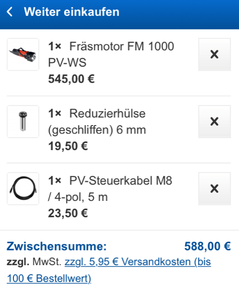
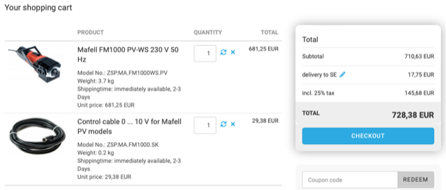
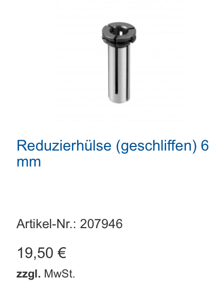
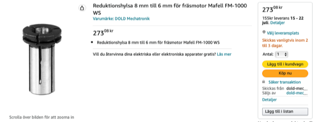

# Todo: Consider the "best" way to buy a Mafell Milling motor FM 1000 PV-WS (1000 W with PV control and quick tool changer)?

```#22cf1801``` *As of 2022-07-12 15:49*

[mail plain/text](mail.txt)


I think I have already decided that the milling motor I want to go for is the Mafell Milling motor FM 1000 PV-WS.

1) Consider to bout it directly from [Mafell.de](http://mafell.de/) web shop (<https://produkte.mafell.de/fraesen/fraesmotor/fraesmotor-fm-1000-pv-ws> )?

==&gt; It seems [Mafell.de](http://mafell.de/) only sell to German customers (No way to changed delivery address to Sweden)?



2) Consider to buy it from Sorotec web shop (<https://www.sorotec.de/shop/Mafell-FM1000-230V-50Hz-9182.html> )?

==&gt; It seems the shopping cost from Sorotec to Sweden is around 18€?

> 

==&gt; The price Ex.VAT seems to be 568€ (710,63€ / 1,25)?

==&gt; It seems Sorotec does not sell adaptors for the Mafell quick release chuck?

==&gt; It seems I need to contact them to make an order as a company to make the order ex VAT?

3) Consider I would also like a 6mm collet adaptor?



==&gt; Det verkar som om jag kan köpa reduktionshylsna på [Amazon.se](http://amazon.se/) ([https://www.amazon.se/Reduktionshylsa-till-fräsmotor-Mafell-FM-1000/dp/B07XP2N58J/ref=sr_1_1?crid=3IXONQSA0M54J&keywords=Reduktionshylsa+8+mm+till+6+mm+för+fräsmotor+Mafell+FM-1000&qid=1657049310&sprefix=reduktionshylsa+8+mm+till+6+mm+för+fräsmotor+mafell+fm-1000+%2Caps%2C81&sr=8-1](https://www.amazon.se/Reduktionshylsa-till-fr%C3%A4smotor-Mafell-FM-1000/dp/B07XP2N58J/ref=sr_1_1?crid=3IXONQSA0M54J&keywords=Reduktionshylsa+8+mm+till+6+mm+f%C3%B6r+fr%C3%A4smotor+Mafell+FM-1000&qid=1657049310&sprefix=reduktionshylsa+8+mm+till+6+mm+f%C3%B6r+fr%C3%A4smotor+mafell+fm-1000+,aps,81&sr=8-1) )?



...


