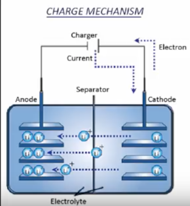
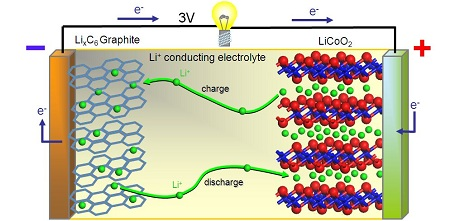
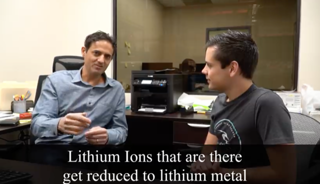
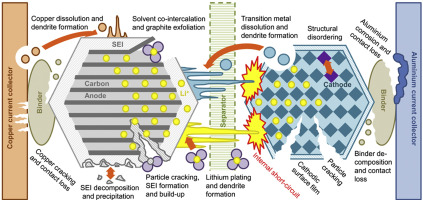
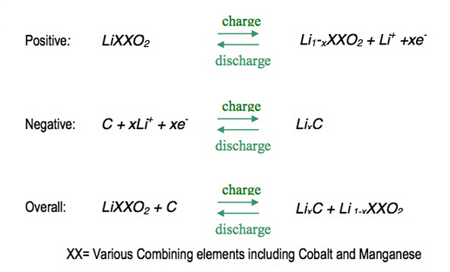
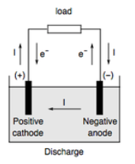
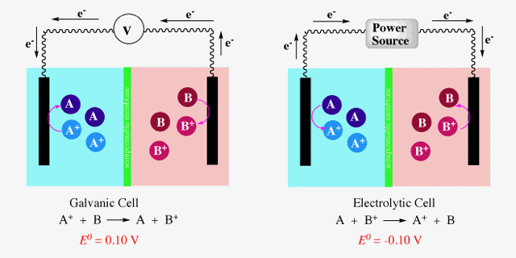

# Todo: Consider to understand the basics of Lithium Iron Phosphate batteries for my off-grid house energy storage?

```#24933ee2``` *As of 2020-01-06 14:02*

[mail plain/text](mail.txt)


It seems I may choose Lithium Ion Phosphate batteries for my off-grid house energy storage solution?

1) Consider the youtube video "Battleborn Battery CEO Interview! LiFePO4 Low-temp Charging, Storage, Longevity and so much more" that seems to contain good and condensed information on how to treat and use Lithium Ion Phosphate batteries (<https://www.youtube.com/watch?v=ywn-vBjKblI> )?

> ==&gt; At 0:46 He seems to explain that a cold battery must be charged slowly because the ions then moves much slower than the electrons (<https://youtu.be/ywn-vBjKblI?t=46> )?

>   
> *A generic Lithium Ion battery cell is charged by Oxidation of Lithium to Lithium Ions at the cathode that then travels to the Anode*

> *Q: When charged we do NOT want the Lithium Ions to reduce on the Anode so where does the reduced Ions go?*

> *A: It seems a common design is to have the Anode be able to capture Lithium Ions into Lithium Carbon "Graphite" (*[*http://www.jmbatterysystems.com/technology/cells/how-cells-work](http://www.jmbatterysystems.com/technology/cells/how-cells-work) )?*

>   
> *An example of the chemistry of a Lithium Ion battery with ions traveling between Lithium Cobalt Oxide (Cathode) and Lithium Carbon "Graphite" (Anode)*

> *NOTE: For a Lithium Iron Phosphate battery the Cathode is **Lithium Iron Phosphate.*

> *It would thus seem that the process of oxidation (discharge) at the Anode from Lithium Carbon to Lithium Ions at reduction at the Cathode of Lithium Ions into Lithium Iron Phosphate (or Lithium Cobalt Oxide) is spontaneous. And this in turn is so because there is a potential difference between Lithium Carbon Oxide and Lithium Cobalt Oxygen when placed in an electrolyte?*

> ==&gt; At 0.54 he seems to state that if we get more Lithium Ions than electrons at the Anode we get "Metallisation" where Lithium is reduced (electrons captured) into pure Lithium rather than into the wanted Lithium Carbon Graphite we want (<https://youtu.be/ywn-vBjKblI?t=58> )?

> 

> *Hm... Now for that to make sense we must somehow understand why Lithium Ions would prefer to get reduced into Lithium Carbon Graphite rather than into pure Lithium in presence of an excess of electrons? I can speculate that *

==&gt; Consider the image he links to in the video to visualise Lithium Ion cell degradation mechanisms (<https://ars.els-cdn.com/content/image/1-s2.0-S0378775316316998-fx1.jpg> )?

>   
> *visualisation example of many Lithium Ion battery cell degradation mechanisms*

==&gt; At 2:39 he seems to state that their battery can take 1/5 C charging (20A into 100 Ah battery) at -3 Centigrades (<https://youtu.be/ywn-vBjKblI?t=159> )?

> *So my understanding of this is that even at low temperatures you can charge a Lithium Iron Phosphate battery as long as you do it at a rate so that "Metal Plating" does not occur. And this in turn means you must charge at an amperage that allows for proper reduction of Lithium Ions to Lithium Carbon graphite at the Anode. And for the batteries the vendor "Battleborn" produces they can take 20A charging into a 100 Ah battery at -3 centigrades of temperature withou and significant harm done to the cells.*

==&gt; At 3:50 he seems to state that cold discharging is Ok without the risk of metal plating (<https://youtu.be/ywn-vBjKblI?t=230> )?

> *He does not explain why the Lithium Ions does not risk to be reduced to pure lithium at the Cathode in the presence of an excess of electrons (the Ions in a cold battery travels slower enhancing the excess of electrons to ions ration at the reduction side).*

2) Consider this article "" about the chemical oxidation and reduction in a Lithium Ion battery cell (<http://electronicsgate.com/projects/liioncharger.html> )?

>   
> *A generic Lithium Ion battery cell charge and discharge chemical formulation of oxidation (release) and reduction (capture) of electrons*

> *As I understand it the Cathode is made of some Lithium XX Oxide (e.g., Lithium Iron Phosphate or Lithium Cobalt Oxide defining the two common Lithium Ion battery types). The spontaneous process is the one where the Anode releases electrons through Oxidation of Lithium Carbon into Lithium Ions while at the same time these Lithium Ions tarvbels to the Cathode and gets reduced back to Lithium XX Oxide. This causes electrons to travel from the Anode (oxidation releases electrons) to the Cathode (reduction captures electrons).*

==&gt; It seems there is in fact no confusion between "Current" direction and actual battery pole polarity (<https://en.wikipedia.org/wiki/Anode> )?

>   
> *A battery cell discharges from the positive cathode to the negative anode which matches that in fact it is the negative electrons that does the traveling in the opposite direction*

> *As I understand it the definition of the direction of Current was defined before we knew anything of the actual existence of negatively charged electrons. Thus "Current" by accident got the direction "wrong". But this works out just fine because although electrons actually travel from the Anode to the Cathode when a battery is discharged - this still corresponds with the "Current" going from the positive Cathode to the Negative Anode! Confusing - and yet not!*

3) Consider to remember the linked common licensed article "Degradation diagnostics for lithium ion cells" for later reference (<https://www.sciencedirect.com/science/article/pii/S0378775316316998?via%3Dihub> )?

==&gt; It seems the article "Degradation diagnostics for lithium ion cells" is accessible through the name "10.1016/j.jpowsour.2016.12.011" or the link <https://doi.org/10.1016/j.jpowsour.2016.12.011> (<https://www.doi.org> )?

> *"**The DOI system provides a technical and social infrastructure for the registration and use of **persistent interoperable identifiers**, called DOIs, for use on digital networks.**"*

4) It seems I have to not get confused when the cell when charged is called "Electrolytic" and when discharged is called "Galvanic" (<http://butane.chem.uiuc.edu/pshapley/genchem2/c6/1.html> )?

>   
> *A "battery" cell is "Galvanic" when discharged and "Electrolytic" when charged*

==&gt; It seems when discharged the Oxidation (release of electrons) happens at the Anode while when charged the oxidation (release of electrons) happens at the Cathode?

5) It seems I must not confuse "Oxidation" with involving oxygen in that it only means "loosing electrons" (<https://web.mst.edu/~gbert/BATTERY/battery.html> )?

> "*Each cell contains two metal electrodes and at least one electrolyte solution (a solution containing ions that can conduct electricity). The battery operates through electrochemical reactions called oxidation and reduction. These reactions involve the exchange of electrons between chemical species. If a chemical species **loses** one or more **electrons**, this is called **oxidation**. The opposite process, the **gain** of **electrons**, is called **reduction**.*"

6) I seems in lithium Ion batteries it is Lithium that serves in the oxidation-reduction (discharge-charge) reaction whilst in NiMH batteries hydrogen serves this purpose (<https://www.science.org.au/curious/technology-future/lithium-ion-batteries> )?

> *"Both electrodes in a lithium-ion cell are made of materials which can intercalate or ‘absorb’ lithium ions (a bit like the hydride ions in the NiMH batteries)."*

> *"The most common lithium-ion cells have an anode of carbon (C) and a cathode of lithium cobalt oxide (LiCoO2). In fact, the lithium cobalt oxide battery was the first lithium-ion battery to be developed from the pioneering work of R Yazami and J Goodenough, and sold by Sony in 1991. "*

7) Consider the Wikipedia article on Lithium Iron Phosphate batteries (<https://en.wikipedia.org/wiki/Lithium_iron_phosphate_battery> )?

==&gt; It seems a Lithium Iron Phosphate battery is a "Lithium Ion" battery where the Cathode is of Lithium Iron Phosphate?

> *"**The **lithium iron phosphate battery** (LiFePO**4 battery) or LFP battery (lithium ferrophosphate), is a type of rechargeable battery, specifically **a lithium-ion battery, using LiFePO******4 as the cathode** material, and a graphitic carbon electrode with a metallic backing as the anode.**"*

...


