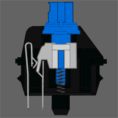
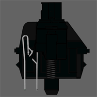
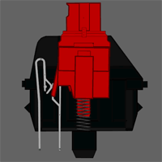
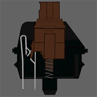

# Todo: Consider to research and understand the components and vendors for tactile mechanical text input keyboards?

```#252a3a34``` *As of 2019-01-31 18:43*

[mail plain/text](mail.txt)


It seems I should now more about the components in a tactile mechanical keyboard for computers?

==&gt; Also see “Todo: Consider to build the DIY ibm-like old-style tactile switches keyboard as indicated by Snazzy Lab youtube video?"

1) Consider the Chinese keyboard kit vendor KBDFan (<https://kbdfans.cn>)?

==&gt; They seems to categorise keyboards as 20%, 40%, 60%, 65%, 75%, 80% and 95% (<https://kbdfans.cn/collections/pcb> )?


==&gt; It seems we must match the PCB with a subtle case - and accompanying frame (<https://kbdfans.cn/collections/case> )?


==&gt; It seems I can (or must?) buy the frame for the switches separately (<https://kbdfans.cn/collections/keyboard-part> )?

  

*60% keyboard format means NO function key row 75% keyboard format includes the function key row *

==&gt; It seems KBDFan sell mechanical keyboard switches from a sortiment of vendors?


==&gt; KBDFans seem to sell kits with function key row (<https://kbdfans.cn/collections/diy-kit/products/kbd75v2-custom-keyboard-diy-kit> )?


==&gt; It seems “Hot Swap” means I solder special switch and LED connectors to the PCB that will them allow me to replace frame with switches and LEDs without soldering (<https://kbdfans.cn/collections/keyboard-part/products/switch-led-hot-swap-32pcs> )?


2) Consider this Swedish article on keyboard switches (<https://www.nordichardware.se/test/svenska-tangentbordsguiden-en-djupdykning-i-brytare.html>)?

==&gt; It seems Cherry Switches, owned by ZF Electronics, are the best known and ubiquitous switches used in tactile keyboards?

==&gt; It seems the Cherry Blue is a “clicky” keyboard switch?



The “Clicky” Sherry Blue switch

==&gt; It seems Sherry MX Black is a linear non-click keyboard switch?



The linear resistance non-click Sherry MX Black keyboard switch

==&gt; It seems the Cherry Red is a Cherry MX Black but with less resistance?



The Cherry Red is a non-click keyboard switch (A Cherry Black but with lower resistance)

==&gt; It seems the Cherry MX Brown is a hybrid between the tactile clicking Cherry Blue and the linear non-click Cherry Red



Cherry Brown keyboard switch (hybrid of clicking Cherry Blue and linear non-clicking Cherry Red)

==&gt; It seems Kailh sells Cherry MX switch “clones” (they even use the same color coding and naming scheme)?

...

3) Consider alternative vendors to buy mechanical keyboard switches from?


==&gt; Consider where to buy Cherry Switches?

=&gt;= It seems DigiKey-key sells Cherry Swtches (<https://www.digikey.se/products/en/switches/pushbutton-switches/199?k=&pkeyword=&sv=0&v=1644&sf=0&FV=ffe000c7&quantity=&ColumnSort=0&page=1&pageSize=25>)?

==&gt; Consider where to buy Kailh Switches?

==&gt; It seems Bangood sells Kailh keyboard switches (<https://www.banggood.com/sv/search/kailh-switch.html?sbc=1>)?

==&gt; It seems Novelkeys sells Kaihl keyboard switches (<https://novelkeys.xyz/products/kailh-switches> )?

==&gt; Consider where to buy Aliaz Switches?

==&gt; It seems Novelkeys sells Aliaz Switches by Gateron (<https://novelkeys.xyz/products/aliaz-switches>)?

==&gt; Consider where to buy Gateron Switches?

==&gt; It seems Mechanical keyboards sells Gateron Switches (<https://mechanicalkeyboards.com/shop/index.php?l=product_list&c=98> )?

==&gt; Consider where to buy Zealios Switches?

==&gt; It seems Zealios sell their Switches on their own site (<https://zealpc.net/products/zealio> )?


