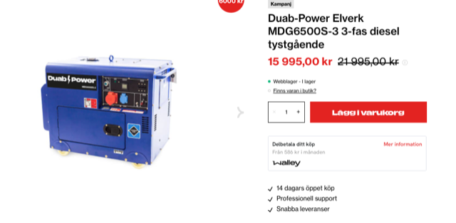
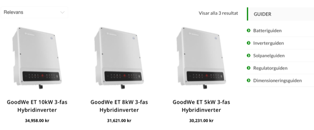
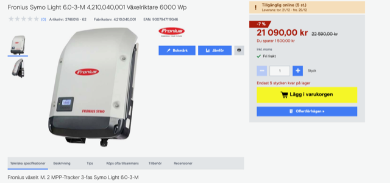
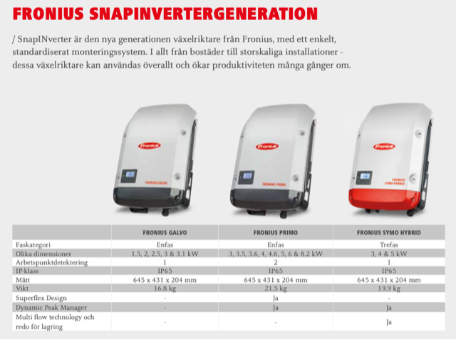
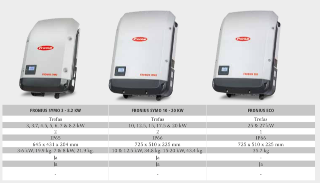

# Todo: Consider ways to create 3-phase 4-5 kW power under "off-grid" conditions (from battery or fuel)?

```#257f750e``` *As of 2023-11-22 13:50*

[mail plain/text](mail.txt)


I may need to be able to produce three phase hight electrical power for things like saw mills and other power machines when I build my off grid house.

==&gt; Also see "Todo: Consider a band saw mill I can purchase to cut timber into lumber for my house build adventure?"



<https://duab.se/garage-verkstad/elverk/dieseldrivna-elverk/duab-power-elverk-mdg6500s-3-3-fas-diesel-tystgaende?gad_source=1&gclid=Cj0KCQiA6vaqBhCbARIsACF9M6kaSNyHWalaBN7Mq_sXfAU3eX8H2O9g6BV0yC-552QfS_3Uh9oeUAsaAj7PEALw_wcB>



<https://solenergibutiken.se/?s=GoodWe&post_type=product>



<https://www.conrad.se/sv/p/fronius-symo-light-6-0-3-m-4-210-040-001-vaxelriktare-6000-wp-2746016.html?utm_source=google&utm_medium=surfaces&utm_campaign=shopping-feed&utm_content=free-google-shopping-clicks&utm_term=2746016&gad_source=1&gclid=Cj0KCQiA6vaqBhCbARIsACF9M6lCz9pCz0YPRWQcmSGn9tcdsokuiKZEqBu0uCb6ysMtimWL4uqybTUaAhjcEALw_wcB>

NOTE: It seems it is the Fronius Symo product line-up that produces 3 phase AC ([https://www.fronius.com/~/downloads/Solar%20Energy/Brochures/SE_BRO_Fronius_Endcustomer_SWE.pdf](<https://www.fronius.com/~/downloads/Solar Energy/Brochures/SE_BRO_Fronius_Endcustomer_SWE.pdf>) )?





...


