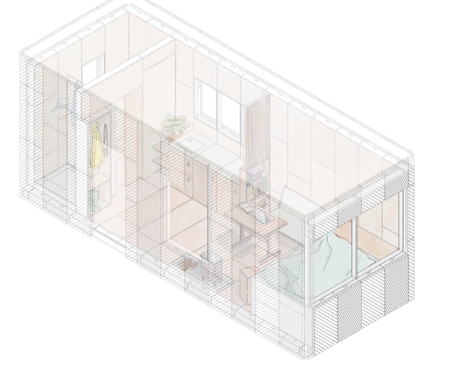

# Todo: Consider to check out UK-based U-build and find a Swedish located CNC workshop for manufacturing?

```#276c0a50``` *As of 2021-07-26 01:40*

[mail plain/text](mail.txt)


1) U-build seems to live here on the web (<https://u-build.org> )?

==&gt; Consider their 10-30 m2 cabins (<https://u-build.org/designs/cabins/> )?



2) They seem to be able to arrange for a local CNC shop to manufacture my U-build design (<https://u-build.org/faqs/> )?

> "  
> *Do you ship overseas?  
> We do not ship parts outside of the UK, as this doesn’t make sense from an environmental or cost perspective, but one of the great things about U-Build is that it can be sent digitally all around the world and cut at a local workshop with ‘CNC cutting facilities’.

> **If you are able to find a local CNC cutting workshop, structural engineer and build team in your country,** then we can work with you to turn your idea into drawings and send the files to them directly for cutting.

> The cost of this is based on the overall size and complexity of your design so please get in touch with details and we will create an estimate.*  
> "

3) Consider to compare their modular system with the Wikihouse project design?

==&gt; See "[Todo: Consider to build a WikiHouse (open source CNC micro factory produced house)?](../2ae81711/chime.md)"

==&gt; Also see “[Todo: Consider an art-project where citizens self organize to build a Wikihouse?](../f39c11ad/chime.md)”

==&gt; Also see “[Todo: Consider to propose immigration housing using Wikihouse based new villages?](../557d5379/chime.md)”

==&gt; Also see “[Todo: Follow up and learn about WikiHouse - Open Source house building](../eaec0e9b/chime.md)”

==&gt; Also see “[Todo: Consider to evaluate the idea of the economy-of-the-future on how well it creates incitements to go with Wikihouse?](../fd1fd39c/chime.md)”

==&gt; Also see “[Todo: Darwinet - Consider to design a domain for WikiHouse projects?](../0d7012ac/chime.md)”

...


