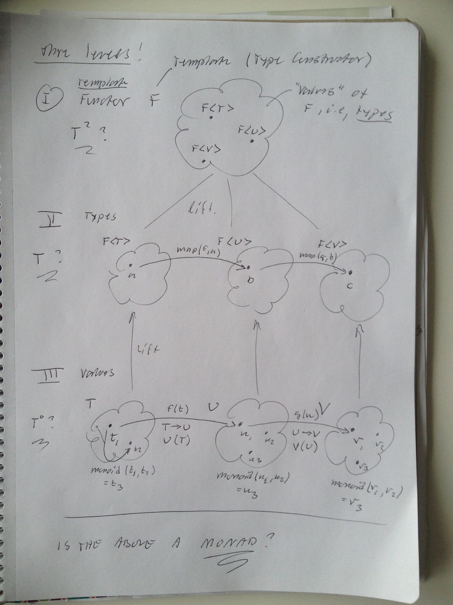
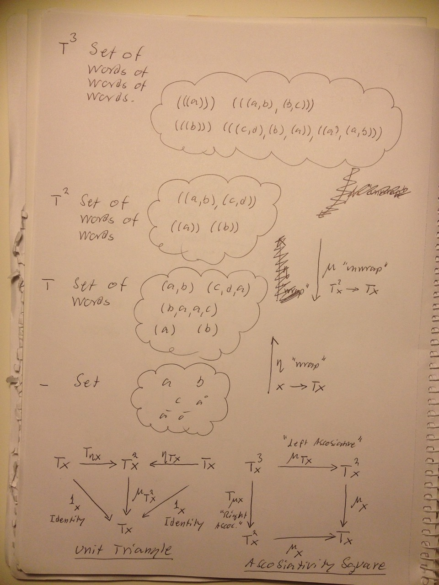

# Todo: Functional Programming - Consider if Monad T-square, T and value maps to C++ Functor Template F, Functor type F&lt;T&gt; and value T?

```#279bdfdb``` *As of 2016-12-13 17:56*

[mail plain/text](mail.txt)


I get a hunch that it could possibly be a path to insight to view the three levels of C++ implementation of Functor (Template level of Functor F, Type level of F&lt;T&gt; and value level T t) as somehow correlated to Monad definition of mapping between value level, T level and T-squared level?

1) Consider this C++ talk on Functional Programming (<https://www.youtube.com/watch?v=DiisKQAkGM4>)?

==&gt; It seems to propose quite clear definitions on how to implement Functors in C++?

==&gt; He states std::vector&lt;T&gt; is a Functor.

==&gt; It is because we can map a vector of one type to a vector of another type using a function that converts the containing values.

==&gt; We can get std::vector&lt;U&gt; from a std::vector&lt;T&gt; using a function U(T) :)

==&gt; This shall be the job of std::vector&lt;U&gt; bind(std::function&lt;U(T)&gt; f, std::vector&lt;T&gt; a).

==&gt; Simply iterate over provided std::vector&lt;T&gt; and for each element ’i' push a U into result std::vector&lt;U&gt; using f(a&#91;i&#93;).

==&gt; At 31:30 he defines ”Applicative Functor” as an object with operations ”pure” to create an instance from the wrapped value and apply to create an Applicative&lt;U&gt; from provided Applicative&lt;F&gt; and Applicative&lt;T&gt;

==&gt; It seems then ”pure” corresponds to the Etha-transformation below (It ”lifts” values to Applicable values)?

==&gt; At 49:25 he states that a Monad is an "Applicative Functor” with a member operation join that Flattens a Functor-of-a-Functor-of-x to be just Functor-of-x (i.e. flattens it)

==&gt; To it seems ”join” is the mju-transformation below (It ”flattens” Functor/Applicable/Monad-square of type to just Functor/Applicable/Monad)?

==&gt; So, it would seem the ”bind” has nothing to do with Monads (it is just a convenient way to lift the function U(T) to the Functor-space F&lt;T&gt; —&gt; F&lt;U&gt; (using Monad-defined algebra for the Etha (lift) and Mju (flatten) transforms)?

...

2) Consider the following model of the three levels?



3) Consider Professor Chengs youtube lectures on Monads (<https://www.youtube.com/watch?v=9fohXBj2UEI&list=PL0E91279846EC843E>)?

==&gt; Consider part I (<https://www.youtube.com/watch?v=9fohXBj2UEI>)?

==&gt; it seems a Monad is defined by a Functor that maps a ”category" to itself (i.e., Functors operates on a closed set)?

==&gt; This seem to fit the implementation in C++ of functor F&lt;T&gt; defines a map-function that turns an F&lt;T&gt; to an F&lt;U&gt;, i.e., a functor in the same Functor space (the category if these functors)?

==&gt; She seem to use the notation T to mean a Functor.

==&gt; And she refers to c as an object in category C.

==&gt; She uses the phrase ”A Functor from category C to itself” (meaning a Functor operates on Categories)?

==&gt; Then the functor T is defined to that "T on c” is c.

==&gt; This seems to be the definition of an ”Endo-functor” (spelled endofunctor)?

==&gt; Thus an Endofunctor maps objects in a Category onto objects in the same Category?

==&gt; It seems a Monad includes the definition of two natural transformations related to something called ”Unity” and ”Multiplication”

==&gt; It seems the transformation defines transform-of-the-Functor (not mappings of elements)?

==&gt; She seem to state that the notation ’1’ stands for the ”Identity Functor"

==&gt; She seem to state that T-square stands for ”Multiplication” (As in Functor-on-Functor)?

==&gt; Then the Etha transformation transforms the Identity Functor ’1’ to ”our” Functor T ( ’1’ —&gt; T)

==&gt; And the Mju transformation transforms the Multiplication Functor (T-square) back to ”our” Functor T ( T-square —&gt; T)

==&gt; Q: How can we understand T-square as ”multiplication” (where is this operation defined)?

==&gt; It seems Etha and Mju correspond to Clojure implementation map and flatmap?

==&gt; It also seems Etha is Haskel ”return” and Mju is Haskel bind?

==&gt; Her example of a ”Monad for Monoids” seems interesting to get a grasp of what is going on here?

==&gt; It seems this means the ”Algebra” for this Monad will turn out to be Monoids (plural)?

==&gt; The Category of this Monad is a Set (and it seems Monoids lives in a Category of Sets)?

==&gt; A set seems to be defined as a collection of objects (elements of the Set).

==&gt; An a Monoid is an algebra on a Set?

==&gt; She seem to state that the Functor of ”Monad for Monoids” maps between Sets?

==&gt; The Functor seems to ”lift” a Set of Objects into a Set of Words?

==&gt; With T denoting the Functor T on x —&gt; words of x (x being members of Set X)

==&gt; So, T on elements is a word constructed of these elements.

==&gt; So T on T on elements is

==&gt; She then defines Unity and Multiplication transforms of the ”Monad for Monoids”

==&gt; The Unity transform takes an element x and creates a word with that object in it (maps Set of Objects into the Set of Words)

==&gt; The Multiplication transform ”words of words” (i.e., T-squared) and maps it to a word (i.e., flattens the list of words into one long concatinated word)

==&gt; Consider the following model seems to apply to "Monad for Monoids"?



==&gt; Consider part II (<https://www.youtube.com/watch?v=Si6_oG7ZdK4>)?

==&gt; Consider part III (<https://www.youtube.com/watch?v=eBQnysX7oLI>)?

==&gt; Consider part III-A (<https://www.youtube.com/watch?v=uYY5c1kkoIo>)?

==&gt; Consider part IV (<https://www.youtube.com/watch?v=Cm-O_ZWEIGY>)?

…

Consider to delve deeper into this hunch to see if there is any understanding to find here?

...


