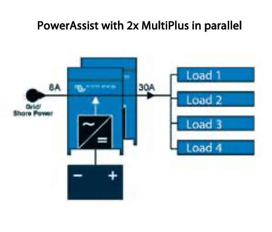

# Todo: Consider Victron products to build a battery supported (power wall) load balance för my three phase 16A and 240V apartment electrical system?

```#27c5556e``` *As of 2022-09-07 16:39*

[mail plain/text](mail.txt)


I am curious if I can install a power wall to charge at low tariffs and use at high tariffs to take advantage of hour-by-hour electrical billing?

1) At first glance it seems I can use a "Multiplus" (charger, inverter and switch) with batteries to get "PowerAssist"



> *This is as far as I get trying to figure out what components to use to charge from the grid at low tariff and power my household from battery at high tariff?*

> *Their product names doe not help. I mean "Multiplus"? Does ot help my engineering brain at all?*

> *It seems they do NOT have a product specifically to switch between grid power and "battery" power? Instead this function is built into the charger and/or inverter?*

> *An inverter seems to be the device that converts DC battery power to AC grid power?*

> *And a charger is clearly a device to charge a DC battery.*

> *Questions are:*

> *1) Do they have a charger that uses grid power and then charge the battery (NOT charging from solar panels or electrical generator)? *  
> *2) Do they have a system for reading electrical tariffs and then control if the household grid is powered from "battery" (when tariff is high) or from the grid (when tariff is low)?*

> *This I failed to determine, as Victron seems to aim their products at off-grid or mobile homes using solar panels or occasional grid power to charge a battery bank for the household demands?*

> *...*

2) Consider to follow up on my contact with [salesscandinavia@victronenergy.com](mailto:salesscandinavia@victronenergy.com) about these questions?

> *"**Hej!*

> *Jag har försökt leta mig fram i ert produktsortiment utan att riktigt greppa om ni har komponenter så jag kan bygga mig en "Powerwall" som automatiskt laddas upp till lågt elpris från nätet, för att sedan driva mitt hushåll på den billiga batteri-elen resten av dagen?

> Jag bor i lägenhet i Sverige med trefas 16A.

> Och tänker mig ett system som fungerar ungefär så här.

> \* En trefas växelriktare mellan inkommande nät och hushållets nät som kan programmeras / styras att växla mellan nätdrift och "batteridrift".  
> \* En laddare som går på nätdrift (enfas räcker?) och kan styras att ladda en batteribank baserad på tariff (eller tid)  
> \* En trefas-inverter som kan driva hushållets behov (?? kW / fas för spis, brödrost, hårtork eller vad som nu är effekttoppen?)  
> \* En kontollenhet som väljer om växelriktaren skall driva hushållet på nät-el eller "batteri-el" beroende på aktuell nät-tariff (eller tid)?

> ==&gt; Har ni ett förslag på hur era komponenter kan kopplas saman för att skapa ett lättskött system så jag kan dra nytta av timme-för-timme pris på el?

> Mången tack på förhand!

> Mvh, Kjell-Olov Högdahl**"*

==&gt; It seems Victron proposes I should hook up three (See mail response "On 7 Sep 2022, at 16:10, [Kontakt@offgridlagret.se](mailto:Kontakt@offgridlagret.se) &lt;[kontakt@offgridlagret.se](mailto:kontakt@offgridlagret.se)&gt; wrote:")?

> *"Hej Kjell-Olov!*

> *Victrons trefas system baseras på två storlekar just nu.  
> **Multiplus 2, 48/3000 Va eller 48/5000 Va**.  
> De är invertera/laddare. Så när de är kopplade mot nätet så laddar de batterierna utifrån tid. (Ej tariff)  
> Till systemet kopplar man en Cerbo GX enhet som styr systemet baserat utifrån olika inställning som man kan göra.

> Frågan är vilket storlek på enheterna som du önskar. Vanligast är 5000Va enheterna som kan ge 4000w kontinuerligt / fas.  
> Tänk på att det krävs tre st Multiplus för trefas setup.

> Kan du kolla lite här så ser du lite mer ingående hur det är tänkt. Återkom gärna sedan till mig.

> <https://www.victronenergy.com/media/pg/Energy_Storage_System/en/ess-introduction---features.html>

> Trevlig kväll!

> *  
> *Med vänlig hälsning, Christian"*

...


