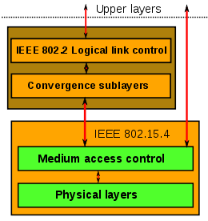

# Todo: Consider to study and understand the IEE 802.15.4 "mesh" network ( of low-rate wireless personal area networks = LR-WPANs)?

```#281eafa1``` *As of 2019-02-01 17:22*

[mail plain/text](mail.txt)


It seems IoT devices may use modules with 802.15.4 WiFi modules to interact with each other locally using a range of protocol layers like ZigBee?

1) Consider the wikipedia article on IEE 802.15.4 (<https://en.wikipedia.org/wiki/IEEE_802.15.4> )?

==&gt; It seems IEE 802.165.4 is standard to utilise existing Wifi radio links to create local area networks fot low bandwidth communication?

==&gt; It seems there are many networking frameworks that utilises the IEE 802.15.4 networking standard?

> “ It &#91;IEE 802.15.4&#93; is the basis for the [Zigbee](https://en.wikipedia.org/wiki/Zigbee),[&#91;2&#93;](https://en.wikipedia.org/wiki/IEEE_802.15.4#cite_note-Zigbee-2)[ISA100.11a](https://en.wikipedia.org/wiki/ISA100.11a),[&#91;3&#93;](https://en.wikipedia.org/wiki/IEEE_802.15.4#cite_note-ISA100-3) [WirelessHART](https://en.wikipedia.org/wiki/WirelessHART), [MiWi](https://en.wikipedia.org/wiki/MiWi), [6LoWPAN](https://en.wikipedia.org/wiki/6LoWPAN), [Thread](<https://en.wikipedia.org/wiki/Thread_(network_protocol)>) and [SNAP](https://en.wikipedia.org/wiki/Subnetwork_Access_Protocol)"

==&gt; The IEEE 802.15.4 seems to define something that resembles an IOS OSI 7 layer stack?



==&gt; It seems IEEE 802.15.4 uses Carrier Sens and Collision Avoidance to access the shared WiFi radio frequency room?

> “The physical medium is accessed through a CSMA/CA protocol. Networks which are not using beaconing mechanisms utilize an unslotted variation which is based on the listening of the medium, leveraged by a random exponential backoff algorithm;"

==&gt; Consider the wikipedia page on Carrier-sense multiple access with collision avoidance (CSMA/CA) (<https://en.wikipedia.org/wiki/Carrier-sense_multiple_access_with_collision_avoidance> )?

2) It seems the IEEE 802.15.4 standard is available for free here (<https://ieeexplore.ieee.org/servlet/opac?punumber=7460873> )?

THIS SUCKS! - I can only open the pdf - NOT download it :(

==&gt; It seems with an account I can only read the 802.15.4 pdf document. But somehow the browser is prohibited from downloading it or copy it?

3) Consider the Wikipedia page on the Open Systems Interconnection model - i.e., The OSI model (<https://en.wikipedia.org/wiki/OSI_model> )?


==&gt; Consider this company article on the OSI model (<https://www.bmc.com/blogs/osi-model-7-layers/> )?


*Source: Muhammad Raza article at <https://www.bmc.com/blogs/osi-model-7-layers/>*

==&gt; Consider this Youtube video on the 7 layer OSI model fro protocols (<https://youtu.be/LANW3m7UgWs> )?

4) Consider available devices, shields and microcontrollers extensions that provides WiFi interaction using the IEE802.15.4 standard?

==&gt; Consider SparkFun “Particle Argon IoT Development Board” (<https://www.sparkfun.com/products/15068> )?

> “The Particle Argon is an IoT development board that allows you to connect your mesh network to Wi-Fi. With the Nordic nRF52840 SoC and an ESP32 you have all the power of an ARM Cortex M4 with OpenThread mesh networking, Wi-Fi (b/g/n), NFC, plenty of GPIOs, LiPo charging and more. The board is designed to act as a standalone Wi-Fi endpoint or a Wi-Fi enabled gateway for a Particle Mesh network."


*Particle Argon IoT Development Board for Thread® - IEEE 802.15.4 WiFi local mesh network *

5) Consider the wikipedia page on Zigbee (<https://en.wikipedia.org/wiki/Zigbee> )?

==&gt; It seems Zigbee is to be used for cost effective, low energy wifi based IoT devices?

> “Zigbee is an IEEE 802.15.4-based specification for a suite of high-level communication protocols used to create personal area networks with small, low-power digital radios,”

> “The technology defined by the Zigbee specification is intended to be simpler and less expensive than other wireless personal area networks (WPANs), such as Bluetooth or more general wireless networking such as Wi-Fi. Applications include wireless light switches, home energy monitors, traffic management systems, and other consumer and industrial equipment that requires short-range low-rate wireless data transfer."

==&gt; It seems to develop for ZigBee one must pay a fee to become a member?

> “The requirements for membership in the Zigbee alliance cause problems for Free Software developers because the **annual fee** conflicts with the GNU General Public Licence.&#91;18&#93; The requirement for the developer to join the Zigbee Alliance similarly conflicts with most other free software licenses.&#91;19&#93;"

6) Consider the wikipedia page on ISA 11.11a (<https://en.wikipedia.org/wiki/ISA100.11a> )?

==&gt; It seems ISA 100.11a is for Industrial automation?

> “ISA100.11a is a wireless networking technology standard developed by the International Society of Automation (ISA). The official description is "Wireless Systems for Industrial Automation: Process Control and Related Applications".&#91;1&#93;"

7) Consider the wikipedia page on WirelessHART (<https://en.wikipedia.org/wiki/WirelessHART> )?

==&gt; It seems WirelessHART aims for creating self-organising mesh networks based on IEEE 802.15.4 wifi radio communication?

> “The protocol utilizes a time synchronized, self-organizing, and self-healing mesh architecture. The protocol supports operation in the 2.4 GHz ISM band using IEEE 802.15.4 standard radios. The underlying wireless technology is based on the work of Dust Networks' TSMP technology.&#91;1&#93;"

8) Consider the wikipedia page on MiWi (<https://en.wikipedia.org/wiki/MiWi> )?

==&gt; It seems MiFi is restricted to be used on Microchip controllers only?

> “MiWi and MiWi P2P are proprietary wireless protocols designed by Microchip Technology that use small, low-power digital radios based on the IEEE 802.15.4 standard”

> “On the PIC platform, the MiWi protocol stacks are small foot-print alternatives (3K-17K) to ZigBee (40K-100K), which makes them useful for cost-sensitive applications with limited memory.

> Although the MiWi software can all be downloaded for free from its official website, there exists a unique restriction and obligation to use it only with Microchip microcontrollers.&#91;3&#93;"

9) Consider he Wikipedia page on 6LoWPAN (<https://en.wikipedia.org/wiki/6LoWPAN> )?

==&gt; It seems 6LoWPAN is an initiative to provide IPv6 over IEEE 802.15.4 wifi radio networks?

> “6LoWPAN is an acronym of IPv6 over Low-Power Wireless Personal Area Networks.&#91;1&#93;"

10) Consider the wikipedia page on Thread (network protocol) (<https://en.wikipedia.org/wiki/Thread_(network_protocol)> )?

==&gt; It seems the Thread network protocol is “free” to use but an annual membership fee is required and aims at providing IPv6 communication over IEEE 802.15.4 wifi radio local networks?

> “Thread is an IPv6-based, low-power mesh networking technology for IoT products, intended to be secure and future-proof.&#91;1&#93; The Thread protocol specification is available at no cost…"

> “Membership of the Thread Group is subject to an annual membership fee except for the "Academic" tier.&#91;3&#93;"

==&gt; Consider the OpenThread networking protocol (<https://openthread.io> )?

> “OpenThread released by Nest is an open-source implementation of Thread®. Nest has released OpenThread to make the networking technology used in Nest products more broadly available to developers, in order to accelerate the development of products for the connected home."

==&gt; Consider the Particle Mech Network (<https://www.particle.io/mesh/> )?


==&gt; Consider this Viemo video on the Particle Mesh IoT network (<https://vimeo.com/255449448> )?

8) Consider he wikipedia page on Subnetwork Access Protocol - SNAP (<https://en.wikipedia.org/wiki/Subnetwork_Access_Protocol> )?

…


