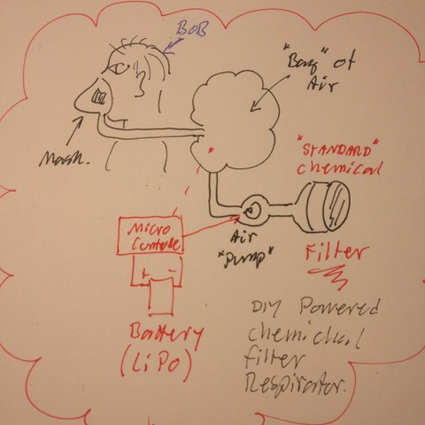

# Todo: Consider a DIY micro controlled (Arduino) Powered Air Purifying Respirator (PAPR)?

```#28a8555c``` *As of 2018-12-09 18:51*

[mail plain/text](mail.txt)


It seems it could be fun and interesting to try and design and build a powered air purifying respirator based existing chemical filters and som micro controller, air “bag” and fan?

1) Consider a design with a half mask, some form of “bag of air” filled by a fan through a commercial available chemical filter?



==&gt; Consider the mask have valves to take in air from the “bag” of air?

==&gt; Consider the “bag” of air is filled by a micro controlled air “pump” (fan)?

==&gt; Consider the fan take air in through a commercial available chemical filter?

==&gt; Consider Bob is now safe? :)

2) Consider to compare with the 3M belt mounted PAPR called GVP-100 (<https://www.amazon.com/SEPTLS142GVP100-3m-Motor-Blowers-GVP-100/dp/B002DLMUQG>)?


3) Consider we can leverage valves and mount piece from diving equipment?

==&gt; Consider we can do something with a diving mask with snorkel (<https://www.lightinthebox.com/sv/p/dykmasker-tva-fonster-vuxen-neopren-inga-verktyg-behovs-dykning-och-snorkling-rod-gul-bla-svart-vit_p5608180.html?prm=1.3.5.3>)?

> 

==&gt; But the snorkel does NOT hav a back-valve (intake and outlet is through the snorkel)?


==&gt; But with a valve we can attach the “Bag” of air to the inlet and create an outlet controlled by the valve?

…


