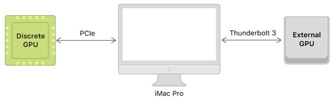
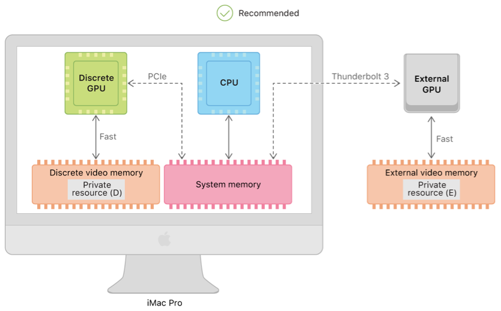

# Todo: Consider to try out C++14-based Apple Metal 2 programming on my Mac Pro D700 graphics?

```#29998ffc``` *As of 2019-03-07 15:41*

[mail plain/text](mail.txt)


It seems a good way to learn the Mac Pro D700 capabilities as well as the Metal 2 graphics API and language is to try it out using Apples examples and tutorials?

1) Consider wikipedia on Metal 2 (<https://en.wikipedia.org/wiki/Metal_(API)> )?

2) Consider Apples developer site on Metal 2 (<https://developer.apple.com/documentation/metal> )?

==&gt; It seems metal programming is done in Swift bu the syntax is based on C++14 (<https://developer.apple.com/documentation/metal/hello_triangle> )?

> "Vertex functions are written in the Metal shading language, which is based on C++ 14. Metal shading language code may seem similar to traditional C/C++ code, but the two are fundamentally different. Traditional C/C++ code is typically executed on the CPU, whereas Metal shading language code is exclusively executed on the GPU. The GPU offers much larger processing bandwidth and can work, in parallel, on a larger number of vertices and fragments. "

==&gt; Consider this Apple developer article with good leads to the different GPU system architecture (<https://developer.apple.com/documentation/metal/choosing_gpus_on_mac/about_gpu_bandwidth> )?



<https://docs-assets.developer.apple.com/published/71d2055757/1a262d7d-8aab-4b3a-95b1-aa97869648e2.png>



<https://docs-assets.developer.apple.com/published/92b2e58f3f/dd271bd5-dfd5-479a-80bb-67eb01405346.png>

...


