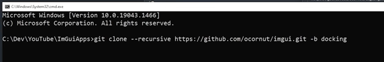
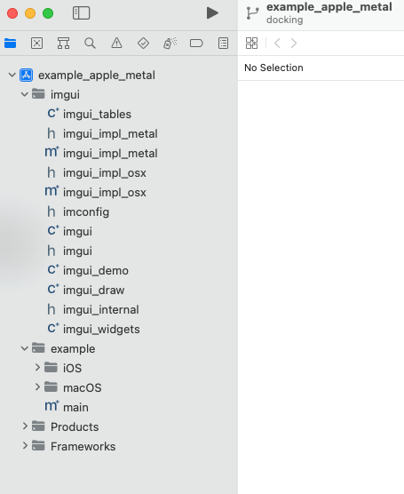
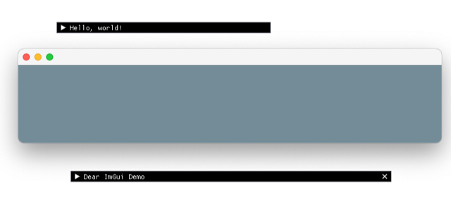
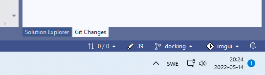

# Todo: Consider to try making a C++ cross platform application using Dear Imgui with an Elm Model,View, Update Architecture?

```#2b57508b``` *As of 2022-05-14 21:07*

[mail plain/text](mail.txt)


==&gt; Also see "[Todo: C++ Elm Idiom - Consider this is actually better described as a Single Atom Architecture (Clojure and React terminology)?](../164356bc/chime.md)"

==&gt; Also see “[Todo: Tha, Elm and Immer - Consider the C++ Immer immutable data structures based text editor "ewig" is in fact implementing the Elm model, view, update?](../5a0eb296/chime.md)

1) Consider the youtube video "BEST WAY to make Desktop Applications in C++" as a template to get started with ImGui (<https://youtu.be/vWXrFetSH8w?list=LL> )?

==&gt; It seems we should use the "docking" branch of the Imgui github repository (<https://youtu.be/vWXrFetSH8w?list=LL&t=608> )?



2) Consider my steps to clone the Imgui Github docking branch to a local folder on macOS (<https://github.com/ocornut/imgui/tree/docking> )?

==&gt; It seems cloning the docking branch works fine (with some strange warnings that I did not understand and ignored...)

> kjell-olovhogdal@Kjell-Olovs-Mac-Pro Github % **git clone** --recursive "<https://github.com/ocornut/imgui.git>" **-b docking**  
> *2022-05-14 19:21:05.539 xcodebuild&#91;1112:32102&#93; Requested but did not find extension point with identifier Xcode.IDEKit.ExtensionSentinelHostApplications for extension Xcode.DebuggerFoundation.AppExtensionHosts.watchOS of plug-in com.apple.dt.IDEWatchSupportCore*  
> *2022-05-14 19:21:05.540 xcodebuild&#91;1112:32102&#93; Requested but did not find extension point with identifier Xcode.IDEKit.ExtensionPointIdentifierToBundleIdentifier for extension Xcode.DebuggerFoundation.AppExtensionToBundleIdentifierMap.watchOS of plug-in com.apple.dt.IDEWatchSupportCore*  
> Cloning into 'imgui'...  
> remote: Enumerating objects: 44250, done.  
> remote: Counting objects: 100% (67/67), done.  
> remote: Compressing objects: 100% (36/36), done.  
> remote: Total 44250 (delta 42), reused 48 (delta 31), pack-reused 44183  
> Receiving objects: 100% (44250/44250), 79.17 MiB | 2.82 MiB/s, done.  
> Resolving deltas: 100% (33683/33683), done.

==&gt; It seems there are examples with ready-to-use xcode projects that worked for me out-of-the-box?

> kjell-olovhogdal@Kjell-Olovs-Mac-Pro examples % cd example_apple_metal  
> kjell-olovhogdal@Kjell-Olovs-Mac-Pro example_apple_metal % pwd  
> /Users/kjell-olovhogdal/Documents/Github/**imgui/examples/example_apple_metal**  
> kjell-olovhogdal@Kjell-Olovs-Mac-Pro example_apple_metal % ls  
> README.md example_apple_metal.xcodeproj iOS macOS main.mm  
> kjell-olovhogdal@Kjell-Olovs-Mac-Pro example_apple_metal % xcode example_apple_metal.xcodeproj  
> zsh: command not found: xcode  
> kjell-olovhogdal@Kjell-Olovs-Mac-Pro example_apple_metal % **xed example_apple_metal.xcodeproj**  
> kjell-olovhogdal@Kjell-Olovs-Mac-Pro example_apple_metal %

NOTE: It seems the command "xed" is the way to launch Xcode from the command line?



==&gt; It seems I can build this example as-is in Xcode Version 13.3.1 (13E500a) and run the example Imgui applcation on macOS?


NOTE: The contained "windows" seems to be de facto free-floating drop-down menus / forms?



3) Consider a possible architecture for using Imgui as the base for my own application (and make it cross platform)?

==&gt; It seems I have to place my application render code in a function called by the Imgui main loop (<https://youtu.be/vWXrFetSH8w?list=LL&t=765> )?

4) Consider my experience and lessons learned from trying out Imgui github project on Windows 11?

CONFUSION: Do NOT Start Visual Studio using "**devenv .**"

> PS C:\\Users\\kjell-olovhogdal\\source\\repos\\imgui\\examples&gt; devenv .

==&gt; Visual Studio will try to open the current folder as a CMake project!

==&gt; For me this did NOT work!

==&gt; Note the CMakeLists.txt files that actually are provided by the imGui github project :)

CONFUSION: Visual Studio will convert the project to your platform SDK and then show the Git Changes tab (NOT the solution explorer)



==&gt; This caused me to spend some minutes trying to open an example project but was greeted by a Git Diff view of the project file \*sigh\*!

5) Consider the tree-view of the imgui github project on macOS (should be the same for all platforms)?

> kjell-olovhogdal@Kjell-Olovs-Mac-Pro imgui % tree  
> .  
> ├── LICENSE.txt  
> ├── backends  
> │ ├── imgui_impl_allegro5.cpp  
> │ ├── imgui_impl_allegro5.h  
> │ ├── imgui_impl_android.cpp  
> │ ├── imgui_impl_android.h  
> │ ├── imgui_impl_dx10.cpp  
> │ ├── imgui_impl_dx10.h  
> │ ├── imgui_impl_dx11.cpp  
> │ ├── imgui_impl_dx11.h  
> │ ├── imgui_impl_dx12.cpp  
> │ ├── imgui_impl_dx12.h  
> │ ├── imgui_impl_dx9.cpp  
> │ ├── imgui_impl_dx9.h  
> │ ├── imgui_impl_glfw.cpp  
> │ ├── imgui_impl_glfw.h  
> │ ├── imgui_impl_glut.cpp  
> │ ├── imgui_impl_glut.h  
> │ ├── imgui_impl_metal.h  
> │ ├── imgui_impl_metal.mm  
> │ ├── imgui_impl_opengl2.cpp  
> │ ├── imgui_impl_opengl2.h  
> │ ├── imgui_impl_opengl3.cpp  
> │ ├── imgui_impl_opengl3.h  
> │ ├── imgui_impl_opengl3_loader.h  
> │ ├── imgui_impl_osx.h  
> │ ├── imgui_impl_osx.mm  
> │ ├── imgui_impl_sdl.cpp  
> │ ├── imgui_impl_sdl.h  
> │ ├── imgui_impl_sdlrenderer.cpp  
> │ ├── imgui_impl_sdlrenderer.h  
> │ ├── imgui_impl_vulkan.cpp  
> │ ├── imgui_impl_vulkan.h  
> │ ├── imgui_impl_wgpu.cpp  
> │ ├── imgui_impl_wgpu.h  
> │ ├── imgui_impl_win32.cpp  
> │ ├── imgui_impl_win32.h  
> │ └── vulkan  
> │ ├── generate_spv.sh  
> │ ├── glsl_shader.frag  
> │ └── glsl_shader.vert  
> ├── docs  
> │ ├── BACKENDS.md  
> │ ├── CHANGELOG.txt  
> │ ├── EXAMPLES.md  
> │ ├── FAQ.md  
> │ ├── FONTS.md  
> │ ├── README.md  
> │ └── TODO.txt  
> ├── examples  
> │ ├── README.txt  
> │ ├── example_allegro5  
> │ │ ├── README.md  
> │ │ ├── example_allegro5.vcxproj  
> │ │ ├── example_allegro5.vcxproj.filters  
> │ │ ├── imconfig_allegro5.h  
> │ │ └── main.cpp  
> │ ├── example_android_opengl3  
> │ │ ├── CMakeLists.txt  
> │ │ ├── android  
> │ │ │ ├── app  
> │ │ │ │ ├── build.gradle  
> │ │ │ │ └── src  
> │ │ │ │ └── main  
> │ │ │ │ ├── AndroidManifest.xml  
> │ │ │ │ └── java  
> │ │ │ │ └── MainActivity.kt  
> │ │ │ ├── build.gradle  
> │ │ │ └── settings.gradle  
> │ │ └── main.cpp  
> │ ├── example_apple_metal  
> │ │ ├── README.md  
> │ │ ├── example_apple_metal.xcodeproj  
> │ │ │ └── project.pbxproj  
> │ │ ├── iOS  
> │ │ │ ├── Info-iOS.plist  
> │ │ │ └── LaunchScreen.storyboard  
> │ │ ├── macOS  
> │ │ │ ├── Info-macOS.plist  
> │ │ │ └── MainMenu.storyboard  
> │ │ └── main.mm  
> │ ├── example_apple_opengl2  
> │ │ ├── example_apple_opengl2.xcodeproj  
> │ │ │ └── project.pbxproj  
> │ │ └── main.mm  
> │ ├── example_emscripten_opengl3  
> │ │ ├── Makefile  
> │ │ ├── README.md  
> │ │ ├── main.cpp  
> │ │ └── shell_minimal.html  
> │ ├── example_emscripten_wgpu  
> │ │ ├── Makefile  
> │ │ ├── README.md  
> │ │ ├── main.cpp  
> │ │ └── web  
> │ │ └── index.html  
> │ ├── example_glfw_metal  
> │ │ ├── Makefile  
> │ │ └── main.mm  
> │ ├── example_glfw_opengl2  
> │ │ ├── Makefile  
> │ │ ├── build_win32.bat  
> │ │ ├── example_glfw_opengl2.vcxproj  
> │ │ ├── example_glfw_opengl2.vcxproj.filters  
> │ │ └── main.cpp  
> │ ├── example_glfw_opengl3  
> │ │ ├── Makefile  
> │ │ ├── build_win32.bat  
> │ │ ├── example_glfw_opengl3.vcxproj  
> │ │ ├── example_glfw_opengl3.vcxproj.filters  
> │ │ └── main.cpp  
> │ ├── example_glfw_vulkan  
> │ │ ├── CMakeLists.txt  
> │ │ ├── build_win32.bat  
> │ │ ├── build_win64.bat  
> │ │ ├── example_glfw_vulkan.vcxproj  
> │ │ ├── example_glfw_vulkan.vcxproj.filters  
> │ │ └── main.cpp  
> │ ├── example_glut_opengl2  
> │ │ ├── Makefile  
> │ │ ├── example_glut_opengl2.vcxproj  
> │ │ ├── example_glut_opengl2.vcxproj.filters  
> │ │ └── main.cpp  
> │ ├── example_null  
> │ │ ├── Makefile  
> │ │ ├── build_win32.bat  
> │ │ └── main.cpp  
> │ ├── example_sdl_directx11  
> │ │ ├── build_win32.bat  
> │ │ ├── example_sdl_directx11.vcxproj  
> │ │ ├── example_sdl_directx11.vcxproj.filters  
> │ │ └── main.cpp  
> │ ├── example_sdl_metal  
> │ │ ├── Makefile  
> │ │ └── main.mm  
> │ ├── example_sdl_opengl2  
> │ │ ├── Makefile  
> │ │ ├── README.md  
> │ │ ├── build_win32.bat  
> │ │ ├── example_sdl_opengl2.vcxproj  
> │ │ ├── example_sdl_opengl2.vcxproj.filters  
> │ │ └── main.cpp  
> │ ├── example_sdl_opengl3  
> │ │ ├── Makefile  
> │ │ ├── README.md  
> │ │ ├── build_win32.bat  
> │ │ ├── example_sdl_opengl3.vcxproj  
> │ │ ├── example_sdl_opengl3.vcxproj.filters  
> │ │ └── main.cpp  
> │ ├── example_sdl_sdlrenderer  
> │ │ ├── Makefile  
> │ │ ├── README.md  
> │ │ ├── build_win32.bat  
> │ │ ├── example_sdl_sdlrenderer.vcxproj  
> │ │ ├── example_sdl_sdlrenderer.vcxproj.filters  
> │ │ └── main.cpp  
> │ ├── example_sdl_vulkan  
> │ │ ├── build_win32.bat  
> │ │ ├── example_sdl_vulkan.vcxproj  
> │ │ ├── example_sdl_vulkan.vcxproj.filters  
> │ │ └── main.cpp  
> │ ├── example_win32_directx10  
> │ │ ├── build_win32.bat  
> │ │ ├── example_win32_directx10.vcxproj  
> │ │ ├── example_win32_directx10.vcxproj.filters  
> │ │ └── main.cpp  
> │ ├── example_win32_directx11  
> │ │ ├── build_win32.bat  
> │ │ ├── example_win32_directx11.vcxproj  
> │ │ ├── example_win32_directx11.vcxproj.filters  
> │ │ └── main.cpp  
> │ ├── example_win32_directx12  
> │ │ ├── build_win32.bat  
> │ │ ├── example_win32_directx12.vcxproj  
> │ │ ├── example_win32_directx12.vcxproj.filters  
> │ │ └── main.cpp  
> │ ├── example_win32_directx9  
> │ │ ├── build_win32.bat  
> │ │ ├── example_win32_directx9.vcxproj  
> │ │ ├── example_win32_directx9.vcxproj.filters  
> │ │ └── main.cpp  
> │ ├── imgui_examples.sln  
> │ └── libs  
> │ ├── glfw  
> │ │ ├── COPYING.txt  
> │ │ ├── include  
> │ │ │ └── GLFW  
> │ │ │ ├── glfw3.h  
> │ │ │ └── glfw3native.h  
> │ │ ├── lib-vc2010-32  
> │ │ │ └── glfw3.lib  
> │ │ └── lib-vc2010-64  
> │ │ └── glfw3.lib  
> │ └── usynergy  
> │ ├── README.txt  
> │ ├── uSynergy.c  
> │ └── uSynergy.h  
> ├── imconfig.h  
> ├── imgui.cpp  
> ├── imgui.h  
> ├── imgui_demo.cpp  
> ├── imgui_draw.cpp  
> ├── imgui_internal.h  
> ├── imgui_tables.cpp  
> ├── imgui_widgets.cpp  
> ├── imstb_rectpack.h  
> ├── imstb_textedit.h  
> ├── imstb_truetype.h  
> └── misc  
> ├── README.txt  
> ├── cpp  
> │ ├── README.txt  
> │ ├── imgui_stdlib.cpp  
> │ └── imgui_stdlib.h  
> ├── debuggers  
> │ ├── README.txt  
> │ ├── imgui.gdb  
> │ ├── imgui.natstepfilter  
> │ └── imgui.natvis  
> ├── fonts  
> │ ├── Cousine-Regular.ttf  
> │ ├── DroidSans.ttf  
> │ ├── Karla-Regular.ttf  
> │ ├── ProggyClean.ttf  
> │ ├── ProggyTiny.ttf  
> │ ├── Roboto-Medium.ttf  
> │ └── binary_to_compressed_c.cpp  
> ├── freetype  
> │ ├── README.md  
> │ ├── imgui_freetype.cpp  
> │ └── imgui_freetype.h  
> └── single_file  
> └── imgui_single_file.h

> 49 directories, 184 files  
> kjell-olovhogdal@Kjell-Olovs-Mac-Pro imgui %

...


