# Todo: Consider to try out Freecad again in november 2023 (version 0.21.1) and document my observations and usability for my needs to "build stuff"?

```#2bc5f8ee``` *As of 2023-11-20 21:23*

[mail plain/text](mail.txt)


I need i CAD program to aid my "build stuff" activities and FreeCad may still be my best option?

==&gt; Also see "Todo: FreeCad Cheat Sheet - Consider the recommendations by youtube viewer on "best" way to start a sketch and configure for landing GUI?"

==&gt; Also see "Todo: Consider to document how I tried to build FreeCad from Github latest branch on mac OS?"

==&gt; Also see "Todo: Consider to study and try out the 2D CAD application LibreCAD, a fork of QCAD (as a companion to 3D CAD FreeCAD)?"

==&gt; Also see "Todo: Consider to study and try out the Open Source 2D CAD application QCAD (NOT CuteCAD as a companion to 3D CAD FreeCAD)?"

==&gt; Also see "Todo: Consider to study and try out the 2D CAD application CuteCAD (as a companion to 3D CAD FreeCAD)?"

==&gt; Also see "Todo: Build House - Consider to really give FreeCad a try to see if I can rely on it to design, model and produce plans using it BIM style?"

==&gt; Also see "Todo: Consider to check out Open Source FreeCAD tool for 3D Design?"

1) Consider my experience to install Freecad with Homebrew on MacOS 12.6.8?

==&gt; it seems the instruction to install FreeCad lives here (<https://wiki.freecad.org/Installing_on_Mac> )?

> You can also use a package manager such as HomeBrew to keep your software updated. Instructions to install HomeBrew can be seen [here](https://brew.sh/). When HomeBrew installed you can simply install FreeCAD through your bash terminal with

> ```
> brew install --cask freecad

> ```

  
> and to use the latest version available on HomeBrew you may run

> ```
> brew install freecad
> ```


? it is a little unclear what the difference are between these two ptions (why can't I use only "brew install freecad"?

> *Aha, the --cask option makes homebrew place the installed application into the "Application" folder of macOS, in effect making it appear in the launchpad!*

> 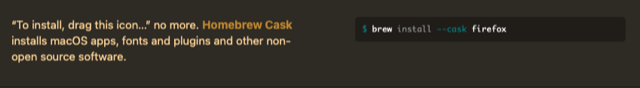

> Note: \*NOT\* the the most self explanatory name in this universe...

==&gt; It seems my "brew install --cask freecad" worked ok?

> Last login: Mon Nov 20 10:16:11 on console  
> kjell-olovhogdal@Kjell-Olovs-Mac-Pro ~ % **brew install --cask freecad**  
> Running \`brew update --auto-update\`...  
> ==&gt; **homebrew/core is old and unneeded, untapping to save space...**  
> Untapping homebrew/core...  
> Untapped 2 commands and 6630 formulae (7,044 files, 775MB).  
> ==&gt; **homebrew/cask is old and unneeded, untapping to save space...**  
> Untapping homebrew/cask...  
> Untapped 4166 casks (4,267 files, 379.8MB).  
> ==&gt; **Auto-updated Homebrew!**  
> Updated 3 taps (freecad/freecad, homebrew/core and homebrew/cask).  
> ==&gt; **New Formulae**  
> abi3audit goread python-filelock  
> action-validator gossip python-flit-core  
> aerleon gotestwaf python-gdbm@3.12  
> ain gotpm python-hatchling  
> ali gptline python-jinja  
> amass graphqlviz python-kiwisolver  
> apify-cli haiti python-lxml  
> apkleaks helidon python-mako  
> apprise hyfetch python-markupsafe  
> appstream img2pdf python-matplotlib  
> arm-none-eabi-binutils imgdiet python-mpmath  
> arm-none-eabi-gcc imgdiff python-mutagen  
> arm-none-eabi-gdb immer python-networkx  
> asitop incus python-packaging  
> asn intercept python-pathspec  
> asnmap invoice python-pluggy  
> auditwheel iocextract python-psutil  
> authz0 jprq python-pycurl  
> awscli-local jr python-pyparsing  
> badkeys json2ts python-pyproject-hooks  
> bandicoot jupyter-r python-pytz  
> bao karmadactl python-setuptools  
> bashunit katana python-setuptools-scm  
> bazel-diff kew python-sympy  
> bazel-remote killport python-tk@3.12  
> biodiff kor python-trove-classifiers  
> biome kosli-cli python@3.12  
> bkcrack lager qalculate-qt  
> blake3 ldeep raven  
> bob ldid-procursus recoverpy  
> bomber legitify redwax-tool  
> bounceback libdicom reflex  
> bozohttpd libgit2@1.6 regclient  
> build2 libimobiledevice-glue rekor-cli  
> caracal libjcat richgo  
> cargo-all-features libjuice riscv64-elf-binutils  
> cargo-auditable libmapper riscv64-elf-gcc  
> cargo-binutils libnghttp3 riscv64-elf-gdb  
> cargo-deps libpanel risor  
> cargo-docset libsail roadrunner  
> cariddi libshumate rpmspectool  
> cdi libxmlb ruler  
> cdxgen llm s3scanner  
> certgraph llvm@16 saf-cli  
> certsync lune sbom-tool  
> cf2tf lxi-tools scarb  
> cfripper mariadb@11.0 scikit-image  
> chainloop-cli massdriver scilla  
> chainsaw mediamtx scoutsuite  
> changie medusa shell2http  
> chaoskube mentat shellspec  
> checkdmarc meson-python shuffledns  
> cliam mfem sigma-cli  
> cloud-sql-proxy mgis signmykey  
> cloudfox minder sigstore  
> cloudlist mjml skate  
> cloudsplaining modsecurity sloth  
> codelimit modsurfer smlfmt  
> coder mtbl snyk-cli  
> colmap mvfst spacer  
> counts mysql-client@8.0 spglib  
> crunchy-cli mysql@8.0 sqlfmt  
> cryptopp netlistsvg sqlsmith  
> csprecon node@20 squiid  
> ctpv noir ssh-mitm  
> cyclonedx-gomod notation sshportal  
> cyclonedx-python numbat surelog  
> czkawka nvimpager tailspin  
> daktilo ollama tailwindcss  
> dcp onionprobe talhelper  
> der-ascii opentofu terraform-graph-beautifier  
> dezoomify-rs orbiton terraform-local  
> dicebear orbuculum tf-profile  
> diffoci orcania three-body  
> dnsrobocert orogene tlrc  
> dockerfile-language-server osctrl-cli toxiproxy  
> dockly oslo tpm  
> dolphie pan trafilatura  
> dovi_tool patat udp2raw-multiplatform  
> eatmemory patch-package uffizzi  
> ebook2cw pciutils uhdm  
> eza pdfalyzer uncover  
> faircamp perl-xml-parser urlfinder  
> falco phylum-cli uvicorn  
> falcoctl pmix vet  
> favirecon postgresql@16 vulkan-utility-libraries  
> feishu2md powerlevel10k vulsio-gost  
> flyscrape presenterm vunnel  
> freecad/freecad/shiboken2@5.15.11 prettierd web-ext  
> frozen proxify whisper-cpp  
> fwupd pter witness  
> geoip2fast pwned woodpecker-cli  
> ggshield pyspelling wormhole-william  
> ghc@9.4 pystring wtfis  
> ghc@9.6 python-argcomplete xeol  
> gickup python-brotli xlsxio  
> gismo python-certifi xnvme  
> git-mediate python-click yazi  
> gitea python-cryptography yder  
> gitsign python-cycler zix  
> gittuf python-dateutil zug  
> go@1.20 python-docopt  
> ==&gt; **New Casks**  
> 4k-video-downloaderplus dropbox-dash low-profile rustrover  
> affine dropshelf luniistore sf  
> aifun ecodms-client meld-studio sfm  
> akuity elektron-transfer metamer shattered-pixel-dungeon  
> apidog energiza mitmproxy simple-web-server  
> applite expo-orbit modrinth simplex  
> ava finbar monotype songkong  
> batchoutput-pdf floorp music-decoy space-capsule  
> batteryboi font-finagler mutedeck spacedrive  
> bepo fossa muyu sparkplate  
> brickstore free-podcast-transcription nvs spundle  
> browser-deputy git-credential-manager ok-json stash  
> btp gstreamer-development orka3 telegram-a  
> chainner gstreamer-runtime ovito to-audio-converter  
> cilicon hhkb ovito-pro twelite-stage  
> clibor hoppscotch paulxstretch updf  
> clickhouse hovrly pieces viso  
> clinq hp-easy-admin pieces-os voicepeak  
> clop hypercal piphero wetype  
> cloudnet iem-plugin-suite playdate-mirror wiso-steuer-2022  
> commandpost jazz2-resurrection proxy-audio-device wiso-steuer-2023  
> crystalfetch json-viewer recipeui writerside  
> deskpad jukebox replay xiaomi-cloud  
> deveco-studio keymapp reqable xsplit-vcam  
> devtunnel kreya rippling zspace  
> dockx kuaitie ripx zui  
> douyin-chat libndi rode-central  
> draw-things lm-studio routine

> You have **127** outdated formulae and **1** outdated cask installed.

> ==&gt; **Downloading <https://github.com/FreeCAD/FreeCAD/releases/download/0.21.1/FreeCAD-0.21.1-mac-intel_x86.dmg>**  
> ==&gt; **Downloading from <https://objects.githubusercontent.com/github-production-release-asset-2e65be/5736080/f1315968-3abb-426f-a8c2>**  
> ########################################################################################################################## 100.0%  
> ==&gt; **Installing Cask ****freecad**  
> ==&gt; **Moving App 'FreeCAD.app' to '/Applications/FreeCAD.app'**  
> 🍺 freecad was successfully installed!  
> kjell-olovhogdal@Kjell-Olovs-Mac-Pro ~ %

==&gt; It seems I now have FreeCad in my MacOS Launch pad ok?

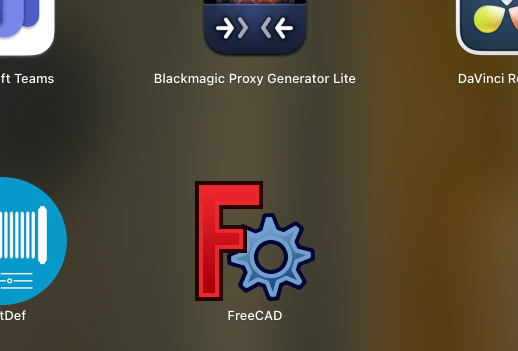

==&gt; It seems macOS accepts to launch FreeCad if I authorise it to do so?

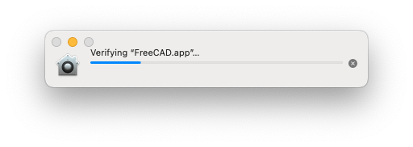

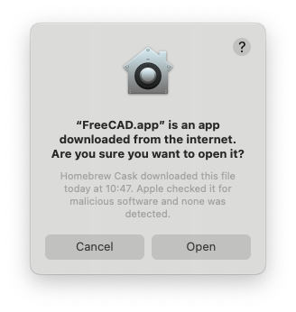

==&gt; It seems I now have FreeCad version 0.21.1?

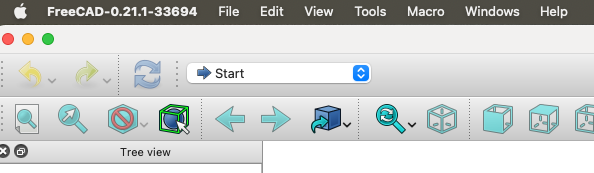

2) Consider to extract the basic steps to design for 3D printing from youtube video "Learning FreeCad with These Basic Steps" (<https://youtu.be/rglvJH9z5ng?list=LL> )?

==&gt; It seems I had to start with File / New?

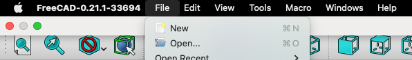

==&gt; It seems I now have two tabs "Start Page" and "Unnamed" shown at the bottom middle?

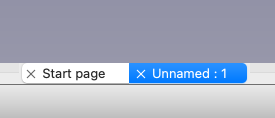

NOTE: I did NOT get the welcome pane shown in the video for version 0.20.0 (<https://youtu.be/rglvJH9z5ng?list=LL&t=188> )?

==&gt; Then the good thing to do seems to go to the "Parts" workspace (<https://youtu.be/rglvJH9z5ng?list=LL&t=202> )?

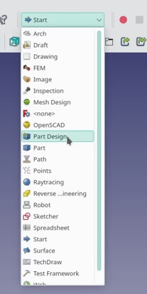

==&gt; It seems in my version 0.21.1 the dropdown is now to the upper left?

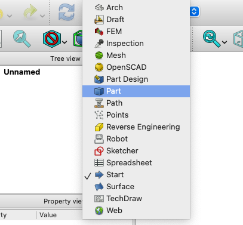

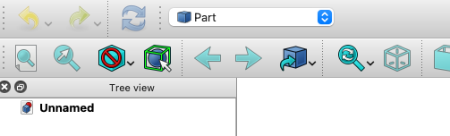

NO - Go to **Part Design !!**

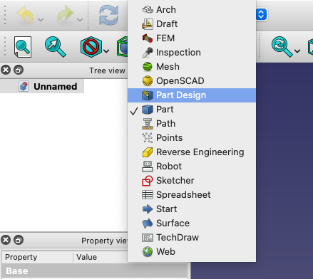

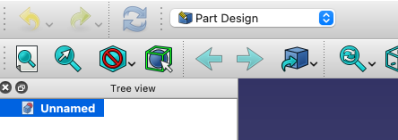

==&gt; And now it seems we should start by creating a body (<https://youtu.be/rglvJH9z5ng?list=LL&t=204> )?

==&gt; I clicked "Create body" in the left bottom pane

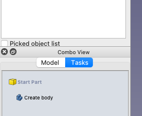

==&gt; Then I clicked "Create Sketch" in the same pane (but with change content)

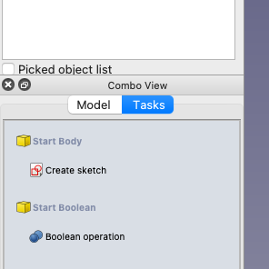

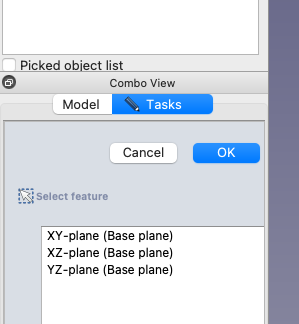

*FreeCad 0.21.1 Combo View pane for created sketch*

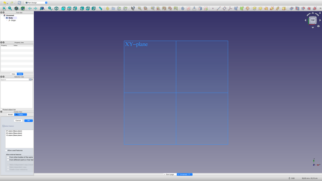

*FreeCad Window for create sketch (default view top down on the XY-plane)*

**NOTE: In FreeCad The Z-axis is up and the Y-axis is back to front (The front plane thus the x = right and z = up) **

==&gt; For my test I selected the "Front" XZ-plane to sketch my wall shelf frame (macOS left-click on the blue plane).

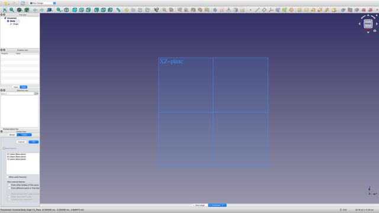

*FreeCad sketch view in "Front" orientation before clicking on the indicated blue plane*

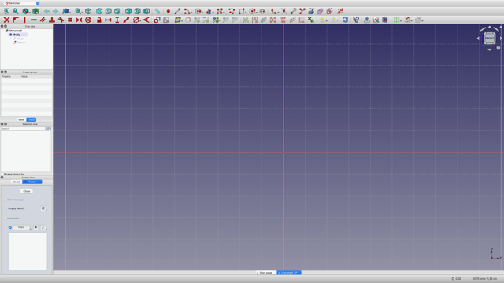

*FreeCad in Sketch-mode*

==&gt; Clicked the icon for "Crate rectangle"  and clicked once for top left and bottom right of a rectangle (**NO attention to dimensions yet**)

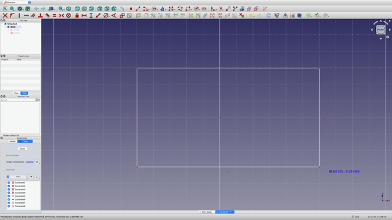

==&gt; I now clicked "Constrain Horizontal Distance"  and then the top horizontal line of the rectangle.

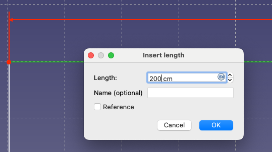

*Horizontal constraint set to 200 cm*

*==&gt; I now clicked "Constrain Vertical Distance" * and then the left horisontal side of the rectangle.

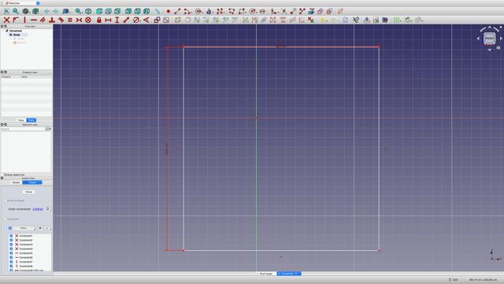

*A Height and Width constrained rectangle in FreeCad sketch*

==&gt; It seems one can close the sketch in two ways?

1) By clicking &lt;Close&gt; in the

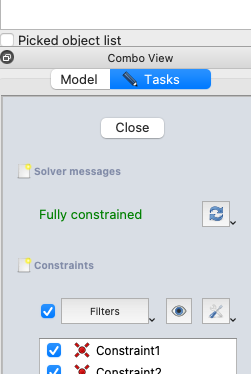

2) By clicking the "Close Sketch" icon .

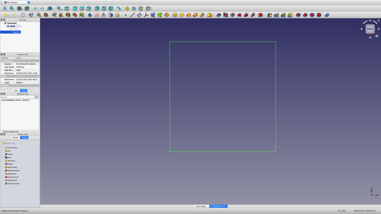

*A fully constrained rectangle in FreeCad*

==&gt; It seems to "Extrude" into a Body I need to select the &lt;Model&gt; tab and select the sketch in the tree to be able to "Pad" a 2D geometry?

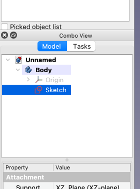

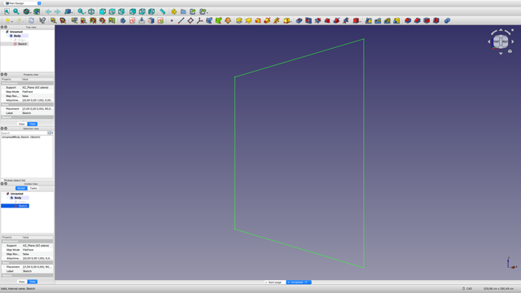

*A sketch selected in FreeCad (to be able to "pad" as in "Extrude into 3D body")*

==&gt; It seems in FreeCad you do "Pad" to extrude a whole sketch into a 3D body?

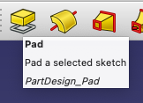

NOTE: In my macOS the view gets thrown off and the window shows only white!

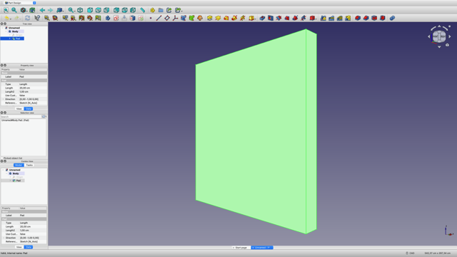

*A rectangle sketch "padded" to 20 cm (200 times 208 cm rectangle) *

...to be continued ...

...


