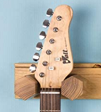
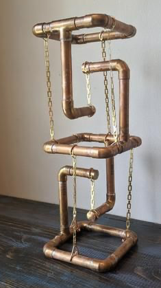
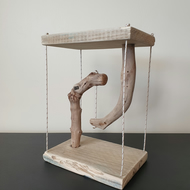

# Todo: Consider an accoustic guitar wall mount hanger designed as a "floating table" mechanism?

```#2c4cbe6b``` *As of 2021-08-14 15:50*

[mail plain/text](mail.txt)


1) Consider a guitar "fork" in wood based on two short wooden rods into a back piece?

> 

2) Consider a "floating" mount based on some "Floating table" designs?

>   
> 

> The basic idea here is to mount the "bottom" part of the floating table to the wall and the "table top" house the guitar fork.

3) Consider a nice tough is to use actual guitar strings for the floating fork design?

> The basic idea here is to use actual guitar strings to have the mount float ;)

...


