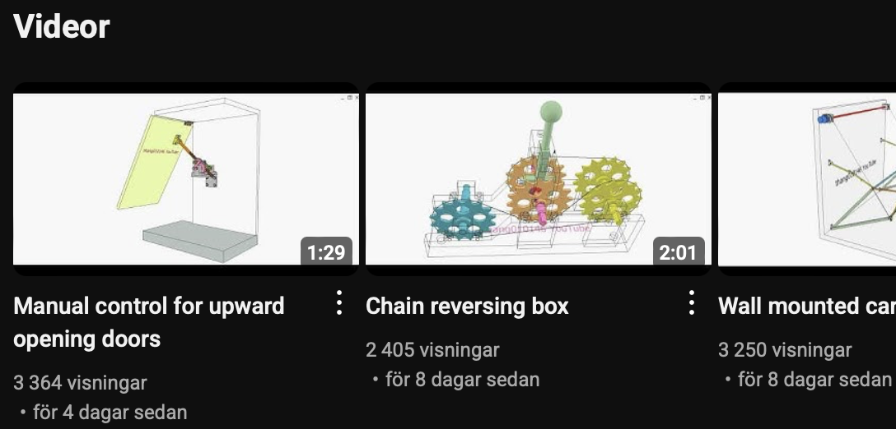
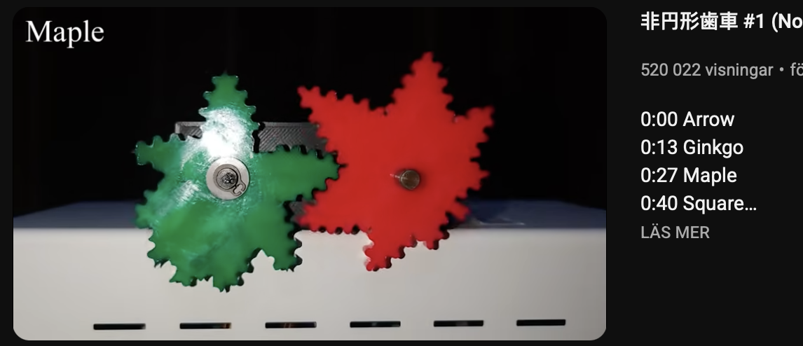

# Todo: Consider to delve into youtube video "5 Sources of Amazingly Inspirational Mechanisms! (and they're all FREE)"

```#2d50f6eb``` *As of 2025-05-08 22:11*

[mail plain/text](mail.txt)


I want to learn and use useful and interesting mechanisms.

1) Consider leads and inforamtion in youtube video "5 Sources of Amazingly Inspirational Mechanisms! (and they're all FREE)" (https://youtu.be/WgOLTtANcuU )?

> BEST SOURCES OF MECHANICAL INSPIRATION LINKED BELOW:  
> 507 Mechanical Movements - [https://archive.org/details/fivehundr...](https://www.youtube.com/redirect?event=video_description&redir_token=QUFFLUhqbkVFRWNxZUVxZU10TFJkamFGZFB2X0EtenQ1UXxBQ3Jtc0tuTXFSWEZUV2plU0VieUFyWnFIT2FCTmtCYkxqckVWVmJxdjZVazVFQXlkNVJvUmtHUUtsbC1PMFNxVlI3Rm9aSnR4S01XN3hSblRKVG9CRk9Dazc1enlNX3pJeFV2RVdMekVWSlZJd3IyYUJRUlloWQ&q=https%3A%2F%2Farchive.org%2Fdetails%2Ffivehundredseven00browiala&v=WgOLTtANcuU)  
> 507 Movements website - [https://507movements.com/](https://www.youtube.com/redirect?event=video_description&redir_token=QUFFLUhqbEQtZEM1Z21uNzNnWmNvS3hzcHJhM29DbGg0QXxBQ3Jtc0tsdndPZ1lpUFBkSkh1Y2Q2OXdnQUVyRm5SUUVUNGV4NEQyUktWdmd1RzZMYnJPU3BydHh2WWpfRjg2X1NJNmNxbnhSRUR3WUxNMnA4ZEd0M1kzSFVMOXRyN0dkWGFnR3lJbDdLdUllTnY5RWxJTHBGRQ&q=https%3A%2F%2F507movements.com%2F&v=WgOLTtANcuU)  
> The Engineers' Sketch Book - [https://archive.org/details/gri_33125...](https://www.youtube.com/redirect?event=video_description&redir_token=QUFFLUhqbXNTZDMzWFhtVnhEYUQ2aEQ0U19hRW1wSXpLZ3xBQ3Jtc0tsczl1NndtT2pFNDdfMTh2UjRiNTVDdGVkcUdGMHlFV1g4ZmJkd0dZM1RSaWkwYTl4T201YXZ2RGphTFh1SGk1cmxvVGpKS0RhX05vQ253Y3FKdm5XSGFFSFlid2R0UjFBNnlQUzNkRkNSMTd2MUkyWQ&q=https%3A%2F%2Farchive.org%2Fdetails%2Fgri_33125001402706&v=WgOLTtANcuU)  
> Mechanisms In Modern Engineering Design Vol 1 - [https://archive.org/details/Artobolev...](https://www.youtube.com/redirect?event=video_description&redir_token=QUFFLUhqblFFQW0yLXoxOU9XY1NiQTljZmdJRXRfbmJ6d3xBQ3Jtc0traF9oT0VET3l2SUVHTTdBUGpjZW5lM3JUT0R3OEdCa1VFanFQb0hvc1FpUkJaUzNZbFFfamJzMWl5Z3pDMlE2QWgtVmpBV3JPVnhROXVRMDJsZ1lBLUZFX2RIVWRWS1h0ZlYzSlpBOTA0NV9wTi03cw&q=https%3A%2F%2Farchive.org%2Fdetails%2FArtobolevskyMechanismsInModernEngineeringDesignVol1&v=WgOLTtANcuU)  
> Mechanisms In Modern Engineering Design Vol 2 1 - [https://archive.org/details/Artobolev...](https://www.youtube.com/redirect?event=video_description&redir_token=QUFFLUhqbndBdzVwdGVnMk9SNjREMWd1eUZ4Y2VuOUJhZ3xBQ3Jtc0tsRG8wZVJXV2FsQXlZX3UxZGRiZ3dhbl9VT191M2Y4bmUzY3puYUhXSTVwMlBIMi1pdkctbV9VWHFsX0NOdC1FTDFIbzczWXhJRjFBMDU3S0lQNlduTEdMeU00Z3FZem1FaDFOczJVaTdFcWpfci1uQQ&q=https%3A%2F%2Farchive.org%2Fdetails%2FArtobolevskyMechanismsInModernEngineeringDesignVol21&v=WgOLTtANcuU)  
> Mechanisms In Modern Engineering Design Vol 2 2 - [https://archive.org/details/Artobolev...](https://www.youtube.com/redirect?event=video_description&redir_token=QUFFLUhqbUJfMFlvRnlpZjFOY1c5QS0wSWZ2b180SlNQZ3xBQ3Jtc0traWU1THhHQnM3bFk5aFZzdndyR01DOWQwWEE1dExXNXR4Y3F2aS1tSzByWkdLeGVGUXJfNWJaTVBBYnduLW12R0tYYm9ZdzdGMTk4SUhDRjF0VmszLW5lUTQxZDNSR0t3ODM2RFU4bVphb00zWVNrNA&q=https%3A%2F%2Farchive.org%2Fdetails%2FArtobolevskyMechanismsInModernEngineeringDesignVol22&v=WgOLTtANcuU)  
> Mechanisms In Modern Engineering Design Vol 3 - [https://archive.org/details/Artobolev...](https://www.youtube.com/redirect?event=video_description&redir_token=QUFFLUhqbW9oa0N1TlVVdFNZbl9hUENVaXhmT01yTjZ2Z3xBQ3Jtc0trYWFZLVV4OEExdHJiYVBmNVp1UXFGSmFFamhwQzloV3lockdwX2lEOGpMbGRBeUNJdXprd2Z4Ukc3VmpqNVVzd0I4bDNMb2IxSUZHNjUxOXlodnVuVUstUHJMMVRCeWRTdFhpQUZDOU1tZlZxaGNVVQ&q=https%3A%2F%2Farchive.org%2Fdetails%2FArtobolevskyMechanismsInModernEngineeringDesignVol3&v=WgOLTtANcuU)  
> Mechanisms In Modern Engineering Design Vol 4 - [https://archive.org/details/Artobolev...](https://www.youtube.com/redirect?event=video_description&redir_token=QUFFLUhqbFVzRTJ5SmR0dm9iSml4VHdBekdvTDl2WlJtUXxBQ3Jtc0tsa1NScFNMNWhGSDlXdWJlSTYzbVhRZ0diVVNFbDQ3V0JXVUx6S0RUQktWNllNUWFheDJvLXZNOUtBSmdRSGs5MVd4eWduRWdMR2JvWWpQZkdtd0NTcGlBLVdubXcwR25xUkNoclFxYkNoMU1nNEZ0aw&q=https%3A%2F%2Farchive.org%2Fdetails%2FArtobolevskyMechanismsInModernEngineeringDesignVol4&v=WgOLTtANcuU)  
> Mechanisms In Modern Engineering Design Vol 5 1 - [https://archive.org/details/Artobolev...](https://www.youtube.com/redirect?event=video_description&redir_token=QUFFLUhqa3MwRGRRYV9qZ3B1V2N1N2V1azhNcnJOY0k1UXxBQ3Jtc0tuVnVxYWc4QWpVc1o0UUVDbjRyT0RJeEVkLURpTkJ1OXA2Wlh6MGxlSS1WWkQ3Y2NRTVAtTlBZb2FXRUFVR3JzaElfNEJKejMzaHdNSVd4NGhCd1o5RG1hTzBLNHVZaHp1Zzhtb0FoWHdRV3B2RmYzVQ&q=https%3A%2F%2Farchive.org%2Fdetails%2FArtobolevskyMechanismsInModernEngineeringDesignVol51&v=WgOLTtANcuU)  
> Mechanisms In Modern Engineering Design Vol 5 2 - [https://archive.org/details/mechanism...](https://www.youtube.com/redirect?event=video_description&redir_token=QUFFLUhqa09ZR2MyU1pwU1JGQnR0blNVUFJXUjZQS1BzZ3xBQ3Jtc0tsek9jYXdfWng3aU55TXk1Z1J5eE51NWpmTjR4RkVRcmU1TkRLTlBqMXBlVHVtN1I4MTlaOFgxdFNmNjNfb1NVN0hMeWVxZXY3aHJDVy1Edy1DNVUxbUZZb2g1RmxMQ3Y0WUNpekI4bHN4anJiMHh0NA&q=https%3A%2F%2Farchive.org%2Fdetails%2Fmechanismsinmodernengineeringdesign-artobolevsky-v5-2&v=WgOLTtANcuU)  
> thang010146 - [‪@thang010146‬](https://www.youtube.com/@thang010146)  
> S.CRAFT - [‪@SCRAFTchannel‬](https://www.youtube.com/@SCRAFTchannel)  
> Engineezy - [‪@Engineezy‬](https://www.youtube.com/@Engineezy)

2) Consider youtube channel "thang010146" (https://www.youtube.com/@thang010146 )?



3) Consider youtube channel "S.CRAFT" (https://www.youtube.com/@SCRAFTchannel )?



...


