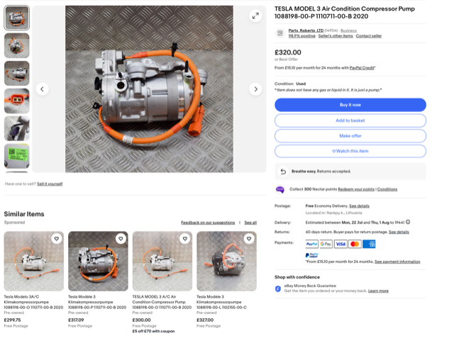
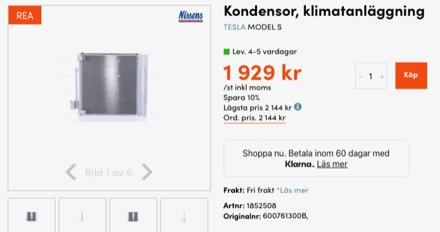
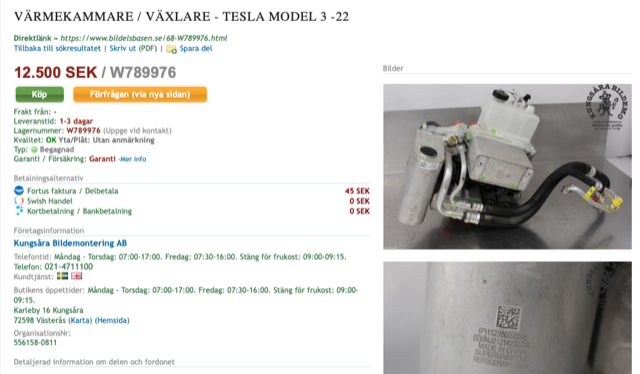
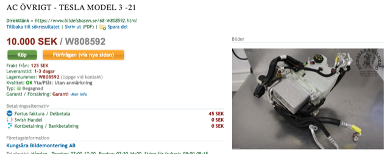
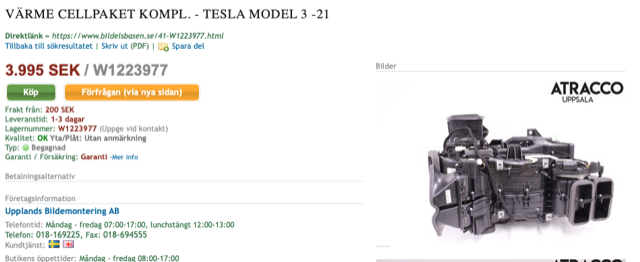
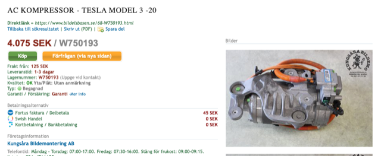

# Todo: Consider to using a Tesla heat pump in a Caravan RV build?

```#2e741259``` *As of 2024-07-13 13:11*

[mail plain/text](mail.txt)


I want a caravan that is energy efficient.

1) Consider the initial idea about using a Tesla heat pump to keep the heat inside a caravan rv?

> *So, the basic idea here is to find a small efficient heat pump that we can use to heat and keep the heat in an rv caravan.*

> *I imagine a Tesla heat pump made for a car could be a suitable choice?*

2) Consider it seems we can buy used Telsa compressor pumps on ebay for around 4000 SEK?

> 

3) Consider the parts I need to assemble a functional Tesla heat pump system?

> 

> 

> 

> 

> 

...


