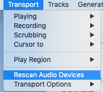
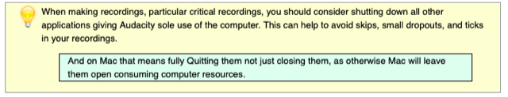
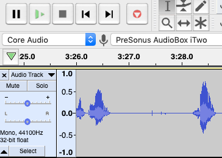
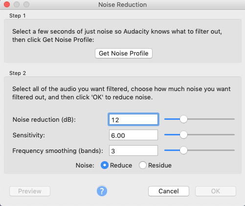
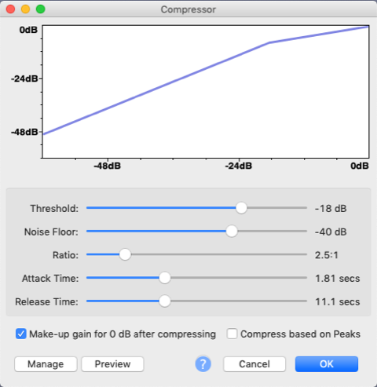
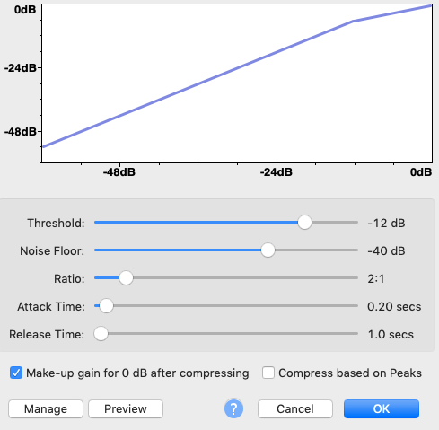
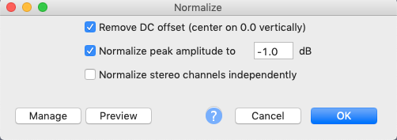
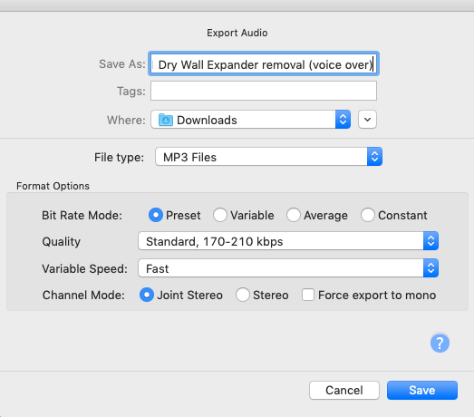
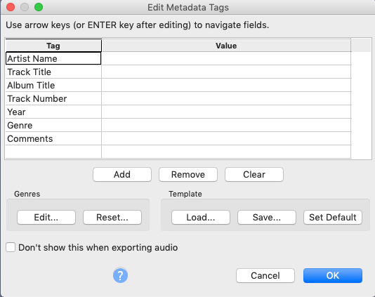

# Todo: Consider to document my experience of learning how to record voice overs using Audacity for Mac?

```#2e913613``` *As of 2019-08-26 17:33*

[mail plain/text](mail.txt)


I did not like the experience of recording voice over in FCPX so it seems to be time to try out Audacity for comparison.

==&gt; Also see "[Todo: Consider to document my installation experience of Audacity for Mac on my Mac Pro 2013?](../47c14537/chime.md)"

1) It seems Audacity comes with a help entry on recording with an USB audio interface (<https://manual.audacityteam.org/man/usb_recording.html> )?

==&gt; It seems if I connect the USB audio device AFTER I have started Audacity i need to manually make Audacity detect it?

> *" If Audacity was already running when you connected the cable, **restart** Audacity **or** choose Transport &gt; **Rescan** Audio Devices."*



*You have to &lt;Transport&gt; / &lt;Rescan Audio Device&gt; each time you reconnect an external device while Audacity is running*

Q: What is "Transport" (strange an un-intuitive UI).

==&gt; It seems there is no feed-back on the effect of "Rescan"?

==&gt; It is not immediately clear but the row of drop-down controls in the main pane is the "Device Toolbar" according to the help


*It is unclear what the first "Core Audio" means in the "Device Toolbar" but my Presonus AudioBox iTwo shows up in the second drop down*

==&gt; I took a chance and configured for mono recording as I am going to record my voice


*My mono-recording configuration for microphone voice over recording*

NOTE: It may be that I should use stereo-recording to have my mono-microphone input register onto a stereo track right away?

==&gt; It seems there is a help entry on making audio recordings (<https://manual.audacityteam.org/man/record.html> )?

==&gt; It seems Audacity strongly recommends to shut all other applications off to avoid skips, drop-outs or ticks?



2) It seems actually making a recording is easy enough?

==&gt; I made a recording by just hitting the red record button and stop with the space bar.



*The Audacity recording interface with a RED "start-recording" button and easily recognisable stop and pause buttons*

==&gt; It seems if I made a misstake in the recording I could just mouse-drag-mark the end ot the recording and hit delete to get rid of it?

==&gt; It also seemed recording will always start at the cursor so after having deleted an erroneous recording part I could just pick up where I ended?

3) It seems there is a coomonly known process to have Audacity improve voice over recordings (<https://www.instructables.com/id/How-to-Improve-Vocal-Quality-in-Audacity/> )?

1) Apply noise reduction in two steps

> *"Highlight the blank audio...click Effect: Noise Reduction: Get Noise Profile"*

> *"**highlight the rest of the audio and press Effect: Repeat Noise Reduction**"*

**NOTE: It seems to now work because the &lt;OK&gt; button is greyed out and when you click &lt;get Noise Profile&gt; nothing happens (but all is in fact ok)**



*Nothing seems to happen when you click &lt;get Noise Profile&gt; but that is how the Audacity user interface behaves*

*NOTE: It seems on macOS you can click Cmd+A to select all the audio to have noise reduction applied to.*

2) Apply compression

> *"Click on Effects: Compressor"*

> *"Threshold = -18db **Noise Floor = -40db **Ratio = 2.5:1 **Attack Time = 1.81 secs **Release Time = 11.1 secs**"*

> 

> *Recommended compression for narrative recording*

> 

> *The default compressor settings in Audacity &lt;Effect&gt; / &lt;Compressor&gt; dialog*

3) Bass & Treble "boost" in two steps

> *"Go to Effects: Equalisation, select 'Bass Boost' from the dropdown ... Leave the setting as 9db"*

> *"**Repeat this step again, but this time select 'Treble Boost' from the dropdown menu.**"*

4) Apply a limiter

> *"**Go to Effects: Limiter: select Hard Limiter from the dropdown menu ... leave the maximum db rating as 3.00db**"*

5) Apply Normalisation

> *"**Go to Effects: Normalise: leave it as default.**"*

>   
> *Audacity default settings for &lt;Effects&gt; / &lt;Normalise&gt;*

7) Optionally remove blank audio with the built in &lt;Effects&gt; / &lt;Truncate Silence&gt;

8) Export Audio as "Joint Stereo" mp3 file (default settings)

> 

> 

...


