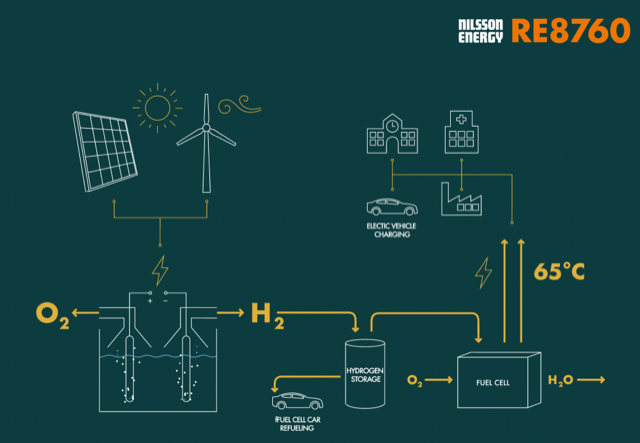

# Todo: House Build - Consider to use the Hydrogen energy storage system RE8760 developed by "Nilsson Energy AB"?

```#2efef0d7``` *As of 2020-01-08 19:59*

[mail plain/text](mail.txt)


Maybe I can actually buy a complete hydrogen energy storage system from Nilsson Energy AB?

==&gt; Also see "[Todo: Consider what energy storage and retrieval efficiency we can expect from hydrogen production, high pressure storage and fuel cell electrical generation?](../4eed46ad/chime.md)

==&gt; Also see "[Todo: House Build - Consider to find options to generate electricity from burning wood e.g., using a string engine driven generator?](../bff71726/chime.md)"

1) It seems Nilsson Energy AB sells a system called RE8760 (<https://nilssonenergy.com/products/> )?

==&gt; Consider to contact Nilsson Energy AB about their hydrogen storage solution they call RE8760?

> More on [RE8760](https://nilssonenergy.com/products/)  
> Mail: [re8760@nilssonenergy.com](mailto:re8760@nilssonenergy.com)  
> Office: Stålhögavägen 12, Grevie, Sweden  
> Postal address: Nilsson Energy AB, Box 1057, 262 21 Ängelholm, Sweden

> *"Renewable Energy solutions for all the 8760 hours that make out a year. As simple as that!"*

>   
> *The Nilsson Energy AB hydrogen storage system RE8760 seems to be exactly what I would like to use for my house?*

2) Consider to listen to the program "klotet" on Swedish Radio P1 "Solel från sommaren hela vintern" about a pilot project with hydrogen energy storage using Nilsson Energy AB solution in a house in Skellefteå (<https://sverigesradio.se/avsnitt/1421896> )?

...

...


