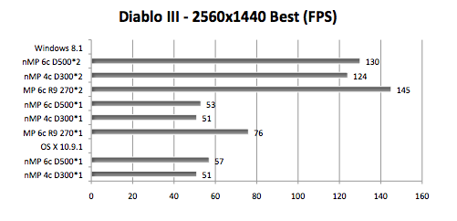

# Todo: Consider the number one limit of a processing unit speed is the in and out data (memory) bandwidth?

```#2f3c8124``` *As of 2019-03-07 15:41*

[mail plain/text](mail.txt)


Watching a video on GPU programming and architecture I was told that the absolute upper limit of processing speed in the data bandwidth to and from the processing unit!

1) The video I watched "An Intro to GPU Architecture and Programming Models I Tim Warburton, Virginia Tech" seems to live here (<https://www.youtube.com/watch?v=lGmPy8xpT4E&t=600s> )?

==&gt; He seems to argue that the upper limit of processing speed is always the in and out data bandwidth of the processing unit to its data storage (memory) (<https://youtu.be/lGmPy8xpT4E?t=704> )?


2) Consider the CPU memory bandwidth of my Mac Pro vs some more contemporary Apple computers?

==&gt; Consider the 6 core E5-1650 v2 memory bandwidth is 59.7 GB/s (<https://ark.intel.com/content/www/us/en/ark/products/75780/intel-xeon-processor-e5-1650-v2-12m-cache-3-50-ghz.html> )

==&gt; Consider 6 core Xeon W-2145 (iMac Pro) memory bandwidth is 85.3 (<https://ark.intel.com/content/www/us/en/ark/products/126707/intel-xeon-w-2145-processor-11m-cache-3-70-ghz.html> )?

I.e., 1 : 1.43 relative the Xeon E5 in Mac Pro 2013?

==&gt; Consider the a c t u a l memory bandwidth depends on the whole system (<https://macperformanceguide.com/autoTopic.html?dglyKW=bandwidth> )?

==&gt; It seems tested memory bandwidth of Mac Pro 2013 is ?? (I could find no practical measurements bu the peak bandwidth is 59.7 GB/s)

==&gt; It seems tested memory bandwidth of Mac Mini 2018 is 22.2 GB / s (<https://macperformanceguide.com/MacMini2018-MemoryBandwidth.html> )?

==&gt; It seems tested memory bandwidth of iMac Pro is 53 GB / s (<https://macperformanceguide.com/iMacPro_2017-Scalability.html> )?

3) Consider the GPU memory bandwidth of Mac Pro 2013 possibly compared with more contemporary computers?

==&gt; Consider this chart over the D300, D500 and D700 GPUs (<https://www.anandtech.com/show/7603/mac-pro-review-late-2013/9> )

Mac Pro (Late 2013) GPU Options AMD FirePro D300AMD FirePro D500AMD FirePro D700SPs128015362048GPU Clock (base)800MHz650MHz650MHzGPU Clock (boost)850MHz725MHz850MHzSingle Precision GFLOPS2176 GFLOPS2227 GFLOPS3481 GFLOPSDouble Precision GFLOPS136 GFLOPS556.8 GFLOPS870.4 GFLOPSTexture Units8096128ROPs323232Transistor Count2.8 Billion4.3 Billion4.3 BillionMemory Interface256-bit GDDR5384-bit GDDR5384-bit GDDR5Memory Datarate5080MHz5080MHz5480MHzPeak GPU Memory Bandwidth160 GB/s240 GB/s264 GB/sGPU Memory2GB3GB6GB


==&gt; It seems on Mac Pro 2013 AMD Crossfire X support available by Apple Bootcamp windows drivers?

> "With two GPUs standard in every Mac Pro configuration, there’s obviously OS support for the configuration. Under Windows, that amounts to basic CrossFire X support. Apple’s Boot Camp drivers ship with CFX support"

> "Under OS X the situation is a bit more complicated. There is no system-wide CrossFire X equivalent that will automatically split up rendering tasks across both GPUs. By default, one GPU is setup for display duties while the other is used exclusively for GPU compute workloads."

> "Due to the nature of the default GPU division under OS X, all games by default will only use a single GPU. It is up to the game developer to recognize and split rendering across both GPUs, which no one is doing at present. Unfortunately firing up two instances of a 3D workload won’t load balance across the two GPUs by default. "

> "The same is true for professional applications. By default you will see only one GPU used for compute workloads. Just like the gaming example however, applications may be written to spread compute workloads out across both GPUs if they need the horsepower. The latest update to Final Cut Pro (10.1) is one example of an app that has been specifically written to take advantage of both GPUs in compute tasks."

==&gt; It seems the mac Pro 2013 graphics cards are physically connected for ADM Crossfire X, but for some reason it is available only to Windows when booted trough Bootcamp (<http://barefeats.com/tube07.html> )?

> "Did you know that if you boot Windows on your 2013 Mac Pro, you can run the dual GPUs in CrossFire mode? The OWC Lab ran some tests for us on a two new Mac Pros running Windows 8.1."

==&gt; It seems in test under Windows games benefits substantially in fps in Crossfire mode?



<http://barefeats.com/images14/tube07_dia.png>

==&gt; It seems 6 core D500 "Crossfired" is 1 : 2.5 relative single D500 gaming (53 : 130)

==&gt; Consider this applies to the D500 "knowing" how to execute one card as "slave" and render directly to the display?

> "  
> GRAPH LEGEND

> nMP 6c D500\*2 = 2013 Mac Pro 6-core with dual FirePro D500s "CrossFired"  
> nMP 4c D300\*2 = 2013 Mac Pro 4-core with dual FirePro D300s "CrossFired"  
> MP 6c R9 270\*2 = 2010 Mac Pro 6-core with dual ASUS R9 270s "CrossFired"

> nMP 6c D500\*1 = 2013 Mac Pro 6-core with dual FirePro D500s "UN-CrossFired"  
> nMP 4c D300\*1 = 2013 Mac Pro 4-core with dual FirePro D300s "UN-CrossFired"  
> MP 6c R9 270\*1 = 2010 Mac Pro 6-core with dual ASUS R9 270s "UN-CrossFired"  
> "

==&gt; Consider wikipedia on ADM Crossfire technology (<https://en.wikipedia.org/wiki/AMD_CrossFireX> )?

==&gt; It is not clear if the D700 Tahiti architecture uses p2p PCIe "Crossfire" (XDMA) or if they route some physical connection?

...

...


