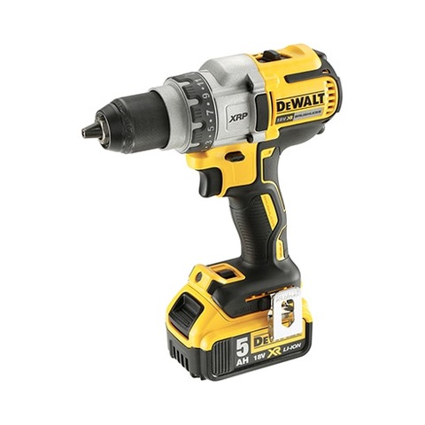
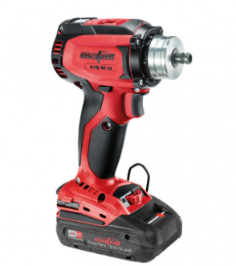
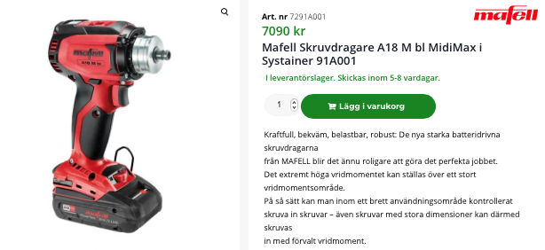
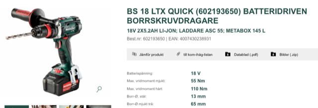
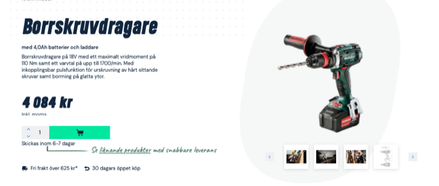
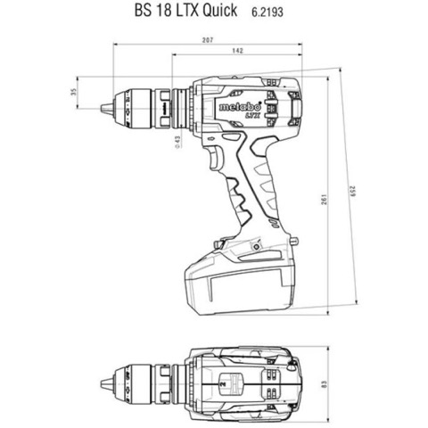

# Todo: Consider a cordless drill with a Euronorm 43 mm collar to be mountable in drilling stands (and other accessories)?

```#303344eb``` *As of 2021-07-28 16:12*

[mail plain/text](mail.txt)


==&gt; Also see "[Todo: Consider to design a "Makers Search Engine" that can scrub the web for CAD files and provide search on measurements and physical properties (mechanical function)?](../b32f00c9/chime.md)"

1) Consider the Dewalt has models with 43 mm collars (<https://www.dewalt.se/powertools/productdetails/catno/DCD991P2/> )?

==&gt; The mount for the handle may be a standard 43 mm collar???



  
> Is the collar on the Dewalt DCD991 an Euronorm 43 mm collar?

> NOTE: Now it would be nice to have the makers Search Engine to find out what drill drivers that has a 43 mm collar?

1) Consider the Mafell 18V drill driver (<https://produkte.mafell.de/en/drilling/cordless-drill-drivers/cordless-drill-driver-a-18-m-bl> )?

> 

> "

> ***Collar diameter 43 mm**  
> Chuck capacity 13 mm  
> Max. drilling diameter in wood / steel 50 / 13 mm  
> Torque soft / hard 44 / 90 Nm  
> Impulse torque (soft) 49 Nm  
> 1st speed range 0 - 600 1/min  
> 2nd speed range 0 - 2050 1/min  
> Weight (including battery 1,7 kg  
> Nominal voltage 18 V  
> Torque settings 11*  
> "

==&gt; It seems I can buy the Mafell 18V Drill driver from Swedish web shop for 7100 SEK (<https://3abyggdelen.se/produkt/mafell-skruvdragare-a18-m-bl-midimax-i-systainer-91a001/> )?

>   
> Mafell 18V drill driver with two batteries, charger and sustainer for 7100 SEK.

> "  
> Leveransomfattning Midi  
> 1 Borrchuck för snabbyte A-SBF 13 206772  
> 1 Bithållare för snabbyte A-SBH 206766  
> 1 Laddare PowerStation APS 18 M; Ref. No. 094492  
> 2 Batteri 18 M 72 LiHD; Ref. No. 094500  
> 1 Bältesklämma  
> 1 Extra handtag  
> 1 Bit PZ 2  
> "

2) Consider the Metabo 18V drill driver (<https://www.metabo.com/se/sv/maskiner/batteridrivna-apparater/batteridriven-borrskruvdragare/bs-18-ltx-quick-602193650-batteridriven-borrskruvdragare.html> )?

>   
> Metabo 18V drill driver with Euronorm 43 mm collar (quick mount system)

> Q: Is this basically the same drill as the Mafell (they take the same battery and are owned by the same cooperation)?

==&gt; It seems I can buy the Metabo 18V drill driver for 5300 SEK (<https://www.proffsmagasinet.se/maskiner-verktyg/batteridrivna-verktyg/skruvdragare/metabo-bs-18-ltx-bl-q-i-borrskruvdragare-med-55ah-batterier-och-laddare-1110915?channable=00a9e8736b750031313130393135ca&VAT=1&gclid=CjwKCAjwgISIBhBfEiwALE19SbivxfJV2jkQG-5GrvsrfLexrzwZWnfIn9Df4I5DIcNdzzVzRL4UEhoCENEQAvD_BwE> )?

>   
> Metabo 18V drill driver with two 4.0 Ah batteries, charger and sustainer for 4000 SEK

>   
> Metabo BS 18 LTX Quick with Euronorm 43 mm collar

...


