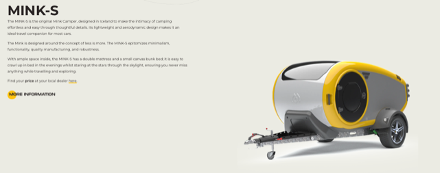
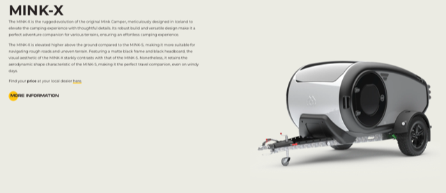
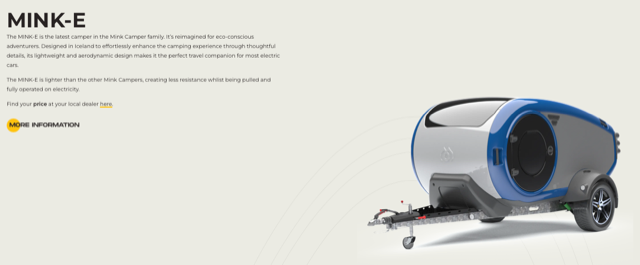
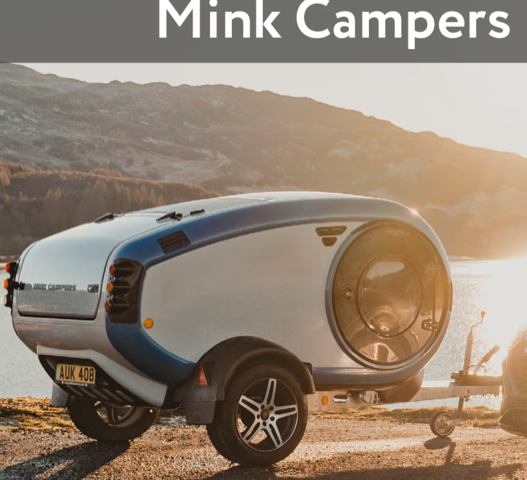
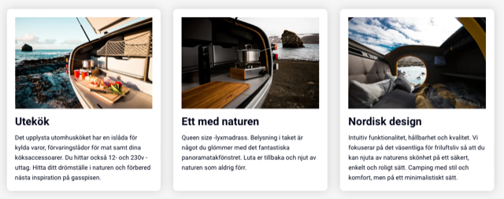
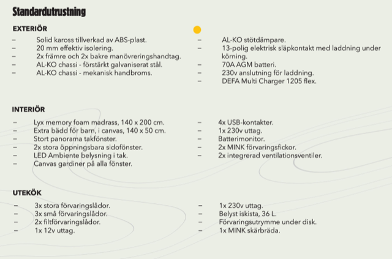
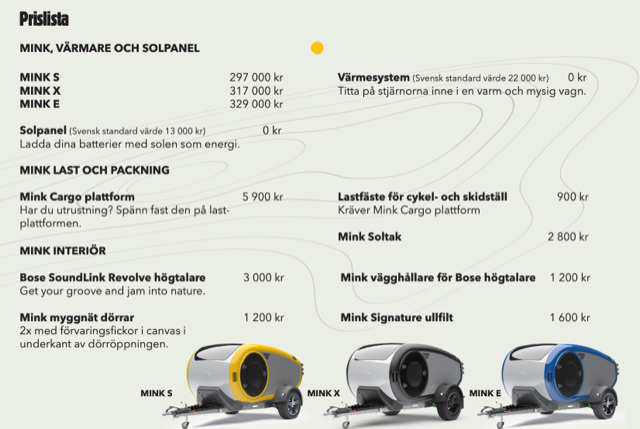

# Todo: Consider the Island developed and produced  "Mink Campers" that are a bed and kitchen on wheels?

```#30956a7b``` *As of 2024-07-17 08:34*

[mail plain/text](mail.txt)


I need a movable home while travelling Sweden for a place to settle down.

1) This seems to be the Mink Campers web site (<https://www.minkcampers.com> )?







2) It seems Mink Campers are sold and rented out by XCamp in Mora (<https://www.xmore.se> )?

==&gt; It seems XCamp both sell and rents out models of the Mink Camper (<https://www.xmore.se/mink-camper/> )?










...


