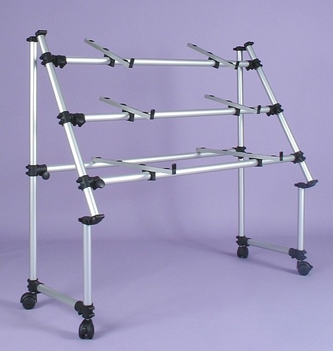
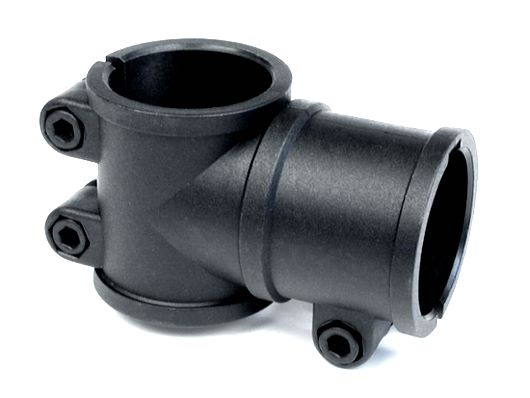
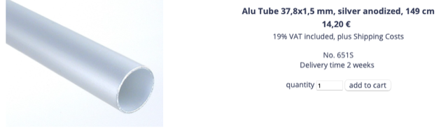
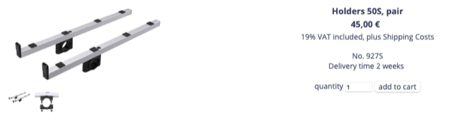
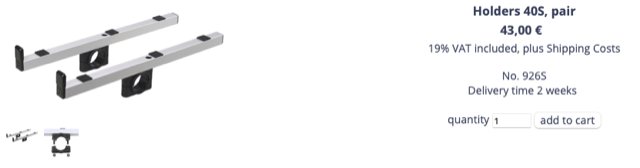
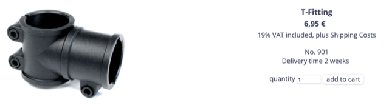
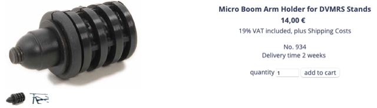
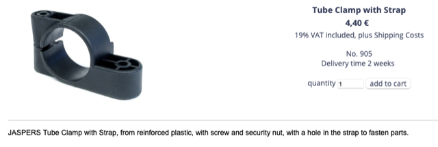
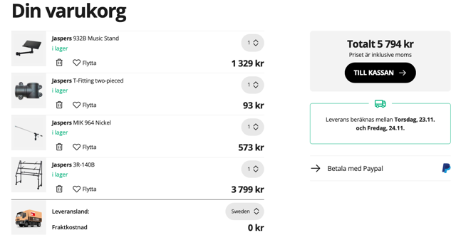

# Todo: Consider Jaspers keyboard stand system for my custom built 3 synthesiser home studio?

```#313b20e5``` *As of 2023-11-21 11:42*

[mail plain/text](mail.txt)


I want to finally have all my music equipment including my three synthesizers up-and-running.

1) Consider the Jasper system EU-shop (<https://www.jaspers-alu.de/index.php> )?

==&gt; Consider parts for a japsers keyboard stand stand-alone solution?

>   
> [*https://www.jaspers-alu.de/aid-258-Keyboard-Stand-3R-140S-JASPERS-Keyboardst-auml-nder-aus-silberfarben-eloxiertem-Aluminium-f-uuml-r-3-Keyboards.html](https://www.jaspers-alu.de/aid-258-Keyboard-Stand-3R-140S-JASPERS-Keyboardst-auml-nder-aus-silberfarben-eloxiertem-Aluminium-f-uuml-r-3-Keyboards.html) *

>   
> <https://www.jaspers-alu.de/aid-561-Micro-Boom-Arm-Holder-for-DVMRS-Stands.html>

>   
> <https://www.jaspers-alu.de/aid-741-T-Fitting.html>

==&gt; Consider jaspers system parts to build some custom solution and attach to my studio wall frame?

> 

>   
> <https://www.jaspers-alu.de/aid-25-Holders-50S-pair.html>

>   
> <https://www.jaspers-alu.de/aid-33-Holders-40S-pair.html>

>   
> <https://www.jaspers-alu.de/aid-741-T-Fitting.html>

>   
> <https://www.jaspers-alu.de/aid-561-Micro-Boom-Arm-Holder-for-DVMRS-Stands.html>

>   
> <https://www.jaspers-alu.de/aid-761-Tube-Clamp-with-Strap.html>

> ...and so on ;) ...

2) Consider to order Jaspers parts through Thoman Swedish shop (<https://www.thomann.de/se/search_dir.html?sw=Jaspers&smcs=a3fcac_4431> )?



...


