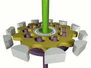
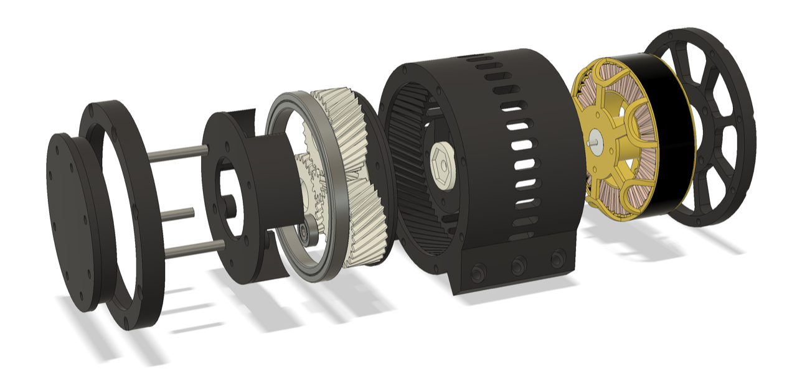

# Todo: Consider to understand high torque and speed robotic leg actuator designs and available DIY build options (e.g., cycloidal drives and the OpenTorque actuator designs)?

```#3187c1e1``` *As of 2019-05-15 09:53*

[mail plain/text](mail.txt)


What robotic leg actuator designs are there and how can we build and use them fro interesting drive projects?

==&gt; Also see "[Todo: Power Feeder - Consider to use a cycloidal gear box and multicopter brushless motor as for high torque robotic actuators to drive wood through a table saw?](../cc8427d2/chime.md)"

1) Consider the wikipedia article on the Cycloidal Drive (<https://en.wikipedia.org/wiki/Cycloidal_drive> )?

> *"**A cycloidal drive or cycloidal speed reducer is a mechanism for reducing the speed of an input shaft by a certain ratio. Cycloidal speed reducers are capable of relatively high ratios in compact sizes. &#91;1&#93;**"*



*The Cycloidal Drive (<https://upload.wikimedia.org/wikipedia/commons/thumb/7/7b/Cycloidal_drive.gif/180px-Cycloidal_drive.gif> )*

2) Consider the youtube video "3D Printed Robot Actuator Finals HaD Prize 2018" (<https://www.youtube.com/watch?v=bK0LCcXq9nA> )?


*3D printed parts of a Dual Cycloid disk based gearbox for a robotic actuator*

==&gt; Consider to delve into the AS5147 Absolute Magnetic Encoders?


*The HaD Prize 2018 Finals 3D Printed Robot Actuator uses AS5147 magnetic encoders*

==&gt; Consider to check out if he cam around to make an Arduino based brushless motor controller for his actuator (possibly of interest in my own projects)?


*Design idea for an Arduino based brushless motor controller for the HaD Prize 2018 Finals 3D Printed Robot Actuator*

==&gt; Consider this youtube video showing the parts and the assembly of the cycloidal drive actuator (<https://www.youtube.com/watch?v=WwEuJozJMuc&feature=youtu.be> )?

> *"**This is an Assembly, Testing and Future design video.The Actuator is fully open source and the Mechanical design, Electronics and Software has been published online. It is about giving back to the maker community that I love. It is also part of my 2018 Hackaday Prize Entry for the Robotics Module Challenge.**"*


*Parts of the 3D printed cycloidal drive robotic leg actuator*


*3D printed cycloidal drive robotic leg actuator uses 5008 Multistar Elite brushless motor*

==&gt; Consider Hobbyking €54 Multistar Elite 5008-330KV Multi-Rotor Motor (<https://hobbyking.com/en_us/multistar-elite-5008-330kv-multi-rotor-motor.html?___store=en_us> )?

==&gt; Consider this hackaday article "3D Printed Robot Actuator" (<https://hackaday.io/project/157812-3d-printed-robot-actuator> )?

==&gt; It seems this cycloidal drive (and robotic leg) lives here on thingiverse (<https://www.thingiverse.com/thing:3167952> )?

3) Consider the OpenTorque actuator designed by Gabriel T Levine (<https://www.gabrael.io/new-page> )?

==&gt; The OpenTorque actuator design seems to live here at Github (<https://github.com/G-Levine/OpenTorque-Actuator> )?



The OpenTorque actuator design (<https://github.com/G-Levine/OpenTorque-Actuator/raw/master/images/exploded_view.png>)

==&gt; Consider the hackaday article "OpenTorque Actuator. A powerful, compliant actuator for legged robotics" (<https://hackaday.io/project/159404-opentorque-actuator> )?

==&gt; Consider this youtube video "OpenTorque Actuator (developed by Gabrael Levine)" (<https://www.youtube.com/watch?v=Hd54ik_45Wo> )?

*AS5147 magnetic encoders?*

*Arduino based brushless motor controller for the HaD Prize 2018 Finals 3D Printed Robot Actuator?*

...


