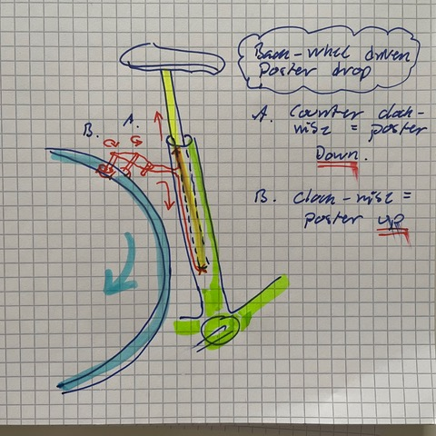

# Todo: Consider a back-wheel mechanical driven Mountain bicycle dropper post?

```#31b9a6f9``` *As of 2021-08-10 12:54*

[mail plain/text](mail.txt)


I want to shed weight and need for maintenance on my bike but maybe I still want a dropper post for my cross country MTB?

1) Consider to design and try out a mechanically friction driven dropper post that takes energy from the back wheel?

> 

> *The basic idea here is to raise and lower the dropper post mechanically with a wire driven by two frictions wheels A and B. *

> *By pressing wheel A to the rim it will rotate counter clock-wise and pull the wire down. The post being attached to the wire will then be pulled down.*

> *And likewise, by pressing wheel B to the rim it will rotate clockwise and thus pull the wire up and consequently pull the post up again.*

> *Now, we need to add a mechanism to place wheels A and B in neutral, A engaged or B engaged to operate the drop and lift the Post.*

> *We also need a way to lock the post in position when stationary.*

> *And thirdly we may need to add either a semi-automated lift/drop end-and-lock mechanism. Or have a slip mechanism the disengages the drop or lift when the post reaches its end position. The latter means the operator presses some leaver to engage wheel A and B and let it drop or lift the post until it starts slipping when the post reaches its end position. Then releasing the drop or lift leaver will lock the post in a stationary position.*

> *NOTE: We would like a design goal top be this mechanism to be lower weight than a pneumatic dropper post?*

2) Consider using Igus light weight and low maintenance (no lubrication) composite bushings for the dropper post tube slide mechanism?

TBD.

3) Consider what off the shelf leaver I can use to operate the engagement of wheel A or B?

...


