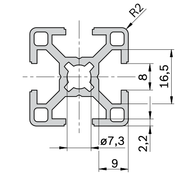

# Todo: Consider the "Bosch Rexroth Silver Aluminium Strut, 30 x 30 mm, 8mm Groove , 2000mm Length" as T-track (T-slot) fastener for my compact living sliding workspace wall?

```#32fc493f``` *As of 2022-07-06 00:16*

[mail plain/text](mail.txt)


I want some standard way to fasten tools, gigs and "stuff" to my compact living sliding workspace wall.

==&gt; Also see "[Todo: Consider what aluminium profiles and T-tracks that fits Festool "standard" clamps (for DIY workbench builds)?](../cd4a0f49/chime.md)"

1) Consider the 30x30 mm 8mm T-slot extruded aluminium profile from Bosch Rexroth as sold by RS-online (<https://se.rs-online.com/web/p/products/2123296/> )?


NOTE: It seems I have confirmed that my Festool quick clamp fits this 8mm T-slot?

==&gt; Consider the datasheet ()?



> *It seems we can determine that the throat is 8mm OK. And the depth of the "belly" is 9mm - 2,2mm = 6,8 mm? In that case this is sufficient for the 6 mm requirement of the Festool clamp. But the width of the "belly" at the bottom seems to narrow? We need 12 mm, but from the looks of it the bottom is not much more than the 8mm of the throat?*

> *So, the Festool clamp will **PROBABLY NOT FIT** in this 30x30 Rexrooth profile?*

==&gt; Consider the Datasheet (<https://docs.rs-online.com/51f9/A700000007302216.pdf> )?

...


