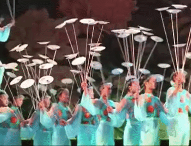
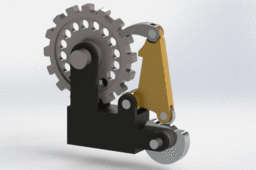
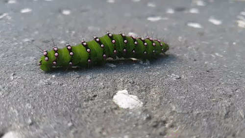

# Todo: Consider "Spinning Plates", "Ratchet Progressing" and "Caterpillar Task Planning" can serve as metaphors to execute day-to-day life?

```#332ca86f``` *As of 2020-07-22 14:47*

[mail plain/text](mail.txt)


I get these metaphors into my head when I think about how to conduct tasks in my life and maybe these three serves as a good base?

1) Consider the "Spinning Plates" metaphor for ensuring all I need to attend to to not let anything important "die"?

>   
> *Keep the important "plates" in your life "spinning"...*

2) Consider the "Ratchet Progressing" metaphor to end work where it can "rest" and be picked up the next time without loosing spent planning and brain resources?

==&gt; Consider this article on the "Ratchet Philosophy" (<https://www.hvacrschool.com/how-to-grow-using-the-progress-ratchet/> )?

> *"**With a ratchet, you don’t lose ground even when you change direction*

> *This means you can keep working away at a problem even though half the time it seems like you are moving in the wrong direction, the ratchet only turns in the direction of progress even when you are turning it the opposite way and it DOESN’T LOSE GROUND.

> You may have caught on but the ratchet is a metaphor for my grandpa’s life and the lives and careers of most successful people. You make progress forward for a time in one direction and then face a setback… when your life is a ratchet you don’t lose ground, you just get prepared for the next push forward.**"*

>   
> *End work so it can "rest" until the next time you return to it ...*

3) Consider the "Caterpillar Task Planning" metaphor to focus on iterating tasks for progress and tasks for "keeping up" while consuming the time I have to live?

==&gt; Consider this youtube video "How Caterpillars Crawl - Extreme Close Up" showng caterpillar locomotion (<https://www.youtube.com/watch?v=vm4EgwOjzNY> )?

>   
> *Move through life by steps of progress and steps of "bring along" what you already have...*

...


