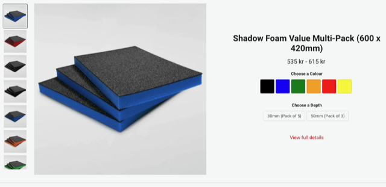
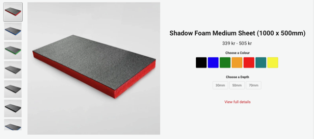
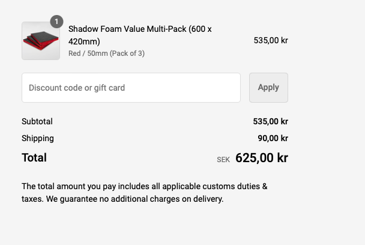

# Todo: Consider the UK brand "shadow foam" for cuttable foam inserts to hold tools and "stuff" in organisation boxes and drawers?

```#342f8390``` *As of 2024-04-15 13:49*

[mail plain/text](mail.txt)


I may need to use foam to hold tools and things I have to keep them organised and easily accessible?

1) Consider foam from UK brand "shadow foam" (<https://shadowfoam.com/pages/standard-sheets> )?





2) It seems shipment to Sweden is around 100 SEK for 3x 600x420 sheets 50 mm thick?



...


