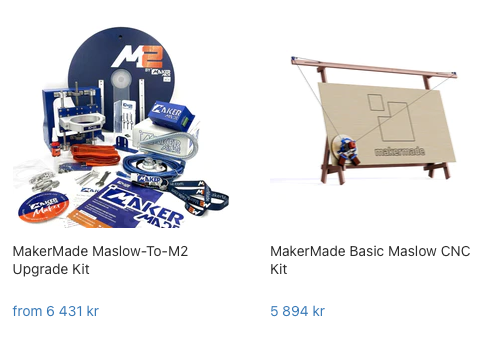
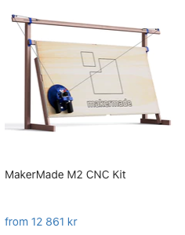

# Todo: Consider to check out and possibly buy and try the original or upgraded M2 Maslow vertical CNC router?

```#34607bde``` *As of 2022-07-12 15:50*

[mail plain/text](mail.txt)


I want to mount a vertical wood working CNC on my slide-out workbench wall in my hallway.

==&gt; Also see "[Todo: Consider the "best" way to buy a Mafell Milling motor FM 1000 PV-WS (1000W with PV control and quick tool changer)?](../22cf1801/chime.md)"

==&gt; Also see "[Todo: Consider an Ooznest Workbee CNC with a Mafell milling motor?](../b0d4214c/chime.md)"

-1) Consider the bottom line of what I think of this CNC router?

> *Consider to investigate of I can use the M2 model with the Mafell Milling motor FM 1000 PV-WS? I mean, what is the best way to mount the Mafell to the Makemade Maslow M2 Z-axis?*

1) Consider youtube video "MakerMade Maslow CNC M2 Machine - Unbox, Build, Review and first cuts 2020" (<https://youtu.be/8e0tILeGOzQ> )?

2) This seems to be the home on the web of makermade that produce and ship the Maslow vertical CNC (<https://makermade.com> )?

3) Consider the original Maslow vertical CN (<https://makermade.com/collections/frontpage/products/basic-maslow-cnc-kit> )?

4) Consider the original plus the upgrade to Makermade Maslow M2 for 12325 SEK (<https://makermade.com/collections/frontpage/products/maslow-to-m2-upgrade-cnc-kit> )?




5) Consider to go for the \*new\* Makemade M2 directly (<https://makermade.com/collections/all/products/2021-m2-cnc-kit> )?



...


