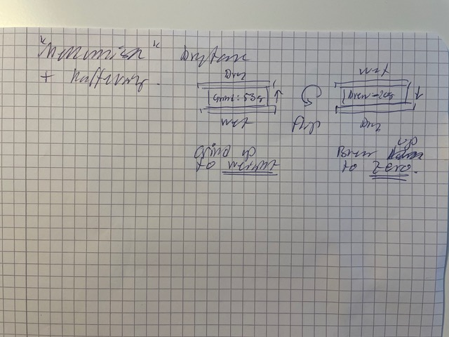

# Todo: Consider a coffee scale that weighs "dry" in one orientation and wights "wet" when flipped around?

```#3564b62c``` *As of 2021-03-28 13:30*

[mail plain/text](mail.txt)




> *The basic idea here is that to brew an espresso you first grind coffee onto the scale until it shows "zero".*

> *Then you flip it around and brew coffee onto the scale until it shows zero again.*

> *In pass one the scale measures the required amount of grind coffee.*

> *In pass two it measures the required amount of water to brew the "correct" espresso.*

> *The functionality of the scale is that the only thing the user needs to do is flip the scale from pass one to pass two :)*

> *Additionally the scale can be configured for different dry-wet ratios :)*

> *Option: Consider to have the scale show the required water amount while grinding coffee onto it in the "dry" phase. In this way the user does not need to hit an exact weight but can aim for the size of the final espresso while still be very precise. As long as the brewer head can hold the coffee and the required amount of water does not exceed the capability of the brewer all is fine :)*


