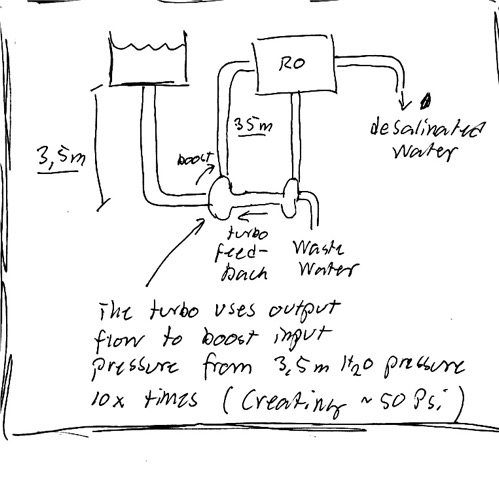

# Todo: Research - Consider to understand and build a sea water  desalination system from aquarium water filtering equipment?

```#357ae8f8``` *As of 2017-11-15 19:44*

[mail plain/text](mail.txt)


Its seems, while learning about deionisation for aquarium corral reef water treatment, that we should be able to use those to create drinking water from sea water?

-1) Consider enhancing household RO water purifiers by enabling higher osmosis pressure with a pressure exchanger?

==&gt; See the Disadvantages listed in wikipedia article on Reverse Osmosis (<https://en.wikipedia.org/wiki/Reverse_osmosis>)?

> “*Household reverse osmosis units use a lot of water because they have **low back pressure**. As a result, they **recover only 5 to 15%** of the water entering the system. The remainder is discharged as waste water. Because waste water carries with it the rejected contaminants, methods to recover this water are not practical for household systems. Wastewater is typically connected to the house drains and will add to the load on the household septic system. A reverse osmosis unit delivering five gallons (19 L) of treated water per day may discharge between 20 and 90 gallons (75–340 L) of waste water per day.&#91;24&#93; This is having disastrous consequence for mega cities like Delhi where large-scale use of **household R.O. devices has increased the total water demand of the already water parched National Capital Territory of India.**&#91;25&#93;*"

**==&gt; Is it feasible to 3D print a pressure exchanger to enhance household RO units?**

1) Consider the RO/DI (Reverse osmosis deionisation) system for corral reef water treatment (<https://www.bulkreefsupply.com/bulk-reverse-osmosis-filters-systems/reverse-osmosis-systems/drinking-water-systems.html>)?

==&gt; They actually sell systems aimed and producing drinking water (priced around 2000-3000 SEK)?

**==&gt; But do these have the capacity to desalination seawater?**

No! This filter is for tap water **(**<https://www.dow.com/en-us/water-and-process-solutions/products/reverse-osmosis?arrowMenu=7aa1cc08-535e-4a02-923f-7fb79bb1bbb3_46a6683c-737e-42ef-9d7c-e775e54fe7ec>**)?**

==&gt; But the company Dow states they are selling RO membranes for brackish and sea water (<https://www.dow.com/en-us/water-and-process-solutions/products/reverse-osmosis>)?

==&gt; But the smallest RO seems to still be large and produce 230 liter per hour (<https://www.dow.com/en-us/markets-and-solutions/products/DOWFILMTECBrackishWaterReverseOsmosisLess4Elements/DOWFILMTECBW302540>)?

2) Consider this wikipedia article on reverse osmosis (<https://en.wikipedia.org/wiki/Reverse_osmosis>)?

==&gt; It seems the energy consumption for sea water desalination is about 3 kW per produced pure water cubic metre?

> “energy consumption has dropped to around 3 kWh/m3, with the development of more efficient energy recovery devices and improved membrane materials."

==&gt; It seems RO membranes are sensitive to contamination so pre-treatment of water is essential?

> “Since accumulated material cannot be removed from the membrane surface systems, they are highly susceptible to fouling (loss of production capacity). Therefore, pretreatment is a necessity for any reverse osmosis or nanofiltration system"

==&gt; It seems a very high pressure is required to desalinate sea water and brackish water?

> “Typical pressures for [brackish water](https://en.wikipedia.org/wiki/Brackish_water) range from 225 to 376 psi (15.5 to 26 bar, or 1.6 to 2.6 MPa). In the case of seawater, they range from 800 to 1,180 psi (55 to 81.5 bar or 6 to 8 MPa)."

==&gt; It seems brackish water desalination can obtain about 80% of the input water as fresh water?

> “"

3) Consider we can use the high pressure pump for RO/DI systems (<https://www.drakfisken.se/tillbehor-delar/aquatec-booster-pump-cdp-8800.html?gclid=CjwKCAiA6K_QBRA8EiwASvtjZXX5kL7-XpCnqiYgMyZKbQmnLA7bnkkr83GMaU3M0SfpbeQSdvqrYRoCbosQAvD_BwE>)?

4) Consider this Youtube clip from

5) Consider if we can create the required 50-60 Psi water pressure by pumping water up into a water tower (pressurise by gravity)?

==&gt; It seems Psi is Pound per square Inch (<https://sv.wikipedia.org/wiki/Psi_(tryckenhet))?>

==&gt; And 1 psi = 6,8948 × 103 [Pa](<https://sv.wikipedia.org/wiki/Pascal_(enhet)>) (N/m²), i.e. roughly 7 kPa.

==&gt; Thus 50 Psi = 50 \* 7000 = 35000 N/m².

==&gt; 1 liter water creates a force of 1 kg \* 9,81 = roughly 10 N

==&gt; But water pressure is given by the weight of the water column on any given area.

==&gt; On any area A we have a water column with volume A\*h (h being water column height) creating a pressure of A\*h\*g/A = h\*g.

==&gt; But the water mass must be in kg to get correct dimensions. One liter of water is 1 kg (one liter is one cubic dm).

==&gt; Transforing cubic dm to cubic meters adds a 1/1000 factor (1/10 cubed).

==&gt; Thus we have: The pressure from water of height h is: 1000 \* h \* g.

==&gt; One cubic meter water creates the pressure of 1000 kg \* g / 1 m² = roughly 10 000 N / m² = 10 kPa.

==&gt; Thus: 1000 \* h\*g = 35000 N/m² gives us h = 35 m.

==&gt; Check for correctness:

==&gt; 1 Pa is 0,0101972 cm water column.

==&gt; 35 000 Pa is 35 000 \* 0,0101972 = 3500 \* 1,01972 = roughly 3500 cm = 35 meters (check out)

6) Consider we can elevate the water pressure by mechanical transducers?

==&gt; Can we use a water turbine that transduce input flow to output half flow double pressure?

==&gt; YES! But these are called “turbos” as explained in this youtube clip (<https://youtu.be/I3XqYK7LwaI>)?


==&gt; It seems it uses the output flow to feed-back energy to pressurise the input water feed?

==&gt; This is in fact just how the turbo in a combustion engine works?

==&gt; The same company also produces this (ingenious) single moving part turbo charger called “**PX Pressure Exchanger**" (<http://www.energyrecovery.com/resource/animation-px-pressure-exchanger-works/>)?

**==&gt; Haha - The Pressure Exchanger has a wikipedia entry to (<https://en.wikipedia.org/wiki/Pressure_exchanger>)?!**


==&gt; See this youtube clip (<https://youtu.be/Y4Yk2Srs4XM>)?


==&gt; The PX Device/Pressure Exchanger seems to work as a turbo charger but without the actual turbo design (no communicating turbines)?

==&gt; Instead a single rotating turbine forces the input and output to take turns filling the rotor (in effect pushing out the previous content of the chamber)?

==&gt; In this way the high pressure output flow can be used to push the input to a higher pressure?

==&gt; The rotor is ceramic


==&gt; It cases the input sea water and output waste water to oscillate in the chambers (in effect acting as a piston)?

==&gt; In the intact phase the low pressure intake water fills a chamber in the rotor


==&gt; When the chamber rotates it gets expose to the waste water high pressure and gets ejected with that higher pressure.


==&gt; The waste water not in the chamber rotates and gets ejected by the low pressure intake water filling the chamber (phase 1 again)


**Ingenious!!**

==&gt; It seems the rotor speed is up to **20 000 rpm** (required to not allow the input and output water to have time to mix)?

==&gt; Can we imagine a design that work on lower rpm by having pistons in the cylinder (hindering input and output water to mix)?

==&gt; But then, the pressure exchanger would have more moving parts that will wear?

...

==&gt; It seems we can find information by searching the web for “desalination turbocharger”?

...

==&gt; Consider we thus can use an RO (Reverse Osmosis) system from a water tower and use the turbo to create the required pressure?



7) Consider to 3D print a Water Power Exchanger and/or a Water Turbo Charger (whatever I can make work)?

**==&gt; It seems we should be able to 3D print the parts for a Water Power Exchanger or Turbo Charger as indicated by the designs above?**

==&gt; Consider to do some research and tests on this :)

==&gt; Hm… Consider we need a Resin 3D printer to be able to produce smooth enough parts to get this to work?

…

8) Consider how we can test the pressure exchanger to not mix input and output water?

**==&gt; Consider we can add pigmentation to the output and check that the power exchanger does not leak output water back to the input?**

...

…

Consider to delve into this idea to turbo charge a desalination RO (Reverse Osmoses) system (replacing the high pressure pump with a low pressure one plus a turbo charger)?

...


