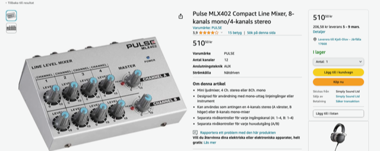
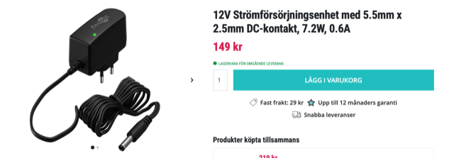

# Todo: Consider the four channel line level mixer "Pulse MLX402 Compact Line Mixer" and a suitable 12V PSU?

```#3650ee06``` *As of 2024-02-25 19:48*

[mail plain/text](mail.txt)


I need a way to mix together my three synths and the "Pulse MLX402 Compact Line Mixer" seems like the best chice so far?

1) Consider the offer for the "Pulse MLX402 Compact Line Mixer" from [amazon.se](http://amazon.se) (<http://tinyurl.com/yfm53y9f> )?



==&gt; It seems it does NOT come with a power adapter and it seems I need a 12V &gt; 200 mA with 5.5 x 2.5 barrel connector and centre positive?

> *"...**It can be used with either a 9v battery or a 12v PSU, neither of which is provided and the PSU takes a bit of tracking down - FYI it needs to be 12v, 200mA (minimum), 5.5x2.5 barrel connector and centre positive. **"*

2) Consider a suitable 12V DC &gt;= 200 mA with 5.5 x 2.5 barrel connector and centre positive?



<http://tinyurl.com/sjkd3b4h>

...


