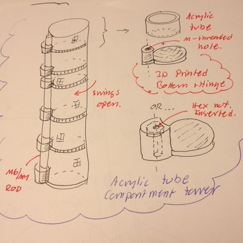

# Todo: Consider an acrylic tube based hinged compartment tower for screws and nuts and other fasteners and small things?

```#381b798e``` *As of 2018-12-16 00:52*

[mail plain/text](mail.txt)


It seems we should be able to utilise some acrylic tubes to create a tower of hunger compartments for fasteners like screws and nuts and other small things?

1) Consider a design using an acrylic tube cut into compartments with 3d printed bottoms with hinges mounted to a vertical rod?



==&gt; Consider to use a threaded rod as the vertical support for the hinged compartments?

==&gt; Consider to 3d-print the compartment bottoms with a hinge attached that we can glue on to the cut acrylic pipe sections?

==&gt; Consider either the 3d printed hinge is tight enough to be threaded on to the rod, or that a hex-nut can be inserted into the hinge (in both cases hinder the compartment to “fall down”?

...

2) Consider to buy a suitable acrylic pipe from a suitable web-shop?

==&gt; Consider Plexiglasshopen (<https://www.plexiglasshopen.se/plexiglasror>)?

==&gt; Consider to buy a pipe of sufficient diameter to hold the things I want to store in the compartment tower?

==&gt; Consider a 54 mm inside diameter acrylic pipe (<https://www.plexiglasshopen.se/shop/product/plexiglasror-6054x-2000-mm?tm=plexiglasror>)?


NOTE: This is 4,6 l of storage or 100 SEK / l of storage …

NOTE: I should be able to fit 60 + hinge width + 20 width for fingers= say 100 mm ==&gt; I have room for 9 towers of 500 mm height on a 940 x 500 acrylic sheet?

NOTE: BUT this is 4,5 m of pipe (or 10 l of storage) !!?

==&gt; Consider a 34 mm inside diameter acrylic pipe (<https://www.plexiglasshopen.se/shop/product/plexiglasror-4034-x-2000-mm?tm=plexiglasror>)?


NOTE: This is 1,8 l of storage or 148 SEK / l of storage

NOTE: I should be able to fit 40 + hinge width + 20 mm width for fingers = say 80 mm ==&gt; I have room for 11 - 12 towers of 500 height on a 940 wide 500 high acrylic sheet?

NOTE: But this is 6 m of pipe (or 5,4 l of storage) (Innefficient and expensive) ?

==&gt; Consider to CAD a design in fusion 360 to see if we should go ahead and try this design for compartmentalised storage using acrylic pipe?

...


