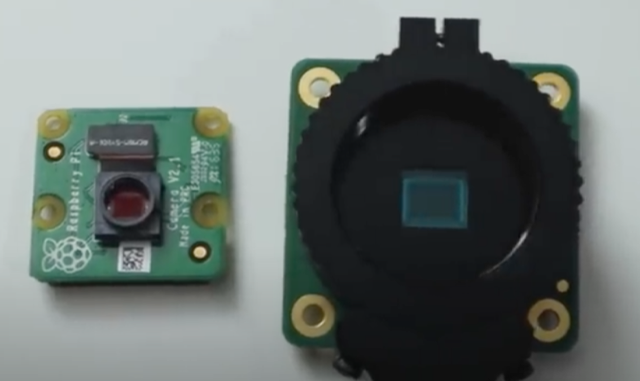
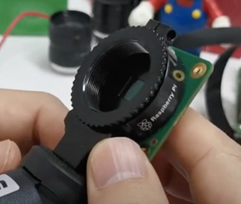
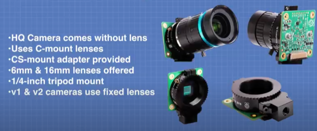
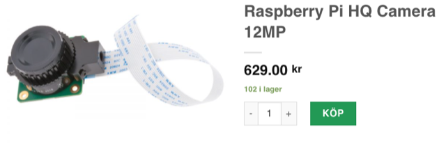

# Todo: Consider the Raspberry Pi

```#3861c541``` *As of 2020-11-08 14:33*

[mail plain/text](mail.txt)


==&gt; Also see "Todo: Consider a home "Confession Cam" system setup for me to quickly and easy make "Confessional Recordings" to use in Youtube project videos or just for my own "figuring out" and life assessment (observations) and planning process?"

==&gt; Also see "Todo: Consider the threads and dimension of my Microphone Boom Stand and Camera mount screw hole are 5/8" 27 TPI and 1/4" 20 TPI (With Manfrotto tripod head mount 3/8" 16 TPI) ?"

==&gt; Also see "Todo: Consider the available 3D printable Manfrotto camera mounts for my DIY Teleprompter triped mount?"

==&gt; Also see "Todo: Consider to automate chocolate tempering for truffle making (e.g., use a thermal camera for contactless temperature reading)?"

==&gt; Also see "Todo: DIY - Consider to 3D print and design a Mobile Phone Camera document scan rig (to capture drawings and documents)?"

==&gt; Also see "Todo: Consider to use my "Camera Incident" on Korsika to introduce a talk on protectionism?"

1) Consider youtube video "Raspberry Pi High Quality Camera Review w/ interchangeable lenses" (<https://youtu.be/_Oh7sITnwMU> )?

>   
> *The Raspberry HQ Camera comes without lens*

> "Raspberry Pi HQ Camera for Raspberry Pi 4: <https://rebrand.ly/komcxjo>

> Raspberry Pi 16mm Telephoto Lens for HQ Camera: <https://rebrand.ly/0amg3os>

> Raspberry Pi 6mm Wide Angle Lens for HQ Camera: <https://rebrand.ly/yprve3d> "

2) Consider youtube video "Raspberry Pi High Quality Camera: 5 Things to Know (Plus Some Pro Tips)" (<https://youtu.be/5VReyl_HnUo> )?

>   
> *The Raspberry HQ Camera comes without lens*

3) Consider youtube video "Raspberry Pi Cameras - The BIG Picture" (<https://youtu.be/MVgr302PNwY> )?

>   
> *The Raspberry HQ Camera comes without lens*

4) Consider where to buy the Saspberry PI HQ Camera and lenses?

==&gt; Consider Electrokil (<https://www.electrokit.com/produkt/raspberry-pi-hq-camera-12mp/> )?

>   
> *Raspberry PI HQ Camera for 630 SEK inc. VAT from Swedish Electro:kit web site*

...


