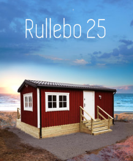

# Todo: House Build - Consider if I can live in a Tiny House on trailer (e.g. from Swedish Rullebo / Bert Karlsson) placed on my property while I build my permanent house?

```#3a499678``` *As of 2020-01-14 17:49*

[mail plain/text](mail.txt)


I need somewhere to live while I build my own house!

==&gt; Also see "[Todo: House Build - Consider if I can live in a Tiny House on trailer (e.g. from Swedish Treesign) placed on my property while I build my permanent house?](../cbcdb2ec/chime.md)"

==&gt; Also see "[Todo: House Build - Consider a modular house design on a trailer designed for Tiny Houses that you can assemble and disassemble and move on EU pallets (empty trailer separate)?](../9c574ff8/chime.md)"

1) Consider to buy a pre-built house on wheels from Swedish "Rullebo", a company led by Bert Karlsson and designed by "Arga Snickaren" (<https://www.rullebo.com> )?

> *"Husen finns i flera olika storlekar: 48 kvm, 35 kvm, 30 kvm och 25 kvm.*  
> *Alla är lika välbyggda, välisolerade och nyckelfärdiga."*

> 

> *An example of a 25 square meter built to specification house on wheels from Swedish Rullebo*

==&gt; On the other hand - these houses uses a lot of plastic, sheet metal and MDF so they are quite a bit from my ideal of a long lasting recyclable low energy house (<https://www.rullebo.com/rullebo-25> )!

> *"**Konstruktion: *  
> *Bärande rostskyddsmålad stålkonstruktion, reglar och takstolar av **stål**. Vagnchassi av stål med drag. Blindbotten av **galvaniserad plåt**.

> Fasad:  
> Ytterpanel av trä, målad med faluröd eller järnvitriol (grå). Vitmålade knutar och foder.

> Tak:  
> Mattsvart plåttak. Hängrännor och stuprör av plåt.

> Isolering:  
> 13 cm **PUR-skum** i tak och väggar, 12 cm i golv.**"*

==&gt; The 25 square meter house seems to way in at 7 tons (<https://www.rullebo.com/rullebo-25> )?

> "  
> Yttermått:  
> 7,3 x 3,4 m (24,8 m2)  
> "  
> "Vikt:  
> 7 ton"

...


