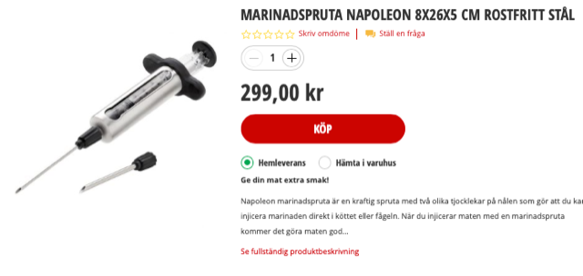
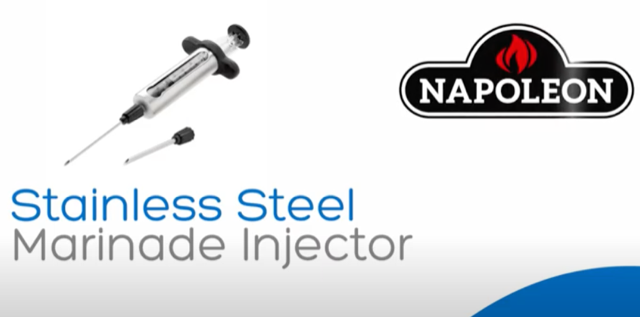

# Todo: Consider a "Marinade Injector" to fix the holes in my concrete wall by injecting a patch material?

```#3a4e87c5``` *As of 2020-11-05 19:58*

[mail plain/text](mail.txt)


1) Consider to try the "Napoleon Marinade Injector" available in the BauHaus stores (<https://www.bauhaus.se/marinadspruta-napoleon-rostfri?gclid=CjwKCAiA4o79BRBvEiwAjteoYMeJWhUAwdYlI2dbuqnA_v7O74LMfP-5uJX9B5T8Gqpwe959Q4SU1RoCF0kQAvD_BwE> )?

>   
> *The Napoleon Marinade Injector is available for 300 SEK at BauHaus stores in Sweden*

> *The website states that this item is available in the Barkarby store at  "**gång 44 fack 3"***

==&gt; Consider this youtube video "" where the size of the syringe and the needle seems large enough for my "HusFix" patch material (<https://youtu.be/hA2DxlDEEl4> )?

>   
> *The Napoleon Stainless Steel Marinade Injector*

...


