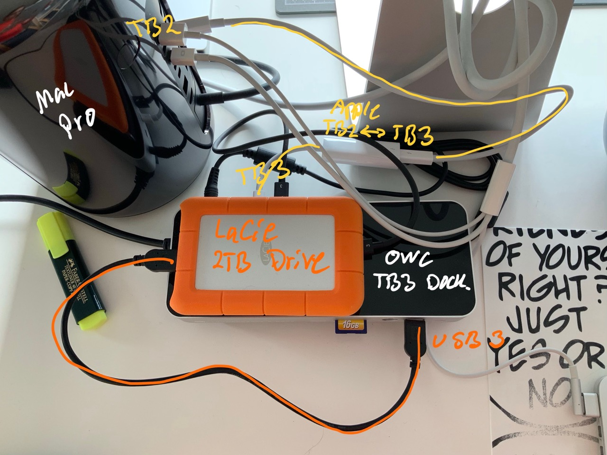

# Todo: Consider to understand why Mac OS after sleep reports "Disk Not Ejected Properly" for a Lacie drive on OWC TB3 Dock?

```#3bf1d51b``` *As of 2019-06-11 15:58*

[mail plain/text](mail.txt)


Why is a disconnected LaCie drive on the OWC TB3 dock reconnected after sleep and why does Mac OS report it has been improperly disconnected?

-1) Consider it seems the problem "goes away" if I disable System Settings Energy Savings "Put hard disks to sleep when possible"


*Disable "Put hard disks to sleep when possible" to not have Mac OS warn about improperly ejected USB 3 drives attached to the OWC TB3 Dock *

1) Consider the symptoms of Mac OS to report "Disk Not Ejected Properly" although the USB Drive previously has been ejected?

==&gt; Consider the architecture of a Mac Pro connected to an Apple TB2 to TB3 adapter to a TB3 OWC Dock to a USB 3 LaCie 2TB Hard Drive?

  
>   
> *A Mac Pro connected to an Apple TB2 to TB3 adapter to a TB3 OWC Dock to a USB 3 LaCie 2TB Hard Drive*

==&gt; Consider how Mac OS keeps reporting the LaCie drive to have been improperly disconnected (regardless of wether it was ejected or not in the first place)?


*After Sleep the Mac OS reports an USB drive on the OWC TB3 Dock to have been ejected improperly*

2) Consider this "Disk Not Ejected Properly" is a known issue for USB drives connected to thunderbolt 3 docks when Mac OS sleeps and wakes up?

==&gt; Consider this thread "Disk Not Ejected Properly - multiple times a day" (<https://talk.macpowerusers.com/t/disk-not-ejected-properly-multiple-times-a-day/10974> )?

> *This thread contains only speculations and reports of user observations of various related issues. But no solution.*

3) Consider if the behaviour of the "Disk Not Ejected Properly" problem changes if I install the OWC driver from the dock (<https://www.owcdigital.com/assets/products/thunderbolt-3-dock-14-port/OWC-Thunderbolt-Dock-Driver.dmg.zip> )?

==&gt; I seem to have installed version 1.1 (and it provides support for connecting iOS devices for charging, the Apple Superdrive DVD reader and writer and Apple Keyboard)?


==&gt; Consider the OWC Drive installation made changes to the Mac OS that may be "incompatible" (whatever that means)?


NOTE: I had to restart the computer after installing the driver.

TODO: Monitor the behaviour of the USB

...


