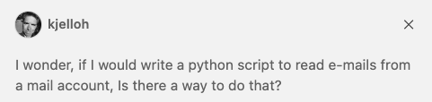
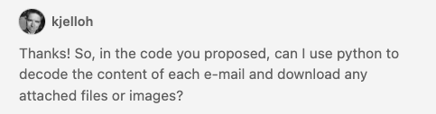

# Todo: Consider ways I can use Python to read my TODO mails and format them into html or pdf?

```#3c223c71``` *As of 2024-03-01 10:23*

[mail plain/text](mail.txt)


I want to save my TODO-mails as a readable document and maybe Python is the framework I can use to do this?

1) Consider the CoPilot suggested python code to read emails from an password protected IMAP4 mail account over SSL?



> Yes, you can use Python's built-in `imaplib` and `email` libraries to read emails from an IMAP server. Here's a basic example:

  
> This script logs into an IMAP server, selects a mailbox, fetches the latest email, and prints its body. You'll need to replace `"[imap.example.com](http://imap.example.com)"`, `"[your-email@example.com](mailto:your-email@example.com)"`, and `"your-password"` with your IMAP server, email, and password.

  
> Please note that this is a basic example and real-world usage would require more robust error checking and handling. Also, if you're using a service like Gmail, you'll need to allow less secure apps and display unlock captcha.

> import imaplib  
> import email  
> from email.header import decode_header

> # your email and password  
> username = "[your-email@example.com](mailto:your-email@example.com)"  
> password = "your-password"

> # create an IMAP4 class with SSL  
> mail = imaplib.IMAP4_SSL("[imap.example.com](http://imap.example.com)")  
> # authenticate  
> mail.login(username, password)

> # select the mailbox you want to delete in  
> # if you want SPAM, use "INBOX.SPAM"  
> mailbox = "INBOX"  
> mail.select(mailbox)

> # get all mail IDs  
> result, data = mail.uid('search', None, "ALL")  
> mail_ids = data&#91;0&#93;.split()  
> latest_email_id = mail_ids&#91;-1&#93;

> # fetch the email body (RFC822) for the given ID  
> result, email_data = mail.uid('fetch', latest_email_id, '(BODY.PEEK&#91;TEXT&#93;)')  
> raw_email = email_data&#91;0&#93;&#91;1&#93;.decode("utf-8")  
> email_message = email.message_from_string(raw_email)

> # print the email body  
> if email_message.is_multipart():  
> for payload in email_message.get_payload():  
> print(payload.get_payload())  
> else:  
> print(email_message.get_payload())



> import os  
> import imaplib  
> import email  
> from email.header import decode_header

> # your email and password  
> username = "[your-email@example.com](mailto:your-email@example.com)"  
> password = "your-password"

> # create an IMAP4 class with SSL  
> mail = imaplib.IMAP4_SSL("[imap.example.com](http://imap.example.com)")  
> # authenticate  
> mail.login(username, password)

> # select the mailbox you want to delete in  
> # if you want SPAM, use "INBOX.SPAM"  
> mailbox = "INBOX"  
> mail.select(mailbox)

> # get all mail IDs  
> result, data = mail.uid('search', None, "ALL")  
> mail_ids = data&#91;0&#93;.split()  
> latest_email_id = mail_ids&#91;-1&#93;

> # fetch the email body (RFC822) for the given ID  
> result, email_data = mail.uid('fetch', latest_email_id, '(BODY.PEEK&#91;&#93;)')  
> raw_email = email_data&#91;0&#93;&#91;1&#93;.decode("utf-8")  
> email_message = email.message_from_string(raw_email)

> # download attachments  
> if email_message.is_multipart():  
> for part in email_message.walk():  
> if part.get_content_maintype() == 'multipart':  
> continue  
> if part.get('Content-Disposition') is None:  
> continue

> filename = part.get_filename()  
> if bool(filename):  
> filepath = os.path.join('/path/to/save/attachments', filename)  
> with open(filepath, 'wb') as f:  
> f.write(part.get_payload(decode=True))

...


