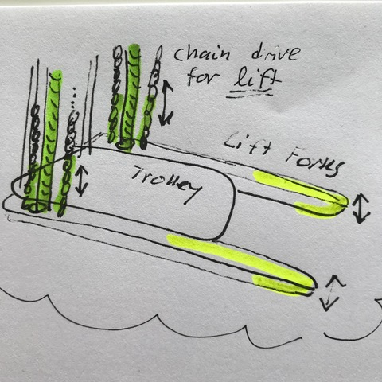

# Todo: Consider to build a transport trolley with forklift capabilities (to aid in lifting and moving heavy objects like furniture and build materials single handedly)?

```#3c96c383``` *As of 2019-07-17 12:46*

[mail plain/text](mail.txt)


I will need machinery to help me be able to lift and move stuff around single handedly when I build my house or live alone.

-1) Consider potentially useful leads I gather from investigating this DIY homemade forklift trolley?

==&gt; Consider the web site "homemadetools" (<http://www.homemadetools.net> )?

1) Consider a design based on a transport trolley with "side forks" that can lift objects up on the trolley?

==&gt; Consider a simple trolley design?


==&gt; Then imagine we attach some forklift action to each side of the trolley platform?



*Design idea to attach chain driven liftable forks on the sides of a transport trolley base*

2) Consider the leads I can get from studying this DIY Hackaday full forklift design (<https://hackaday.com/2013/02/13/diy-forklift-for-the-home-shop/> )?


*DIY Hackaday full forklift design (<https://hackaday.com/2013/02/13/diy-forklift-for-the-home-shop/> )*

==&gt; Consider this demonstration video "Forklift transferring a pallet" (<https://www.youtube.com/watch?time_continue=5&v=jHT2UOdZRNA> )?

...

...


