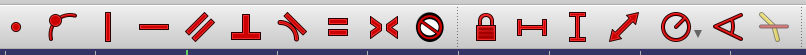
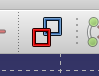

# Todo: Consider that CAD sketch constraints are in fact grouped into three meta-layers Shape, Size, Location?

```#418e9652``` *As of 2020-10-30 19:38*

[mail plain/text](mail.txt)


My mind wandered and came up with an intuition that there are at least three categories of sketch constraints that form three tiers of metalrelations.

1) Consider Shape constraints frames size constraints that frames location constraints?

> *The basic idea here is to first model constraints as being of at least three types. The most abstract constraints deal with the shape of a "thing". Then after that comes size constraints and finally comes the location constraints. Let's explore this idea some more.*

> *It seems to me that on the most abstract level is the shape of the thing we model. In some sense it is also the basic feature of a "shape" and that is why we talk about something having a shape. A square shape means four straight lines in a "loop" where each side are of equal length and each "corner" is 90 degrees. But apart from that we do not "care" anything about the exact size of the square or how it is located in space.*

> *We can fully constrain the shape of a "thing" without saying anything about its actual size. But once the shape is fixed we need only constrain one distance of the shape to have it be fully defined in size. In natural language we talk about the "scale" of the object.*

> *Finally, a thing with a fixed shape and scale (size) can be fixated in space. We note that to fully fixate a thing in 3D space we need to fixate three points of the shape in a way so that we can not rotate the shape in any direction.*

2) Consider the user interface of FreeCad regarding if the sketch constraints are separated into the Categories related to "Shape", "Scale" and "Location"?

>   
> *It seems FreeCad does not categorise constraints into "Shape", "Size" and "Location"?*

> *TODO: Make a list of all FreeCad constrains and try to map them to the constraint categories "Shape", "Size" and "Location"?*

> *TODO: Consider to understand the "Toggle to/from reference mode " *

> 

> *FreeCad "Toggle Reference Mode" icon*

...


