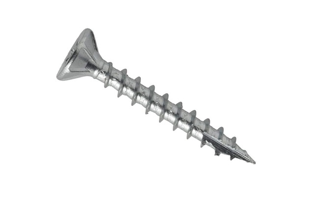
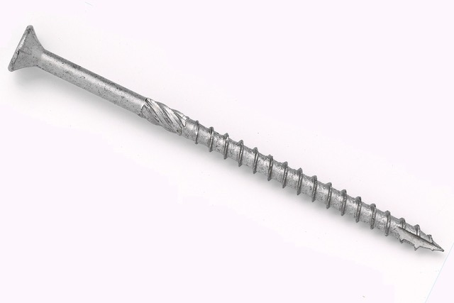
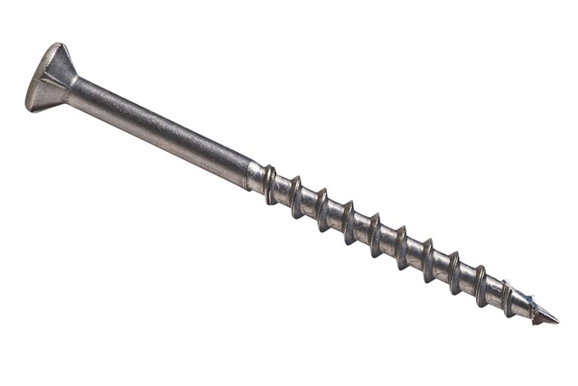
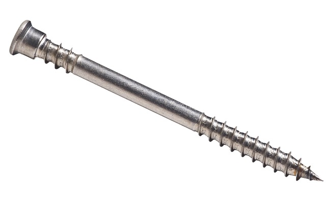
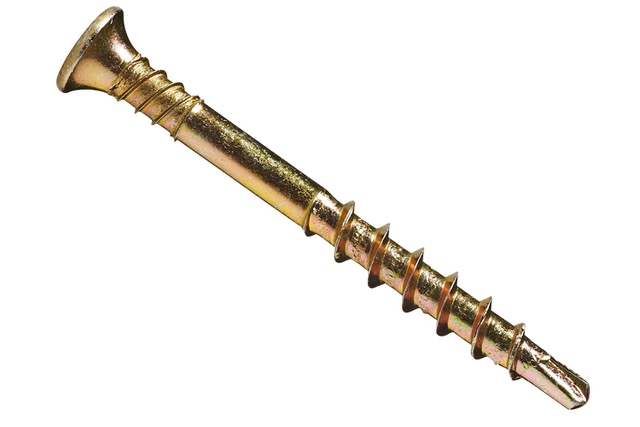
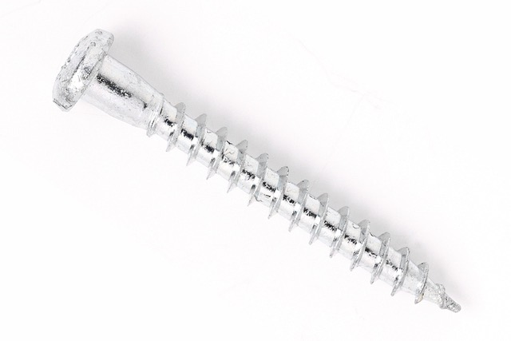
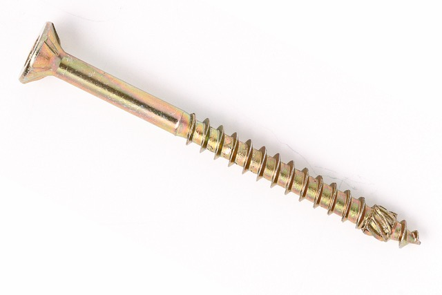

# Todo: House Build - Consider to sufficiently understand the different types of screws for fastening to wood materials?

```#42f885bd``` *As of 2020-01-13 10:53*

[mail plain/text](mail.txt)


I need to understand what kinds of screws I may or can use for fastening things to wood.

1) Consider this article from a vendor that seems to provide a good listing of different types of "wood screws" (<https://gds.se/material/spik-och-skruv/guide-till-traskruvar> )?

>   
> *Swedish "Spånskiveskruv" that normally requires pre-drilling and countersinking*

> SPÅNSKIVESKRUVDenna universalträskruv av härdat eller rostfritt stål kallas även för en spånskruv. Spånskruven kräver oftast både **förborrning** och **försänkning**, innan den kan skruvas ner i materialet.

>   
> *Swedish "Träskruv med Fibercutspets" that does NOT require **pre-drilling and countersinking*

> TRÄSKRUV MED FIBERCUTSPETS**Förbättrad spånskiveskruv**, som varken kräver försänkning eller förborrning. Fibercutspetsen fräser bort träfibren, så risken att träet ska spricka är minimal.

>   
> *Swedish "Trallskruv" with sufficient aggressive thread for soft wood gripping*

> TRALLSKRUVTill en terrass gjord i mjukare träslag bör man använda en skruv med lite grövre gängor, som griper bra tag i träet och arbetar sig snabbt in i det.

>   
> *Swedish "Trallskruv till hårdträ" that can be used without pre-drilling in hard wood*

> TRALLSKRUV TILL HÅRDTRÄSkruvas i hårdträ utan förborrning. Först borrar sig spetsens gängor sig igenom träet, och därefter gör gängorna under skallen plats för skruvens breda hals.

>   
> *Swedish "Gipsskruv till trä" for fastening plaster wall sheets to wood studs*

> GIPSSKRUV TILL TRÄEn specialist för montering av gipsskivor på träreglar. Borrspetsen fräser sig genom skivan, så den inte spricker, varpå gängorna snabbt drar in skruven i träet.

>   
> *Swedish "Beslagsskruv" for mounting metal fittings to wood*

> BESLAGSKRUVDenna skruvtyp används för att sätta fast byggnadsbeslag i trä. Den breda, lätt avsmalnande halsen **fyller upp beslagets hå**l, medan den runda **skallen** lägger sig **plant ovanpå**.

>   
> *Swedish "Träskruv med frässpets" for screwing into hard fiber boards like MDF without pre-drilling*

> TRÄSKRUV MED FRÄSSPETSSpetsen får bra grepp i hårda skivor, ex. MDF, medan stamfräsens spår ovanför spetsen gör väg för resten av skruven – utan att materialet spricker.

...


