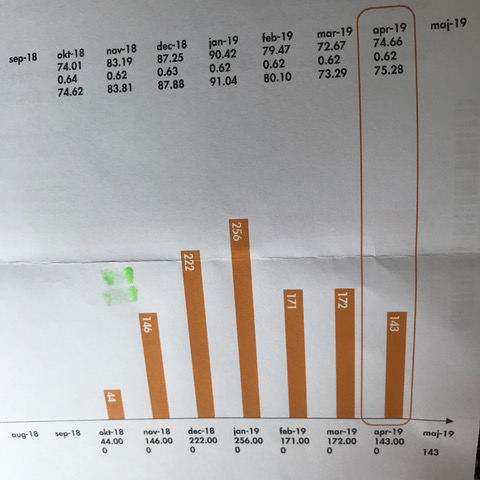
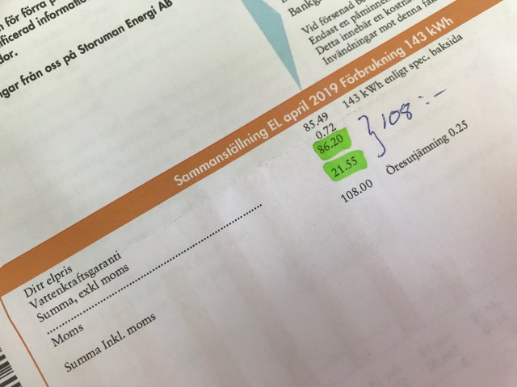
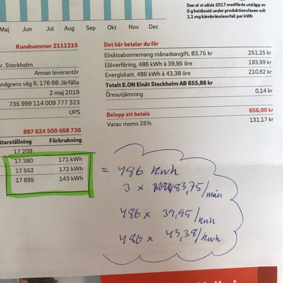

# Todo: Private Economy - Consider to understand my electric bill (what are the different fees and tariffs I pay)?

```#43470125``` *As of 2019-05-30 11:19*

[mail plain/text](mail.txt)


It seems after I have separated the fixed electric delivery cost from the cost of the consumed electricity I can get a better grip on what I actually pay for?

-1) Consider to write an abstract on how the pricing for electricity seems to work?

Production:  70 .. 90 cents / kWh

Distribution:  40 + 44 (tax) = 84 cents / kWh

Distribution: 84 SEK / Month

-------------------------------------------------------------

**Total: 154 .. 174 cents / kWh + 84 SEK / Month**

1) It seems I pay to Storuman Energi for the production of the electricity I consume?

==&gt; It seems I pay between 70 .. 90 cents per kWh for my consumed electricity to be produced?



==&gt; I pay 108 SEK for 143 kWh which should mean I pay 75,52 cents per kWh (close to the stated mean price of Apr 2019)

Q: Why does the price don't match exactly (0,62 + 143 x 74,66 = 106,76 + 0,62 = 107,38



2) It seems I pay to Eon for the delivery cost of the electricity I consume?

==&gt; It seems I pay 84 SEK monthly and 40 + 44 cents per kWh to deliver my electricity to me?




