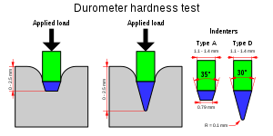

# Todo: Consider to understand the Durometer index used to specify the "hardness" 0..100 of materials (e.g., inlines skate wheels, squeegees and rubber tiers)?

```#47cc43f9``` *As of 2019-01-22 10:18*

[mail plain/text](mail.txt)


Today I discovered that “softness” of sponges for silk screen printing is specified using the durometer index which I previously learned is used to specify skate wheel grippy-ness.

==&gt; Also see “[Todo: Power Feeder - Consuder to base a power feeder design on wheels from casters?](../52436c2e/chime.md)"

1) Consider the wikipedia page on Shore durometer to measure “hardness” of (elastic?) materials (<https://en.wikipedia.org/wiki/Shore_durometer>)?

==&gt; It seems the durometer scale is a measurement of resistance to indentation?

> “Higher numbers on the scale indicate a greater resistance to indentation and thus harder materials. Lower numbers indicate less resistance and softer materials."

==&gt; It seems different durometer scales corresponds to different indentation probe profiles?



==&gt; It seems the durometer scale is defined by the international ASTM organisation?

> “There are several scales of durometer, used for materials with different properties. The two most common scales, using slightly different measurement systems, are the ASTM D2240 type A and type D scales.”

> “ASTM International, formerly known as American Society for Testing and Materials, is an international standards organization that develops and publishes voluntary consensus technical standards for a wide range of materials, products, systems, and services. Some 12,575 ASTM voluntary consensus standards operate globally. The organization's headquarters is in West Conshohocken, Pennsylvania, about 5 mi (8.0 km) northwest of Philadelphia."

==&gt; Consider the defined durometer scales and how they are defined to be measured?

> “  
> Durometer typeConfiguration[Diameter](https://en.wikipedia.org/wiki/Diameter)ExtensionSpring [force](https://en.wikipedia.org/wiki/Force)[&#91;5&#93;](https://en.wikipedia.org/wiki/Shore_durometer#cite_note-5)A35° truncated cone ([frustum](https://en.wikipedia.org/wiki/Frustum))1.40 mm (0.055 in)2.54 mm (0.100 in)8.05 N (821 gf)C35° truncated cone (frustum)1.40 mm (0.055 in)2.54 mm (0.100 in)44.45 N (4,533 gf)D30° cone1.40 mm (0.055 in)2.54 mm (0.100 in)44.45 N (4,533 gf)B30° cone1.40 mm (0.055 in)2.54 mm (0.100 in)8.05 N (821 gf)M30° cone0.79 mm (0.031 in)1.25 mm (0.049 in)0.765 N (78.0 gf)E2.5 mm (0.098 in) spherical radius4.50 mm (0.177 in)2.54 mm (0.100 in)8.05 N (821 gf)O1.20 mm (0.047 in) spherical radius2.40 mm (0.094 in)2.54 mm (0.100 in)8.05 N (821 gf)OO1.20 mm (0.047 in) spherical radius2.40 mm (0.094 in)2.54 mm (0.100 in)1.111 N (113.3 gf)DO1.20 mm (0.047 in) spherical radius2.40 mm (0.094 in)2.54 mm (0.100 in)44.45 N (4,533 gf)OOO6.35 mm (0.250 in) spherical radius10.7–11.6 mm (0.42–0.46 in)2.54 mm (0.100 in)1.111 N (113.3 gf)OOO-S10.7 mm (0.42 in) radius disk11.9 mm (0.47 in)5.0 mm (0.20 in)1.932 N (197.0 gf)  
> "

==&gt; It seems different durometer scales exists to ensure a durometer value of 10…90 on that scale (values 0..10 or 90..100 are NOT to be trusted)?

> “The final value of the hardness depends on the depth of the indenter after it has been applied for 15 seconds on the material. If the indenter penetrates 2.54 mm (0.100 inch) or more into the material, the durometer is 0 for that scale. If it does not penetrate at all, then the durometer is 100 for that scale. It is for this reason that multiple scales exist. But if the hardness is &lt;10 °Sh or &gt;90 °Sh the results are not to be trusted. The measurement must be redone with adjacent scale type.&#91;6&#93;"

==&gt; It seems a durometer value 100…0 is assigned to an indentation of 0…2,54 mm (and is proportional to to the indentation)?

==&gt; It seems we can conclude that an S = 82A durometer skate wheel “hardness” corresponds to an indentation of d = 2,54 \* (1 - S/100 ) = 2,54 \* (1 - 0.82) = 18% of 2,54 mm = 0.46 mm?

NOTE: The wikipedia page on Shore Durometer does not explicitly state that a durometer scale value 0..100 is proportional to an indentation of 2,54..0 mm (but is seems plausible)?

**==&gt; It seems we can conclude that the durometer scale is “simply” the percentage that is NOT indented (Durometer 0 means FULL indentation, i.e., soft, and durometer 100 means NO indentation, i.e., hard)?**

2) Consider how durometer scales are used to specify the grippy-ness (softness) of skate wheels?

==&gt; Consider these inlines wheels I have bought for my Power Feeder are specified as 82A durometer hardness (<https://www.skatepro.se/69-28434.htm> )?


==&gt; Consider this description of Durometer scale for inlines wheels from the Swedish web-shop Skatepro (<https://www.skatepro.se/69-28434.htm#popup_reveal>)?


3) Consider how the “softness” of silk screen printing “squeegees” are specified in the durometer scale (<https://www.mclogan.com/shop/squeegees-per-inch-durometer-p-5-c-293_297_1_4.html>)?


…


