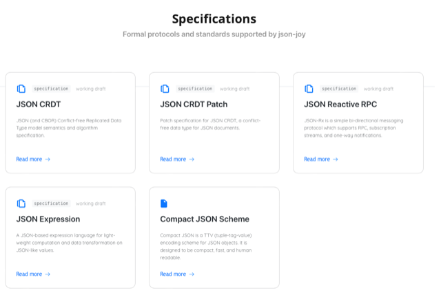

# Todo: Consider the text merging algorithms of automerge.org as presented in youtube video ""New algorithms for collaborative text editing" by Martin Kleppmann (Strange Loop 2023)"?

```#47ed9e91``` *As of 2024-06-05 10:37*

[mail plain/text](mail.txt)


Darwinet will need a way to merge asynchronous changes to arrays likes text and the algorithms and strategies of [automerge.org](http://automerge.org/) seems valuable to research.

1) Consider youtube video ""New algorithms for collaborative text editing" by Martin Kleppmann (Strange Loop 2023)" (<https://youtu.be/Mr0a5KyD6BU> )?

==&gt; At around 12:50 he seems to refer to an CRDT algorithm called RGA (<https://youtu.be/Mr0a5KyD6BU?t=769> )?

...

2) Consider the the library for merging CRDT:s as defined by [automerge.org](http://automerge.org/) ([automerge.org](http://automerge.org/))?

==&gt; It seems they base their approach on CRDT:s (Conflict-free replicated data types)?

> *"**Automatic merging*

> *Automerge is a Conflict-Free Replicated Data Type (CRDT), which allows concurrent changes on different devices to be merged automatically without requiring any central server.**"*

==&gt; It seems the automerge library is available in Javascript and Rust for cross platform applications through web technologies like Electron, Chrome, Edge, Firefox etc?

> *"**Implemented in JavaScript and Rust, with FFI bindings across platforms including iOS, Electron, Chrome, Safari, Edge, Firefox, and more.**"*

==&gt; It seems automerge works on it own file format called an "automerge file"?

> *"**Use any connection-oriented network protocol: client-server, peer-to-peer, or local. Or use unidirectional messaging: send an Automerge file as an email attachment or store it on a file server.**"*

3) Consider the automerge Github repository (<https://github.com/automerge/automerge> )?

4) Consider the Binary Document Format suggested and applied by automerge as "automerge files" (<https://automerge.org/automerge-binary-format-spec/> )?

> *"**This document describes the storage format used when serializing Automerge documents and changes for storage or transfer.**"*

==&gt; It seems automerge Binary Document Format is based on a JSON structure?

> *"**An Automerge document is a collaboratively editable JSON-like structure. The serialized form of a document contains complete history of changes and operations that collaborators have applied.**"*

==&gt; It seems that automerge uses the JSON CRDT to merge JSON files to implement CRDT behaviour on file changes (<https://jsonjoy.com/specs/json-crdt> )?

> *"JSON CRDT*  
> *The JSON CRDT specification describes how to implement a full JSON-like conflict-free replicated data type (CRDT). JSON CRDT specification works hand in hand with the JSON CRDT Patch specification, which describes how changes to JSON CRDT documents are represented."*

==&gt; It seems JSON JOY is a framework to build real time collaborative apps based on JSON exchange of data (<https://jsonjoy.com> )?

> *"*

> # Real-time JSON apps

> ####  
> `json-joy` is a collection of libraries and specifications for building real-time collaborative apps on top of JSON documents

> *"*



5) Consider ro elaborate on the needs for merge in Darwinet and how automerge may be applied as part of darwinet framework?

> *I imagine that Darwinet should always protect and keep branches that results from local edits and then share them as immutable first class citizens of the Tha data model. With that I mean that darwinet should share and synchronise an immutable data model of 'everything'.*

> *With this approach I suggest we need two additional mechanisms to actually be able to share and cooperate on information in the immutable data model. One is to have merge as a separate operation where human and algorithm actors may apply merge on divergent states and create new states to share. This enables data to be moulded into new proposed consensus states. Secondly I propose to bring in Death of states as a way to prune off states that is not valuable enough to keep around. This enables the shared data model to evolve under the pressure of 'survival of the fittest' and have parts of the data model die off if it is not used and thus not valued.*

> *The hand waving way to argue for this approach is that it seems to mimic how we explain how life evolve by having 'unfit' individuals to die without procreating? This tempts us to assume that states in our immutable data model that does not 'procreate' may be deemed 'unfit' and by having them die off wee keep evolving on data in the model we collectively deems the most valuable and fit to use?*

> *...*

==&gt; It seems we may be tempted to represent the darwinet immutable data model (the Tha) in JSON to then apply JSON JOY algorithms to merge changes?

> *The basic idea here is that as JSON JOY exists to treat JSON files as CRDTs (See <https://jsonjoy.com/specs/json-crdt> ). We may then use this JSON-like conflict-free replicated data type (CRDT) in the JSON CRDT algorithm (which is an Replicated Growable Array (RGA) algorithm; see <https://jsonjoy.com/specs/json-crdt/model-document/crdt-algorithms> )? *

6) Consider the wikipedia article on Conflict Free replicated data type (<https://en.wikipedia.org/wiki/Conflict-free_replicated_data_type> )?

==&gt; It seems RGA is listed as one of the known sequence CRTDs?

> *"Some known Sequence CRDTs are Treedoc,&#91;5&#93; RGA,&#91;17&#93; Woot,&#91;4&#93; Logoot,&#91;18&#93; and LSEQ.&#91;19*&#93;

> *...*

> *&#91;17&#93; Roh, Huyn-Gul; Jeon, Myeongjae; Kim, Jin-Soo; Lee, Joonwon (2011). "Replicated Abstract Data Types: Building Blocks for Collaborative Applications". Journal of Parallel and Distributed Computing. 71 (2): 354–368. doi:10.1016/j.jpdc.2010.12.006.*

> *"*

7) Consider the paper "Replicated abstract data types: Building blocks for collaborative applications" that may be purchased as a pdf ([https://www.sciencedirect.com/science/article/abs/pii/S0743731510002716?via%3Dihub](https://www.sciencedirect.com/science/article/abs/pii/S0743731510002716?via=ihub) )?

==&gt; It seems the paper abstract defines "RGA" as Replicated Growable Arrays?

> *"Abstract*

> *For distributed applications requiring collaboration, responsive and transparent interactivity is highly desired. Though such interactivity can be achieved with optimistic replication, maintaining replica consistency is difficult. To support efficient implementations of collaborative applications, this paper extends a few representative abstract data types (ADTs), such as arrays, hash tables, and growable arrays (or linked lists), into replicated abstract data types (RADTs). In RADTs, a shared ADT is replicated and modified with optimistic operations. Operation commutativity and precedence transitivity are two principles enabling RADTs to maintain consistency despite different execution orders. Especially, **replicated growable arrays (RGAs) **support insertion/deletion/update operations. Over previous approaches to the optimistic insertion and deletion, RGAs show significant improvement in performance, scalability, and reliability."*

8) Consider the wikipedia article on "Dynamic Array" (<https://en.wikipedia.org/wiki/Dynamic_array> )?

> *"In computer science, a **dynamic array, growable array**, resizable array, dynamic table, mutable array, or array list is a random access, variable-size list data structure that allows elements to be added or removed. It is supplied with standard libraries in many modern mainstream programming languages. Dynamic arrays overcome a limit of static arrays, which have a fixed capacity that needs to be specified at allocation*.*"*

==&gt; It seems that the C++ std::vector can be seen as a "dynamic array" or "Growable array"?

> *"Language support*

> ***C++'s std::vector **and Rust's std::vec::Vec are implementations of **dynamic arrays**, as are the ArrayList&#91;27&#93; classes supplied with the Java API&#91;28&#93;: 236 and the .NET Framework.&#91;29&#93;&#91;30&#93;: 22 "*

9) Consider that it seems that the "Replicated Growable Array (RGA) CRDT Algorithm" is defined for JSON files (<https://jsonjoy.com/specs/json-crdt/model-document/crdt-algorithms> )?

> *"The Replicated Growable Array (RGA) algorithm is used for all JSON CRDT nodes which implement an ordered lists of values. Th*e RGA algorithm allows users to concurrently insert and remove elements from the list and then merge the lists together.*"*

...


