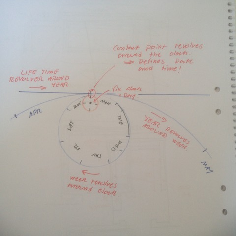

# Todo: Programming - Consider to visualise a calendar as gear of days within gear of weeks within gear of months within gear of years within gear of 10 years and life?

```#4815abe6``` *As of 2018-04-20 15:22*

[mail plain/text](mail.txt)


Could it be a good idea to design a calendar user interface with interconnected gears with revolutions representing passing of time and gear teeth are hours, days, weeks, years, 10 years on the lifetime gear?

==&gt; Also see “[Todo: Programming - Consider to visualise a calendar as spirals of days within spirals of weeks within spirals of months within spiral of years?](../c1eee518/chime.md)”

==&gt; Also see “[Todo: Consider to make the Todo-App (Owl&Bells) focus on Jordan B. Petersson teaching about creating micro-adjustments (have user performs actions) that reduce pain by aiming at tuning life for optimal honesty (virtue or truth)?](../5057914f/chime.md)

“

==&gt; Also see “[Todo: Programming - Consider to study existing Todo/Task application idioms and relate them to Owls&Bells attention-scheduling idiom?](../9c245a3b/chime.md)”

==&gt; Also see “[Todo: Consider to propose a religion-free Calendar for the society-of-the-future?](../40efe336/chime.md)”

==&gt; Also see “[Todo: Consider to make a calendar app that "talks" by using recordings made by oneself, friends or strangers?](../46a523dc/chime.md)

“

1) Consider how to visualise a calendar of day, week, month, year and 10 year nested inside a lifetime gear?


2) Consider a fix clock (day) around which week, year and lifetime revolves?



==&gt; Consider the contact point revolves around the clock (day)?

==&gt; Consider the contact point defines date and time?

3) Consider schedules tasks can be placed on the wheels depending on in what whey they repeat or not?

==&gt; Consider “non repeating” events are placed on the “once in a lifetime” wheel (rod)?

4) Consider to model this Calendar as gears in Fusion 360?

TODO: Try to model this Calendar as gears in Fusion 360?

…

…

Consider to delve into this idea to model a calendar as revolving gears for day, week, year, lifetime with fun visualisations for scheduled events?

...


