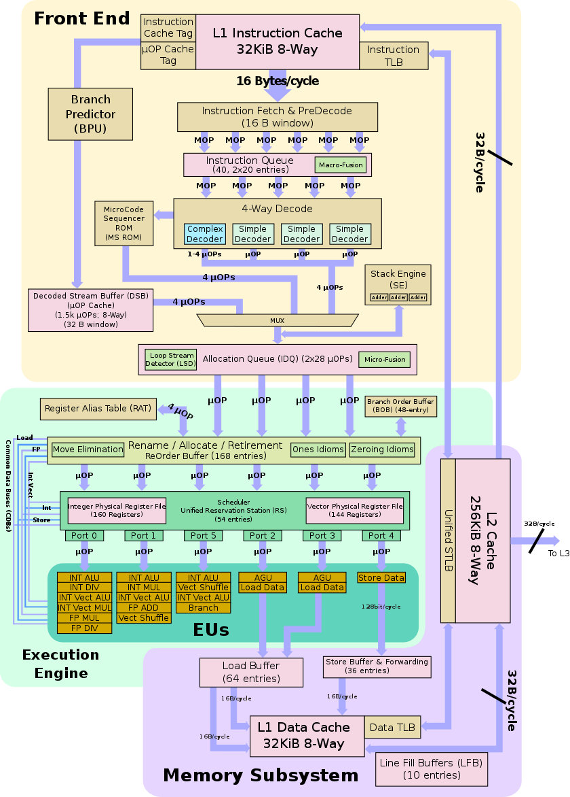
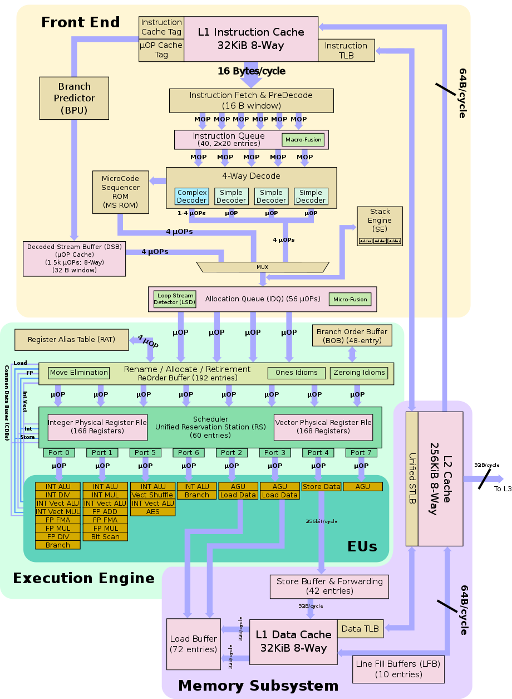
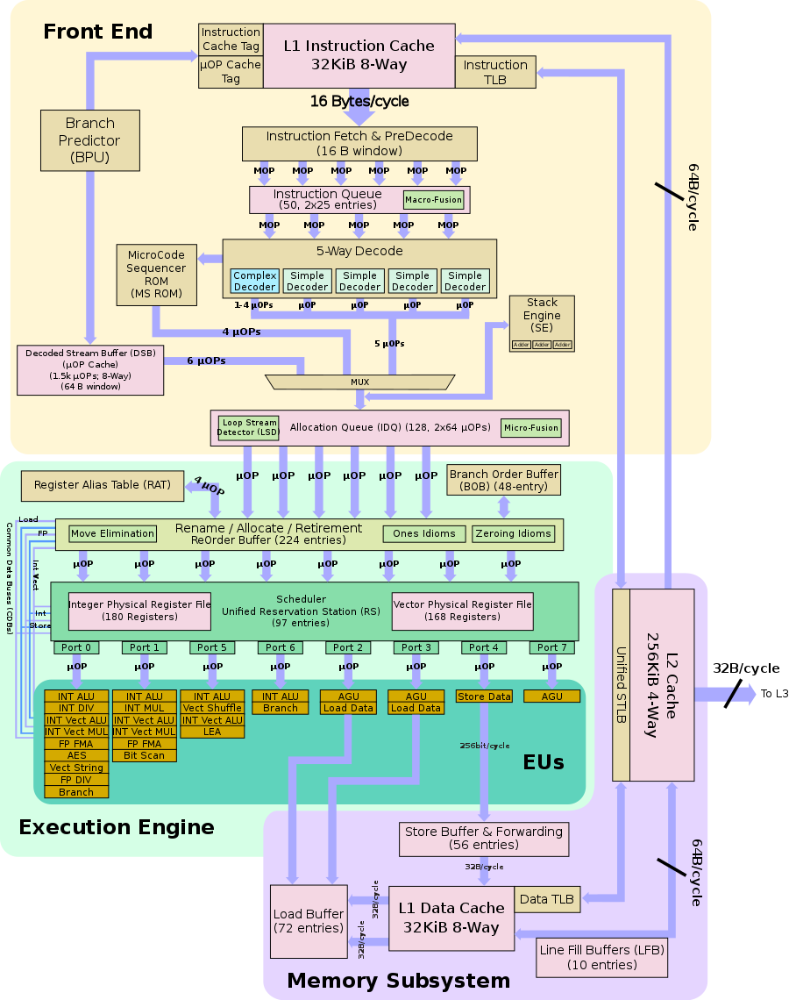

# Todo: Consider to understand the Intel CPU microarchitecture history and key technology benefits of each (Sandy Bridge, Ivy Bridge, Haswell, Broadwell, Skylake...)?

```#48bbd89a``` *As of 2019-02-27 22:09*

[mail plain/text](mail.txt)


It seems I should take some time to research the Intel CPU architectures to get a grip of what is going on and where the technology is going (and what is out there and why)?

==&gt; Also see “[Todo: "Why I bought a new 2013 Mac Pro in 2019!"](../61d6cdde/chime.md)"

1) consider the wikipedia page on Intel CPU architectures (<https://en.wikipedia.org/wiki/List_of_Intel_CPU_microarchitectures>)?

> “[Sandy Bridge](<https://en.wikipedia.org/wiki/Sandy_Bridge_(microarchitecture)>)  
> released January 9, 2011, built on a 32 nm process and used in the [Core i7](https://en.wikipedia.org/wiki/Intel_Core#Core_i7_2), [Core i5](https://en.wikipedia.org/wiki/Intel_Core#Core_i5_2), [Core i3](https://en.wikipedia.org/wiki/Intel_Core#Core_i3_2) second generation microprocessors, and in Pentium B9XX and Celeron B8XX series. Formerly called Gesher but renamed in 2007.[&#91;1&#93;](https://en.wikipedia.org/wiki/List_of_Intel_CPU_microarchitectures#cite_note-1) First x86 to introduce 256 bit AVX instruction set and implementation of YMM register.
- [Ivy Bridge](<https://en.wikipedia.org/wiki/Ivy_Bridge_(microarchitecture)>): 22 nm shrink of the Sandy Bridge microarchitecture released April 28, 2012.”

> “[Haswell](<https://en.wikipedia.org/wiki/Haswell_(microarchitecture)>)  
> 22 nm microarchitecture, released June 3, 2013. Added a number of new instructions, including [FMA](https://en.wikipedia.org/wiki/FMA_instruction_set).
- [Broadwell](<https://en.wikipedia.org/wiki/Broadwell_(microarchitecture)>): 14 nm shrink of the Haswell microarchitecture, released in September 2014. Formerly called Rockwell."

> “  
> [Skylake](<https://en.wikipedia.org/wiki/Skylake_(microarchitecture)>)14 nm microarchitecture, released August 5, 2015.
- [Kaby Lake](https://en.wikipedia.org/wiki/Kaby_Lake): successor to Skylake, broke Intel's [Tick-Tock schedule](https://en.wikipedia.org/wiki/Tick-Tock_model) due to delays with the 10 nm process.
- [Coffee Lake](https://en.wikipedia.org/wiki/Coffee_Lake): successor to Kaby Lake and a second refinement to the 14 nm process

  
> "

==&gt; It seems by examining the graphics of the Ints Core Architectures we can see the following (<https://en.wikichip.org/wiki/intel/microarchitectures> )?

 

*Ivy Bridge and Haswell Front-end (Haswell 64B/Cycle vs. Ivy Bridge 32B/Cycle instruction read) Skylake and Coffee lake Front-End *

 

*Ivy Bridge Execution Engine Haswell Execution Engine*


*Skylake and Coffee Lake Exection Engine*

...

2) Consider Linus Tech quicky youtube video “Intel Core i9 Explained” on the Intel Core i9 (<https://youtu.be/suQnh1TvGHw?t=65> )?


3) Consider the mac pro 6.1 uses Xeon processors with Ivy bridge microarchitecture (<https://en.wikipedia.org/wiki/List_of_Macintosh_models_grouped_by_CPU_type> )?

==&gt; Consider this wikipedia page on Intel Xeon processors (<https://en.wikipedia.org/wiki/List_of_Intel_Xeon_microprocessors> )?

==&gt; Consider the Mac Pro 6.1 CPUs

&lt;Mac Pro 2013&gt;

Xeon E5-1650 v2 (22nm Uniprocessor Ivy Bridge-EP “Efficient Performance")

Xeon E5-1680 v2 ( -“-)

Xeon E5-2697 v2 (22nm Dual processor Ivy Bridge-EP “Efficient Performance")

==&gt; It seems

==&gt; Consider the wikichip page on the Ivy Bridge microarchitecture (<https://en.wikichip.org/wiki/intel/microarchitectures/ivy_bridge_(client)> )?

> “Ivy Bridge is designed to be manufactured using 22 nm Tri-gate FinFET transistors. This is Intel's first generation of FinFET. This correlates to 8 nm Fin width and a 42 nm Fin pitch (shown below). SRAM cell is at 0.1080 µm² and 0.092 µm² for high performance and high density respectively."



*Intel Ivy Bridge Core (<https://en.wikichip.org/wiki/File:ivy_bridge_block_diagram.svg> )*

4) It seems My MacBook Pro mid 2014 uses Intel Core processors with the HasWell microarchitecture (<https://en.wikipedia.org/wiki/MacBook_Pro> )?

==&gt; It seems the updated MacBook Pro mid 2015 15” uses the same processor microarchitecture as the mid 2014 (my) models?

> “The 15-inch models &#91;May 19, 2015&#93; were released with the same Intel Haswell processors and Iris Pro graphics as the 2014 models due to a delay in shipment of newer Broadwell quad-core processors."

==&gt; Consider the wikichip page on the Haswell microarchitecture (<https://en.wikichip.org/wiki/intel/microarchitectures/haswell_(client)> )?

> “While sharing a lot of similarities with its predecessor Ivy Bridge, Haswell introduces many new enhancements and features. Haswell is the first desktop-line of x86s by Intel tailored for a system on chiparchitecture. This is a significant move that will continue to be developed over the next couple of microarchitectures. Overall Haswell shares the same basic flow as Sandy Bridge and Ivy but expends on them considerably in the execution engine with wider execution units and additional scheduler ports."



*One Intel Haswell Core (<https://en.wikichip.org/wiki/File:haswell_block_diagram.svg> )*

5) It seems iMac Pro 2017 uses Xeon W Skylake microarchitecture (<https://en.wikipedia.org/wiki/List_of_Macintosh_models_grouped_by_CPU_type> )?

==&gt; Consider the wikichip page on the Intel Skylake microarchitecture (<https://en.wikichip.org/wiki/intel/microarchitectures/skylake_(client)> )?

> “Overall Skylake builds upon Intel's previous microarchitecture, Broadwell, but includes a wider and more beefed up front end, more optimized execution engine, and numerous other enhancements. Intel designed Skylake to encompass a wide range of devices and applications with a large emphasis on mobile with models ranging from as low as 4.5 W to as high as 100 W."


*Intel Skylake Core (<https://en.wikichip.org/wiki/File:skylake_block_diagram.svg> )*

5) It seems the 2018 Mac Mini uses Intel Coffee Lake architecture (<https://en.wikipedia.org/wiki/Mac_Mini> )?

&lt;mac Mini 2018 CPUs&gt;

I3-8100B

I5-8500B

I7-8700B

==&gt; Consider this wikichip page on the Intel Coffee Lake microarchitecture (<https://en.wikichip.org/wiki/intel/microarchitectures/coffee_lake> )?

> “While there is no change in pure IPC over Skylake and the actual microarchitecture is largely the same, Intel introduced a number of major architectural changes in Coffee Lake"



Intel Coffe Lake Core (identical to Skylake) (<https://en.wikichip.org/wiki/File:skylake_block_diagram.svg> )


