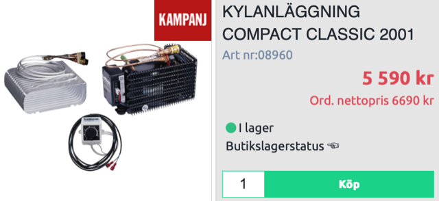
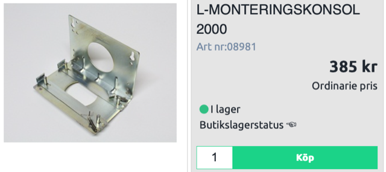
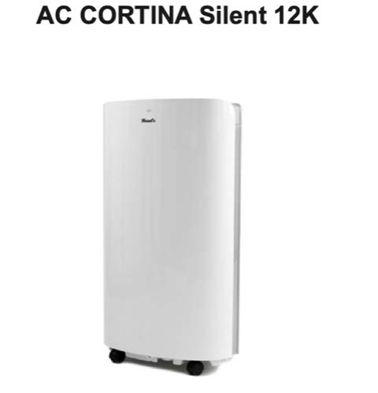

# Todo: Consider to build a small split system AC from a boat refrigerator compressor unit Isotherm Classic?

```#49cef06d``` *As of 2021-06-14 23:03*

[mail plain/text](mail.txt)


1) Consider the Isotherm Classic 2001 (<https://www.erlandsonsbrygga.se/Hemsida/Inredning___VVS/Kyla/Kylaggregat/KYLANLAGGNING_COMPACT_CLASSIC_2001?id=08960> )?



==&gt; Consider to buy also the bracket to save brain resources?



==&gt; It seems the compressor unit should fit inside a 23 cm duct (16 cm squared)?

> Driftspänning: 12-24 V  
> Max Boxvolym: 125 L  
> Förångare: Liten O  
> Mått förångare: 240x85x210mm  
> Mått kompressor: 280x160x160mm  
> Vikt: 9 kg  
> Strömförbrukning: Medel/Max (12V)\* 0,6 / 2,7 A  
> Kompressor typ: Danfoss BD35F  
> Temperaturområde: Ner tiil +2°C

==&gt; The O-condenser should be with 240 x 85 cm "mouth" and 210 cm long (it seems wider than it is deep)?

2) Hm... It seems I actually would need 30W per cubic meter to efficiently cool down my apartment (<https://se.trotec.com/produkter-och-tjaenster/maskiner-homecomfort/luftkonditionering/praktiska-kunskaper-luftkonditionering/> )?

> ## Snabb beräkning av kyleffektbehovet för bostäder och kontor

  
> Hur hög effekt behövs för att kyla ett rum?  
> För det finns det en tumregel: Varje kubikmeter rumsinnehåll kräver en kyleffekt på 30 watt.  
> Med denna tumregel kan man snabbt räkna ut den nödvändiga kyleffekten, på samma sätt som i exemplet nedan med ett exempelrum på 35 m² yta och 2,5 m rumshöjd:

> > 35 m² x 2,5 m rumshöjd =  
> > 87,5 m³ rumsinnehåll x 30 watt =  
> > 2 625 watt

> Denna beräkning är enbart en överslagsberäkning för moderna, isolerade bostads- och kontorsrum (passivhusstandard). Utöver detta är den nödvändiga kyleffekten även beroende av rummets ”värmebelastning”: Solstrålning, isolering, fönsterstorlek, antal personer och värmekällor spelar också stor roll vid val av luftkonditionering.

The small Isotherm unit consumes 32W and if we guess this results in a cooling effect 2.5 times, around 80-90W?

2) Consider to rebuild a portable Wood’s AC Cortina Silent 9K Eco (<https://woods.se/shop/luftkonditionering/woods-ac-cortina-silent-9k-eco/#description> )?

==&gt; It seems to be 471x850x355 mm in size?

==&gt; It seems the cool air comes out on top?


2) Consider to rebuild a Woods (<https://woods.se/shop/luftkonditionering/woods-ac-cortina-silent-12k/#description> )?



==&gt; It seems to use R290 coolant?

==&gt; It seems to have an "efficiency" factor of 2.6 (3500 W Cooling with 1300W consumption)?


...


