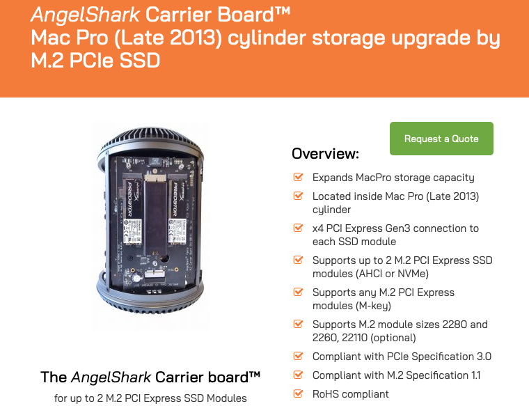

# Todo: Mac Pro 2013 Upgrade options - Consider the article "The Definitive Trashcan Mac Pro 6.1 (Late 2013) Upgrade Guide"?

```#49d5b9dd``` *As of 2020-10-21 11:47*

[mail plain/text](mail.txt)


1) This seems to be a good article "The Definitive Trashcan Mac Pro 6.1 (Late 2013) Upgrade Guide" from May 2019 for information on possible Mac Pro "Trashcan" 2013 upgrade options (<http://blog.greggant.com/posts/2019/05/07/the-definitive-mac-pro-2013-trashcan-guide.html> )?

> Credit to the CPU list goes to Mac Rumors forum member ActionableMango.

> **Architecture****Cores****CPU-Model****GHz****Turbo****RAM****Watt****Ivy-Bridge**12 coreE5-2697 V22.73.51866130WIvy-Bridge12 coreE5-2696 V22.53.31866130WIvy-Bridge12 coreE5-2695 V22.43.21866115WIvy-Bridge10 coreE5-2690 V23.03.61866130WIvy-Bridge10 coreE5-2680 V22.83.61866115WIvy-Bridge8 coreE5-2687W V23.44.01866150WIvy-Bridge8 coreE5-2667 V23.34.01866130WIvy-Bridge8 coreE5-2673 V23.34.01866110WIvy-Bridge8 coreE5-1680 V23.03.91866130WIvy-Bridge6 coreE5-1660 V23.74.01866130WIvy-Bridge6 coreE5-1650 V23.53.91866130WIvy-Bridge4 coreE5-1620 V23.73.91866130W

> #### Useful Links

- [Cylinder Mac Pro 2013 CPU Processor Upgrade](https://everymac.com/systems/apple/mac_pro/mac-pro-cylinder-faq/how-to-upgrade-mac-pro-cylinder-cpu-processor.html)
- [MacRumors: Mac Pro CPU Compatibility List](https://forums.macrumors.com/threads/mac-pro-cpu-compatibility-list.1954766/)

  
> *"**Internally, The Mac Pro does feature one SSD slot, using a custom Apple SSD running at PCIe 2.0 x4, capable of a maximum of 2 GB/s. Very few native third-party solutions exist, but they are out there, by makers like OWC and Transintl.**"*

> *"**... users have figured out how to shoe-horn NVMe drives in the Mac Pro offering top-tier performance and much better prices. Unfortunately, no one has taken the time to compile a list, so the known so far are: Samsung 960, Samsung 970 Pro, Toshiba XG3, and Crucial P1. **"*

> *"**The Mac Pro 2013 uses the same interface as the 2013-2015 MacBooks. **"*

> *"**The quick summary is you'll need a Mac Pro running 10.13+, an adapter and an NVMe SSD with a Sintech adapter, if you for some reason choose the GFF adapter, you'll need tape, a file and some free time.**"*

> *"**Currently, the only vector for multiple M.2 NVMe drives internally is the Amfeltec Angelshark Carrier Board. This keeps the original port intact and thus allows for three internal NVMe drives.**"*

==&gt; It seems Amfeltec does not list the price for its Mac Pro 2013 M.2 NVMe carrier board (<https://www.amfeltec.com/mac-pro-late-2013-cylinder-ssd-upgrade/> )?

> 

...


