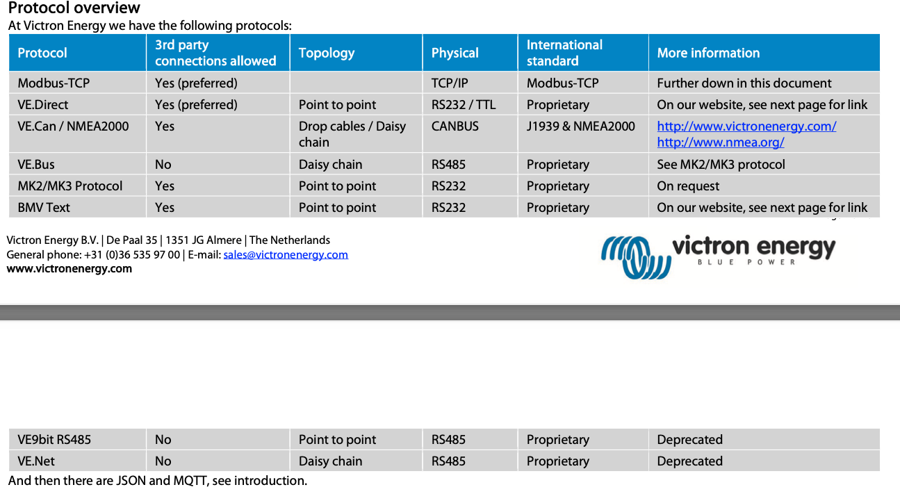
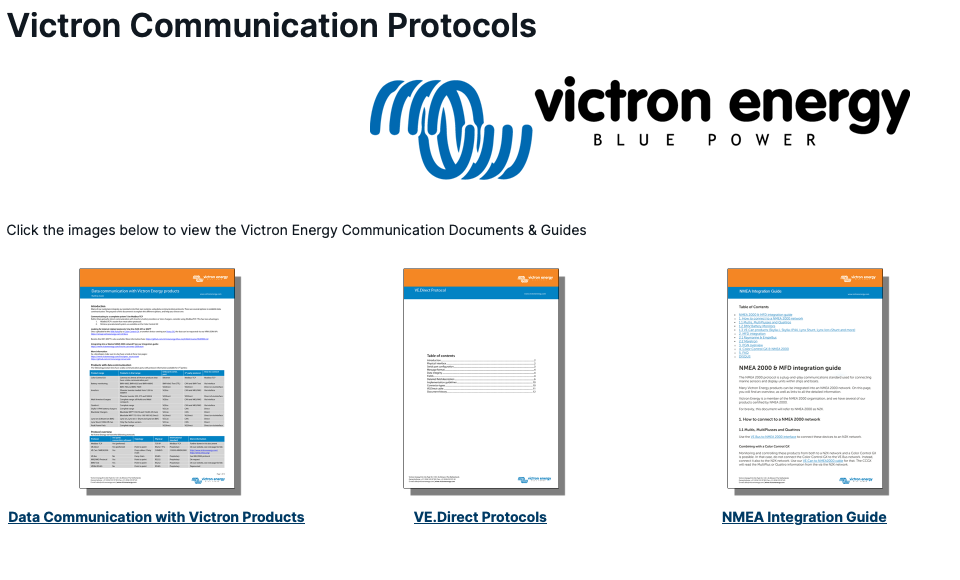

# Todo: Consider the Victron communication protocols available to integrate third party products (e.g., open source hardware?)

```#4a17eb75``` *As of 2024-06-29 18:20*

[mail plain/text](mail.txt)


It could be fun to try and develop my own micro controller based system components to attach into a Victron components system.

1) Consider this discussion "GX Modbus-TCP Manual" on the Victron Mod-bus protocol option (<https://www.victronenergy.com/live/ccgx:modbustcp_faq> )?

2) Consider the information "Data communication with Victron Energy products" (<https://www.victronenergy.com/upload/documents/Technical-Information-Data-communication-with-Victron-Energy-products_EN.pdf> )?

> Products with data communication

> The following product lines have a data communication port, with protocol information available for 3rd parties:

  
>        

> Product range

  
> Products in that range

  
> Onboard comm. port

  
> 3rd party protocol

  
> How to connect

  
> Color Control GX

  
> Gateway to almost all Victron products that have a data communication port

  
> Ethernet

  
> Modbus-TCP

  
> Modbus-TCP

  
> Battery monitoring

  
> BMV-600S, BMV-602S and BMV-600HS

  
> BMV-60xS Text (TTL)

  
> CAN and BMV Text

  
> Via interface

  
> BMV-700 and BMV-700H

  
> VE.Direct

  
> VE.Direct

  
> Direct or via interface

  
> Inverters

  
> Phoenix Inverter models from 1200 to 5000VA

  
> VE.Bus

  
> CAN and MK2/MK3

  
> Via interface

  
> Phoenix Inverter 250, 375 and 500VA

  
> VE.Direct

  
> VE.Direct

  
> Direct of via interface

  
> Multi Inverter/chargers

  
> Complete range: all Multis and Multi compacts

  
> VE.Bus

  
> CAN and MK2/MK3

  
> Via interface

  
> Quattro’s

  
> Complete range

  
> VE.Bus

  
> CAN and MK2/MK3

  
> Via interface

  
> Skylla-i/-IP44 battery chargers

  
> Complete range

  
> VE.Can

  
> CAN

  
> Direct

  
> BlueSolar Chargers

  
> BlueSolar MPPT 150/70 and 150/85 (VE.Can)

  
> VE.Can

  
> CAN

  
> Direct

  
> BlueSolar MPPT 75/10 to 150/100 (VE.Direct)

  
> VE.Direct

  
> VE.Direct

  
> Direct or via interface

  
> Lynx Ion (Lithium Ion BMS)

  
> Lynx Ion, Lynx Ion + Shunt and Lynx Ion BMS

  
> VE.Can

  
> CAN

  
> Direct

  
> Lynx Shunt 1000A VE.Can

  
> Only the Canbus version.

  
> VE.Can

  
> CAN

  
> Direct

  
> Peak Power Pack

  
> Complete range

  
> VE.Direct

  
> VE.Direct

  
> Direct or via interface


==&gt;

> 

3) Consider the "Victron Energy BV" Github repositories (<https://github.com/victronenergy> )?

4) Consider the Victron 'GX' product series refers to their central monitoring system components able to read and control other components (<https://www.victronenergy.com/live/venus-os:start> )?

> *"**Victron GX product range*

> *Introduction

> GX products are Victron's state-of-the-art monitoring solution. The family consists of the different GX products, and their accessories.  
> The GX-device lies at the heart of the system - providing monitoring, and operating as the communication-centre of your installation. All the other system-components - such as inverter/chargers, solar chargers, and batteries - are connected to it. Monitoring can be carried out locally and remotely - via our free-to-use Victron Remote Management portal (VRM). The GX device also provides Remote firmware updates and allows inverter/charger settings to be changed remotely.*  
> *"*

5) Consider the "Victron Communication Protocols" information as stated by Australian company "Master Industries" (<https://www.master-instruments.com.au/pages/victron-communication-protocols.html> )?



==&gt; NMEA 2000 & MFD integration guide <https://www.master-instruments.com.au/files/data_sheets/Chargers/victron_nmea_intergration.pdf>

> *"The NMEA 2000 protocol is a plug-and-play communications standard used for connecting marine sensors and display units within ships and boats.*

> *Many Victron Energy products can be integrated into an NMEA 2000 network. On this page, you will find an overview, as well as links to all the detailed information."*

==&gt; The VE.Direct Protocol document <https://www.master-instruments.com.au/files/data_sheets/Chargers/ve_direct_protocol_3_25.pdf>

==&gt; Data communication with Victron Energy products <https://www.master-instruments.com.au/files/data_sheets/Chargers/data_communication_with_victron_energy_products_en.pdf>

...


