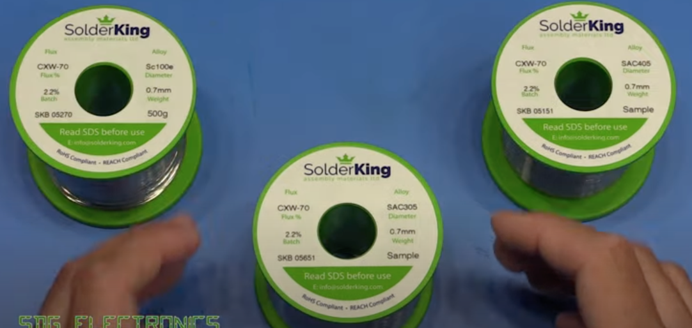

# Todo: Consider I may prefer LED free Zink, Cobalt, Copper  alloy (e.g., SolderKing Sc100e) of dimension 0.7 mm (through hole) and 0.3-0.4 mm (SMD)?

```#4a50564d``` *As of 2023-04-01 14:11*

[mail plain/text](mail.txt)


I want to upgrade my soldering skills to LED free solders.

1) Consider youtube video "SDG #255 SAC305, SAC405, Sc100e, 60/40 Lead/Lead Free Solder Comparison using SolderKing" (<https://youtu.be/UOQJcMRU7kc> )?



*Tested LED Free solder alloys Sc100e (Zink, Cobalt, Copper), SAC305 (3% silver, 0.5% Copper) and SAC405 (4% silver, 0.5% copper) - <https://youtu.be/UOQJcMRU7kc?t=159> *

...


